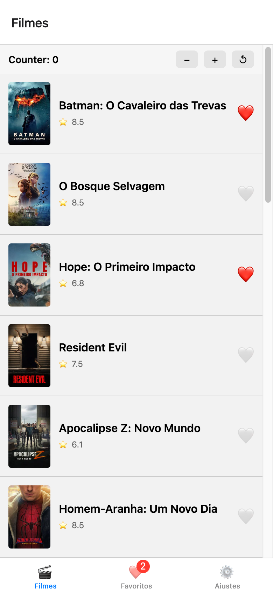

# README — Atividade 2 — Guilherme Jeske

## Identificação

- **Aluno:** Guilherme Jeske
- **Opção Reanimated escolhida:** **A — Heart pop** (+ **C — poster cresce no detalhe** como bônus)
- **Bônus implementados:** Bottom Tabs (Filmes + Favoritos + Ajustes), deep link `expo://detail/<id>`, 2 opções Reanimated (A + C), `staleTime` + `prefetchQuery`, Hermes explícito no `app.json`, paginação infinita (`useInfiniteQuery` + `onEndReached`), CI GitHub Actions
- **Repo (fork):** https://github.com/GuilhermeJeske1006/puc-iec-mobile-multiplataforma

## Como rodar

```bash
cd exercicios/02-app-rn-navegacao-estado/guilherme-jeske
npm install
cp .env.example .env   # colar o TMDB API Read Access Token (eyJhbGc...)
npx expo start         # i = iOS, a = Android, w = web
npm test               # 15 testes Jest
```

| Ambiente | Favoritos persistem? | Observação |
|---|---|---|
| Dev build (`npx expo run:ios` / `run:android`) | ✅ MMKV nativo (JSI) | recomendado pra avaliar MMKV |
| Web (`w`) | ✅ o `react-native-mmkv` usa `localStorage` no web | Reanimated roda, com limitações do web |
| Expo Go | ⚠️ em memória | o Expo Go não traz o módulo nativo do MMKV → fallback em `Map` + aviso na aba Favoritos |

## O que o app faz

Lista os filmes populares da TMDB (TanStack Query, com paginação infinita até o limite de 500 páginas da TMDB e cache) e cada card tem um ❤️ que
favorita/desfavorita via Zustand (`useFavoritesStore`). Os ids favoritos são salvos no MMKV a cada mudança e
lidos de forma síncrona quando o store é criado, então sobrevivem a reloads sem flash de lista vazia. O ❤️ faz um
"pop" (1 → 1.4 → 1 com spring + rotação) rodando na UI thread com Reanimated, a aba **Favoritos** mostra a lista
persistida e o detalhe abre com o poster crescendo via `withSpring`.

## Screenshot

Lista com ❤️ ativo e badge na aba Favoritos (web, viewport 390×844):



## Screencast da animação

15s (gravado com Playwright no web): heart pop → aba Favoritos → reload (favoritos persistem) → detalhe com poster
crescendo → desfavoritar no detalhe e voltar com a lista sincronizada. As legendas pretas foram adicionadas só na
gravação e não fazem parte do app.


## Arquitetura

```
App.tsx                        ← providers + NavigationContainer com linking (deep link)
src/
├── routes/
│   ├── RootStack.tsx          ← Stack: Tabs + Detail
│   └── BottomTabs.tsx         ← Tabs: Filmes + Favoritos (badge com contagem) + Ajustes
├── screens/
│   ├── MovieList.tsx          ← FlatList + useInfiniteQuery + onEndReached
│   ├── FavoritesScreen.tsx    ← useQueries(ids persistidos) + "Limpar"
│   ├── SettingsScreen.tsx     ← storage ativo, engine JS (Hermes?), Reduce Motion, limpar favoritos
│   └── MovieDetail.tsx        ← HeartButton + AnimatedPoster
├── components/
│   ├── MovieCard.tsx          ← ❤️ fora do Pressable de navegação + prefetch antes de navegar
│   ├── HeartButton.tsx        ← Reanimated opção A (heart pop)
│   └── AnimatedPoster.tsx     ← Reanimated opção C (poster cresce com withSpring)
├── store/
│   ├── counterStore.ts        ← Zustand (hands-on)
│   └── favoritesStore.ts      ← Zustand + hidratação síncrona + persist via subscribe
├── storage/
│   └── mmkv.ts                ← new MMKV() + fallback em memória (Expo Go) + adapter getItem/setItem/removeItem
├── queries/movies/            ← TanStack Query (popular infinito, detalhe com queryOptions + prefetch)
└── services/api.ts            ← axios + interceptors TMDB
__tests__/                     ← 15 testes Jest (5 counter + 10 favorites/persistência)
```

## Decisões técnicas

- **Reanimated A (heart pop):** é o feedback mais direto da ação principal (favoritar). Os shared values
  (`scale`, `rotation`) vivem no runtime de UI; `withSequence(withTiming(1.4), withSpring(1))` só descreve a
  animação, e o worklet do `useAnimatedStyle` calcula cada frame na UI thread, sem re-render React e sem bridge.
  Detalhes de micro-interação: compressão no `pressIn` (antecipação), pop só ao favoritar (desfavoritar só encolhe),
  respeita *Reduce Motion* (`useReducedMotion`) e tem `accessibilityState`.
- **Diretiva `'worklet'`:** o plugin Babel workletiza sozinho só o callback dos hooks (`useAnimatedStyle`). O helper
  `heartTransform`, chamado de dentro dele na UI thread, precisa declarar `'worklet'`; sem isso o app quebra com
  *"Tried to synchronously call a non-worklet function on the UI thread"*. Conferi no output do Babel: 2 worklets
  gerados no `HeartButton.tsx`. Não usei `runOnJS`/`runOnUI`, que estão deprecated no `react-native-worklets` 0.5
  (substituídos por `scheduleOnRN`/`scheduleOnUI`), porque a animação não precisa voltar pro JS thread.
- **MMKV em vez de AsyncStorage:** MMKV é síncrono (JSI, C++), então o store lê os favoritos já no `create()`.
  Com AsyncStorage (Promise) o app renderizaria primeiro uma lista vazia e só depois hidrataria.
- **Persist via `subscribe` em vez do middleware `persist`:** o módulo `zustand/middleware` quebra no bundler web
  do Metro (`import.meta`). O `subscribe` só grava quando a referência de `ids` muda, e fica explícito quando o save
  acontece.
- **Store guarda só ids:** os dados dos filmes ficam no cache do TanStack Query (fonte única de server state); a aba
  Favoritos busca cada id com `useQueries`, e quando o filme já foi aberto ou pré-carregado os dados vêm do cache.
- **Ajuste de dependências:** o starter vinha com `react-native-reanimated@3.16` / `babel-preset-expo@56`, que não
  batem com o Expo SDK 54 (o Expo Go 54 traz o Reanimated 4.1 nativo → crash por mismatch JS/nativo). Rodei
  `npx expo install --fix` (Reanimated 4.1 + `react-native-worklets` 0.5) e removi o plugin Babel manual, porque o
  `babel-preset-expo` 54 já injeta o `react-native-worklets/plugin`. Corrigi também o `tsconfig` (`paths` sem
  `baseUrl` impedia o `tsc`).

## Verificação

- `npm test` → **15/15 verdes** (CI exige ≥ 6)
- `npx tsc --noEmit` → limpo
- `npx expo export --platform ios --platform android --platform web` → os 3 bundles compilam (iOS/Android em
  bytecode Hermes `.hbc`)
- Autograder local (`grader/lib/validators/rn-app.ts`) → **15/15**; J.A.R.V.I.S. no PR #258 → **15/15**
- Testes no web com token TMDB real:
  - ❤️ pop medido via `requestAnimationFrame`: pico 1.4 em ~106ms, assenta (±2%) em ~480ms
  - poster: escala 0.6 → 1, `translateY` −40 → 0, opacidade 0 → 1
  - paginação: 20 → 40 → 59 → 79 filmes, sem duplicados
  - favoritos persistem após reload
  - aba Favoritos e detalhe sincronizados
  - deep link `/detail/<id>` com botão voltar

## Referência

- Reanimated: https://docs.swmansion.com/react-native-reanimated/
- MMKV: https://github.com/mrousavy/react-native-mmkv
- Zustand: https://github.com/pmndrs/zustand
- TanStack Query (infinite queries / prefetch): https://tanstack.com/query/latest

---

## 🎁 Bônus implementados

- [x] **Bottom Tabs com aba Favoritos** — 3 abas como no guia (Filmes + Favoritos + Ajustes): `src/routes/BottomTabs.tsx` + `src/screens/FavoritesScreen.tsx` + `src/screens/SettingsScreen.tsx`
- [x] **Deep link** `expo://detail/<id>` — `linking` no `App.tsx` com `initialRouteName: 'Tabs'` (cold start abre [Tabs, Detail], com botão voltar). Schemes `expo` e `aula02` registrados no `app.json` (dev build); Expo Go: `exp://<ip>:8081/--/detail/<id>`; web: `/detail/<id>`
- [x] **2 opções Reanimated** — A (`HeartButton.tsx`) + C (`AnimatedPoster.tsx`)
- [x] **`staleTime` + `prefetchQuery`** — `movieByIdQueryOptions` (10 min) + `usePrefetchMovie` chamado no `onPress` do card antes do `navigate` (o request corre durante a transição)
- [x] **Hermes** — `"jsEngine": "hermes"` no `app.json` (o export gera `.hbc`)
- [x] **Paginação infinita** — `useInfiniteQuery` + `getNextPageParam` (`page`/`total_pages`) + `onEndReached`
- [x] **CI GitHub Actions verde** — `.github/workflows/test-atividade-2-guilherme-jeske.yml` na raiz do repo (o
  `test.yml` do starter fica numa subpasta, e o GitHub só executa workflows de `.github/workflows` na raiz).
  Execuções: https://github.com/GuilhermeJeske1006/puc-iec-mobile-multiplataforma/actions/workflows/test-atividade-2-guilherme-jeske.yml
