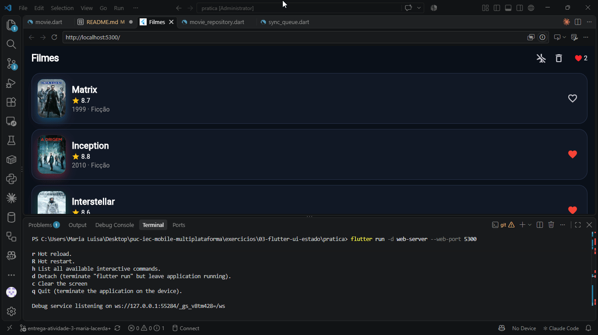

# Atividade 3 — Flutter: UI + Estado + Firebase + Offline-first

**Aluna:** Maria Luisa Lacerda  
**Disciplina:** Arquitetura de Aplicações Móveis e Multiplataforma

## Como rodar

### Pré-requisitos

- Flutter instalado
- Chrome ou outro navegador compatível
- Projeto Firebase configurado
- Arquivo `lib/firebase_options.dart` gerado pelo FlutterFire

### Instalar as dependências

Na pasta:

```text
exercicios/03-flutter-ui-estado/pratica
```

execute:

```bash
flutter pub get
```

### Executar os testes

```bash
flutter test
```

Todos os testes da atividade devem passar.

### Executar o aplicativo

A aplicação pode ser executada no Chrome:

```bash
flutter run -d chrome --web-port 5300
```

Caso o Flutter não consiga iniciar o Chrome automaticamente:

```bash
flutter run -d web-server --web-port 5300
```

Depois, abra manualmente:

```text
http://localhost:5300
```

## Estado local e estado na nuvem

O aplicativo utiliza **Riverpod** para controlar o estado local da interface. Ao favoritar ou desfavoritar um filme, o estado é atualizado imediatamente no `favoritesProvider`, fazendo com que os widgets que observam esse provider sejam reconstruídos.

O **Cloud Firestore** é utilizado para persistir os favoritos na nuvem. Dessa forma, o Riverpod é responsável pelo estado utilizado pela interface durante a execução do aplicativo, enquanto o Firestore mantém os dados persistidos entre diferentes execuções e recarregamentos da página.

Esse comportamento pode ser observado ao favoritar um filme e pressionar `F5`: o estado local é recriado, mas os favoritos são carregados novamente a partir do Firestore.

Além disso, o Firestore está configurado com persistência offline:

```dart
FirebaseFirestore.instance.settings =
    const Settings(persistenceEnabled: true);
```

A aplicação também implementa uma estratégia **offline-first** para a lista de filmes. O `MovieRepository` consulta primeiro o cache local e, quando necessário, busca dados atualizados da fonte remota. O cache possui um tempo de validade (TTL), evitando chamadas desnecessárias quando os dados ainda estão atualizados.

Quando o aplicativo está offline e existe cache disponível, os dados salvos continuam sendo exibidos ao usuário.

## Funcionalidades implementadas

- Exibição dos filmes em `MovieCard`
- Favoritar e desfavoritar filmes
- Contador de favoritos no cabeçalho
- Limpeza da lista de favoritos
- Estado compartilhado com Riverpod
- Persistência dos favoritos no Cloud Firestore
- Persistência offline do Firestore
- Banner de modo offline
- Serialização e desserialização de `Movie`
- Estratégia cache-first
- Controle de validade do cache com TTL
- Fila de sincronização de operações offline
- Tratamento de conflitos na fila
- Persistência da fila após cada operação sincronizada

## Evidência do Firestore

A imagem abaixo demonstra os favoritos persistidos no Cloud Firestore.



Na coleção `favorites`, o documento `meus-favoritos` mantém os identificadores dos filmes selecionados. Após atualizar a página com `F5`, esses dados são carregados novamente e os respectivos filmes continuam marcados como favoritos.

## Testes

Para executar toda a suíte:

```bash
flutter test --reporter=compact
```

A implementação foi validada pelos testes automatizados fornecidos na atividade, incluindo os cenários de UI, estado compartilhado, cache offline, TTL e fila de sincronização.

---

> Orientações do professor. 

# Filmes (Flutter) — pratica/ da Atividade 3

App de catálogo de filmes em **Flutter**. Já roda; você completa os scaffolds (UI, estado, Firebase e offline-first) até `flutter test` ficar **verde**.

## Rodar
```bash
cd exercicios/03-flutter-ui-estado/pratica   # confirme: ls lib
flutter pub get
flutter run -d chrome --web-port 5300   # PORTA FIXA (o cache offline fica no navegador, por porta)
# 💡 Atalho no VS Code: aperte F5 (o .vscode/launch.json já fixa a porta 5300)
#    ou Ctrl/Cmd+Shift+B (terminal integrado: r = hot reload) · ./rodar.sh (Mac/Linux) · rodar.bat (Windows)
```

## Testar (é o seu checklist)
```bash
flutter test                         # tudo: Ex1–Ex3 (UI/estado) + offline (TASKs 11–15) + checklist
flutter test test/offline_test.dart  # só offline-first — cada grupo = 1 TASK
flutter analyze                      # precisa ficar limpo
```
Comece com os testes **vermelhos**; deixe-os **verdes**. `test/checklist_test.dart` e `test/offline_test.dart` são a **spec** (não edite).

## O que completar (🧑‍🏫 aula · 🧑‍💻 casa)
| TASK | Arquivo | O quê | |
|---|---|---|---|
| 1 | `lib/widgets/movie_card.dart` | compor o card (título + ⭐ nota + ano) | 🧑‍🏫 |
| 2 | `lib/state/favorites.dart` | `favoritesProvider` (`toggle` + `clear`) | 🧑‍🏫 |
| 3 | `lib/main.dart` | projeto Firebase + `flutterfire configure` | 🧑‍🏫 |
| 10 | `lib/main.dart` | persistência offline do Firestore (1 linha) | 🧑‍🏫 fácil |
| 4 | `lib/widgets/movie_card.dart` | coração favoritando (`ConsumerWidget` + `ref`) | 🧑‍💻 |
| 5 | `lib/screens/home_screen.dart` | contador `♥ N` no header | 🧑‍💻 |
| 6 | `lib/screens/home_screen.dart` | botão **limpar** favoritos | 🧑‍💻 |
| 7 | `lib/state/favorites.dart` | persistir favoritos no **Firestore** | 🧑‍💻 médio |
| 8 | `lib/services/remote_config.dart` + home | ⏸ **ADIADA** (Remote Config) — não faz parte desta atividade, pule | — |
| 9 | `test/favorites_test.dart` | **você escreve** um teste do provider | 🧑‍💻 |
| 11 | `lib/widgets/offline_banner.dart` | aviso "você está offline" | 🧑‍💻 fácil |
| 12 | `lib/models/movie.dart` | `toJson` / `fromJson` | 🧑‍💻 fácil |
| 13 | `lib/data/movie_repository.dart` | repositório **cache-first** | 🧑‍💻 médio |
| 14 | `lib/data/movie_repository.dart` | validade do cache (**TTL**) | 🧑‍💻 médio |
| 15 | `lib/data/sync_queue.dart` | **fila de sincronização** (conflitos + flush) | 🧑‍💻 🔴 difícil |

✈️ O botão de **avião** na barra do topo simula o modo offline. Veja o `guia-passo-a-passo.md` e o `enunciado.md` (rubrica).

## Entrega
Fork + PR no repo público; link no Canvas. O **J.A.R.V.I.S.** lê o seu código (estrutural) e posta uma nota **mínima**; a final sai no Canvas.
- ✏️ **Edite os arquivos dentro de `exercicios/03-flutter-ui-estado/pratica/` (no lugar)** — **não crie subpasta** `aluno-.../`.

> **CI no seu fork (opcional):** habilite o *Actions* do fork — o workflow *Flutter test — Atividade 3* roda `flutter analyze` + `flutter test` a cada push.
> **Versões:** precisa de Flutter **3.27+** (o `pubspec` já avisa se for mais antigo).

> **Não comite** `.dart_tool/`, `build/`, `pubspec.lock` (já no `.gitignore`).

## Dados reais do TMDB (opcional)

Sem chave, o app usa a lista simulada (5 filmes). Para filmes reais: copie `.env.local.example` → `.env.local`,
cole sua chave do TMDB (`TMDB_KEY=...`) e rode `./rodar.sh` / `rodar.bat` (ou F5 → "dados reais TMDB").
O `.env.local` não vai pro git. Os testes (`flutter test`) nunca usam a chave.