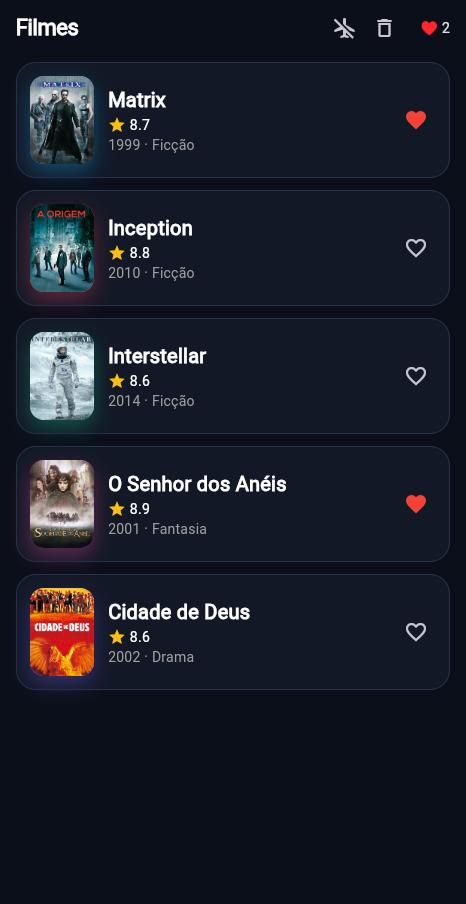
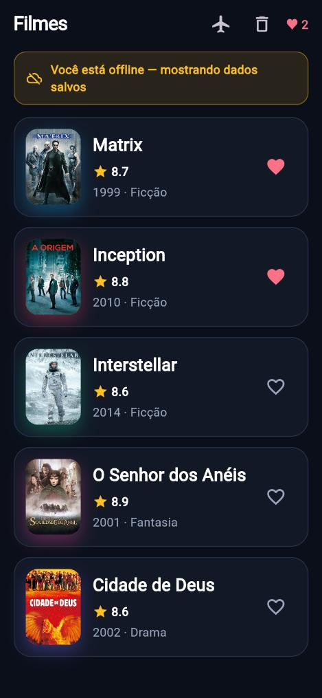

# Filmes (Flutter) — pratica/ da Atividade 3

App de catálogo de filmes em **Flutter**. Já roda; você completa os scaffolds (UI, estado, Firebase e offline-first) até `flutter test` ficar **verde**.

## ✅ Entrega — Gabriel Ceola

Todas as TASKs da atividade feitas (1–7 e 9–15; a 8/Remote Config foi adiada). `flutter analyze` limpo e `flutter test` todo verde (30 testes).

| TASK | O que foi feito |
|---|---|
| 1 | `MovieCard`: `Card` → `Padding(14)` → `Row` com `PosterArt`, título (20, negrito), ⭐ nota e ano (cinza) |
| 2 · 4 · 5 · 6 | `favoritesProvider` (`Notifier<Set<int>>` com `toggle`/`clear`) lido pelo coração do card, pelo contador `♥ N` e pelo botão **limpar** — uma fonte só, sem prop drilling |
| 3 · 7 | Projeto Firebase próprio (`filmes-flutter-77dc4`, plano Spark) com Firestore e regras liberando só `favorites/meus-favoritos`; `Firebase.initializeApp` no `main.dart` + `lib/firebase_options.dart` (Plano B); favoritos lidos de `favorites/meus-favoritos` no `build()` e gravados com `.set()` a cada `toggle`/`clear` (UI otimista) |
| 9 | `test/favorites_test.dart`: 3 testes do provider com `ProviderContainer` (vazio → toggle → toggle → clear, isolamento entre filmes, imutabilidade do `Set`) |
| 10 | `Settings(persistenceEnabled: true)` no `main.dart` |
| 11 | `OfflineBanner` (`ConsumerWidget` + `onlineProvider`) |
| 12 | `Movie.toJson` / `Movie.fromJson` (`rating` via `num.toDouble()`, `posterPath` opcional) |
| 13 · 14 | `watchMovies()` cache-first com TTL: emite o cache na hora, não chama a API se o cache está fresco, revalida e grava se está velho, e offline segue com o cache (sem cache → `OfflineException`) |
| 15 | `SyncQueue`: mesma ação no mesmo filme não duplica, ação oposta cancela; `flush` na ordem, persistindo a cada sucesso e parando no 1º erro |

### Como rodar
```bash
cd exercicios/03-flutter-ui-estado/pratica
flutter pub get
flutter run -d chrome --web-port 5300   # ou -d edge · porta fixa por causa do cache offline
flutter analyze
flutter test
```
O Firebase vem de `lib/firebase_options.dart`. Para usar outro projeto, gere o arquivo com `flutterfire configure` ou pelo Plano B do enunciado e publique as regras do Firestore que liberam `favorites/meus-favoritos`.

### Prints
| Favoritos depois do F5 (Firestore) | Offline (✈️ ligado) |
|---|---|
|  |  |

À esquerda, a página recarregada com F5: Matrix e O Senhor dos Anéis continuam favoritados (`♥ 2`), lidos do documento `favorites/meus-favoritos` (`ids: [1, 4]`). À direita, o modo avião ligado: aparece o banner e a lista continua na tela, vinda do cache local.

### Local × cloud × offline-first
Estado **local** (Riverpod em memória, TASK 2) é instantâneo, funciona sem rede e é trivial de testar, mas morre no F5 e fica preso a um único aparelho. Estado **cloud** (Firestore, TASK 7) sobrevive ao reload e sincroniza entre abas e dispositivos, mas depende de rede, adiciona latência, regras de segurança e limites de uso, e sem conexão o app ficaria sem dados. **Offline-first** (TASKs 10–15) junta os dois: a tela lê sempre o que está no aparelho (cache com TTL), revalida quando a rede deixa e guarda as escritas numa fila para enviar depois. O preço é complexidade: o usuário pode ver dado velho (*stale*), é preciso decidir quando o cache expira e resolver conflitos (favoritar e desfavoritar o mesmo filme offline se cancelam na `SyncQueue`). Aqui a UI é otimista (o `state` muda na hora) e o Firestore com `persistenceEnabled` sincroniza sozinho as escritas feitas sem rede.

## Rodar
```bash
cd exercicios/03-flutter-ui-estado/pratica   # confirme: ls lib
flutter pub get
flutter run -d chrome --web-port 5300   # PORTA FIXA (o cache offline fica no navegador, por porta)
# 💡 Atalho no VS Code: aperte F5 (o .vscode/launch.json já fixa a porta 5300)
#    ou Ctrl/Cmd+Shift+B (terminal integrado: r = hot reload) · ./rodar.sh (Mac/Linux) · rodar.bat (Windows)
```

## Testar (é o seu checklist)
```bash
flutter test                         # tudo: Ex1–Ex3 (UI/estado) + offline (TASKs 11–15) + checklist
flutter test test/offline_test.dart  # só offline-first — cada grupo = 1 TASK
flutter analyze                      # precisa ficar limpo
```
Comece com os testes **vermelhos**; deixe-os **verdes**. `test/checklist_test.dart` e `test/offline_test.dart` são a **spec** (não edite).

## O que completar (🧑‍🏫 aula · 🧑‍💻 casa)
| TASK | Arquivo | O quê | |
|---|---|---|---|
| 1 | `lib/widgets/movie_card.dart` | compor o card (título + ⭐ nota + ano) | 🧑‍🏫 |
| 2 | `lib/state/favorites.dart` | `favoritesProvider` (`toggle` + `clear`) | 🧑‍🏫 |
| 3 | `lib/main.dart` | projeto Firebase + `flutterfire configure` | 🧑‍🏫 |
| 10 | `lib/main.dart` | persistência offline do Firestore (1 linha) | 🧑‍🏫 fácil |
| 4 | `lib/widgets/movie_card.dart` | coração favoritando (`ConsumerWidget` + `ref`) | 🧑‍💻 |
| 5 | `lib/screens/home_screen.dart` | contador `♥ N` no header | 🧑‍💻 |
| 6 | `lib/screens/home_screen.dart` | botão **limpar** favoritos | 🧑‍💻 |
| 7 | `lib/state/favorites.dart` | persistir favoritos no **Firestore** | 🧑‍💻 médio |
| 8 | `lib/services/remote_config.dart` + home | ⏸ **ADIADA** (Remote Config) — não faz parte desta atividade, pule | — |
| 9 | `test/favorites_test.dart` | **você escreve** um teste do provider | 🧑‍💻 |
| 11 | `lib/widgets/offline_banner.dart` | aviso "você está offline" | 🧑‍💻 fácil |
| 12 | `lib/models/movie.dart` | `toJson` / `fromJson` | 🧑‍💻 fácil |
| 13 | `lib/data/movie_repository.dart` | repositório **cache-first** | 🧑‍💻 médio |
| 14 | `lib/data/movie_repository.dart` | validade do cache (**TTL**) | 🧑‍💻 médio |
| 15 | `lib/data/sync_queue.dart` | **fila de sincronização** (conflitos + flush) | 🧑‍💻 🔴 difícil |

✈️ O botão de **avião** na barra do topo simula o modo offline. Veja o `guia-passo-a-passo.md` e o `enunciado.md` (rubrica).

## Entrega
Fork + PR no repo público; link no Canvas. O **J.A.R.V.I.S.** lê o seu código (estrutural) e posta uma nota **mínima**; a final sai no Canvas.
- ✏️ **Edite os arquivos dentro de `exercicios/03-flutter-ui-estado/pratica/` (no lugar)** — **não crie subpasta** `aluno-.../`.

> **CI no seu fork (opcional):** habilite o *Actions* do fork — o workflow *Flutter test — Atividade 3* roda `flutter analyze` + `flutter test` a cada push.
> **Versões:** precisa de Flutter **3.27+** (o `pubspec` já avisa se for mais antigo).

> **Não comite** `.dart_tool/`, `build/`, `pubspec.lock` (já no `.gitignore`).

## Dados reais do TMDB (opcional)

Sem chave, o app usa a lista simulada (5 filmes). Para filmes reais: copie `.env.local.example` → `.env.local`,
cole sua chave do TMDB (`TMDB_KEY=...`) e rode `./rodar.sh` / `rodar.bat` (ou F5 → "dados reais TMDB").
O `.env.local` não vai pro git. Os testes (`flutter test`) nunca usam a chave.
