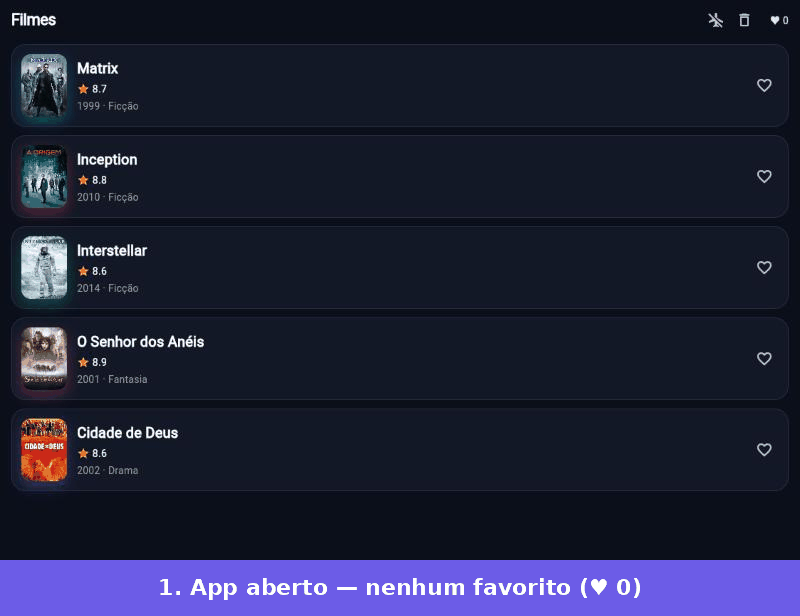

# Filmes (Flutter) — pratica/ da Atividade 3

## ✅ Minha entrega

Todas as TASKs da atividade estão implementadas (a TASK 8, Remote Config, foi adiada pelo professor e não faz parte da entrega):

| Bloco | TASKs | Onde |
|---|---|---|
| UI — `MovieCard` (pôster · título · ⭐ nota · ano · coração) | 1, 4 | `lib/widgets/movie_card.dart` |
| Estado local compartilhado com Riverpod (`toggle` / `clear`) | 2, 5, 6 | `lib/state/favorites.dart`, `lib/screens/home_screen.dart` |
| Teste autoral do provider (`ProviderContainer`) | 9 | `test/favorites_test.dart` |
| Favoritos na nuvem (Firestore `favorites/meus-favoritos`) | 3, 7 | `lib/main.dart`, `lib/firebase_options.dart`, `lib/state/favorites.dart` |
| Persistência offline do Firestore | 10 | `lib/main.dart` |
| Banner de offline | 11 | `lib/widgets/offline_banner.dart` |
| Serialização `toJson` / `fromJson` | 12 | `lib/models/movie.dart` |
| Repositório cache-first + TTL | 13, 14 | `lib/data/movie_repository.dart` |
| Fila de sincronização (conflitos + flush) | 15 | `lib/data/sync_queue.dart` |

### Como rodar
```bash
cd exercicios/03-flutter-ui-estado/pratica
flutter pub get
flutter analyze                          # limpo
flutter test                             # tudo verde (app_test + checklist + favorites + offline)
flutter run -d chrome --web-port 5300    # ou: rodar.bat (Windows) / ./rodar.sh · VS Code: F5
```
- **Firebase:** o app usa o meu projeto Firebase (plano Spark, sem cartão), configurado pelo *Plano B* do enunciado em `lib/firebase_options.dart`. O Firestore tem a regra permanente que libera só `favorites/meus-favoritos`.
- **Offline:** abra o app uma vez online (a lista vai para o cache), depois clique no ✈️ da barra (ou DevTools → Network → Offline): aparece o banner e a lista continua, vinda do cache. Use sempre a porta 5300, porque o cache do navegador é por porta.

### Prova do Firestore — o favorito sobrevive ao refresh (F5)


### App offline (banner + lista vinda do cache)


### Local × cloud × offline-first (trade-offs)
O **estado local** (o `Set<int>` em memória do TASK 2) é o mais simples e o mais rápido: não tem latência nem depende de rede, e funciona offline. Em compensação ele vive preso à memória daquela execução: some no F5 e não é compartilhado entre abas ou aparelhos. O **estado cloud** (Firestore, TASK 7) resolve isso. O documento remoto vira a fonte da verdade, os favoritos persistem e sincronizam entre dispositivos quase em tempo real. O preço é depender de rede: cada leitura e escrita tem latência, pode falhar, e surgem questões de consistência e de regras de segurança. O **offline-first** (TASKs 10–15) combina os dois. A UI sempre lê o que já está **no aparelho** (cache com TTL e cache do Firestore) e mostra algo na hora, mesmo sem internet. A rede passa a ser só um meio de atualizar esse dado local em segundo plano (*stale-while-revalidate*), e as escritas feitas offline entram numa fila que é reenviada na volta, com regras de conflito (ações opostas se cancelam, a mesma ação não duplica) e envio em ordem, persistido a cada sucesso. Isso dá a resposta instantânea do local com a durabilidade e a sincronização da nuvem. O custo é a complexidade: é preciso decidir quando o cache está velho, lidar com conflitos e aceitar que, por um tempo, o usuário pode ver um dado desatualizado.

---

## Enunciado original da pasta `pratica/`

App de catálogo de filmes em **Flutter**. Já roda; você completa os scaffolds (UI, estado, Firebase e offline-first) até `flutter test` ficar **verde**.

## Rodar
```bash
cd exercicios/03-flutter-ui-estado/pratica   # confirme: ls lib
flutter pub get
flutter run -d chrome --web-port 5300   # PORTA FIXA (o cache offline fica no navegador, por porta)
# 💡 Atalho no VS Code: aperte F5 (o .vscode/launch.json já fixa a porta 5300)
#    ou Ctrl/Cmd+Shift+B (terminal integrado: r = hot reload) · ./rodar.sh (Mac/Linux) · rodar.bat (Windows)
```

## Testar (é o seu checklist)
```bash
flutter test                         # tudo: Ex1–Ex3 (UI/estado) + offline (TASKs 11–15) + checklist
flutter test test/offline_test.dart  # só offline-first — cada grupo = 1 TASK
flutter analyze                      # precisa ficar limpo
```
Comece com os testes **vermelhos**; deixe-os **verdes**. `test/checklist_test.dart` e `test/offline_test.dart` são a **spec** (não edite).

## O que completar (🧑‍🏫 aula · 🧑‍💻 casa)
| TASK | Arquivo | O quê | |
|---|---|---|---|
| 1 | `lib/widgets/movie_card.dart` | compor o card (título + ⭐ nota + ano) | 🧑‍🏫 |
| 2 | `lib/state/favorites.dart` | `favoritesProvider` (`toggle` + `clear`) | 🧑‍🏫 |
| 3 | `lib/main.dart` | projeto Firebase + `flutterfire configure` | 🧑‍🏫 |
| 10 | `lib/main.dart` | persistência offline do Firestore (1 linha) | 🧑‍🏫 fácil |
| 4 | `lib/widgets/movie_card.dart` | coração favoritando (`ConsumerWidget` + `ref`) | 🧑‍💻 |
| 5 | `lib/screens/home_screen.dart` | contador `♥ N` no header | 🧑‍💻 |
| 6 | `lib/screens/home_screen.dart` | botão **limpar** favoritos | 🧑‍💻 |
| 7 | `lib/state/favorites.dart` | persistir favoritos no **Firestore** | 🧑‍💻 médio |
| 8 | `lib/services/remote_config.dart` + home | ⏸ **ADIADA** (Remote Config) — não faz parte desta atividade, pule | — |
| 9 | `test/favorites_test.dart` | **você escreve** um teste do provider | 🧑‍💻 |
| 11 | `lib/widgets/offline_banner.dart` | aviso "você está offline" | 🧑‍💻 fácil |
| 12 | `lib/models/movie.dart` | `toJson` / `fromJson` | 🧑‍💻 fácil |
| 13 | `lib/data/movie_repository.dart` | repositório **cache-first** | 🧑‍💻 médio |
| 14 | `lib/data/movie_repository.dart` | validade do cache (**TTL**) | 🧑‍💻 médio |
| 15 | `lib/data/sync_queue.dart` | **fila de sincronização** (conflitos + flush) | 🧑‍💻 🔴 difícil |

✈️ O botão de **avião** na barra do topo simula o modo offline. Veja o `guia-passo-a-passo.md` e o `enunciado.md` (rubrica).

## Entrega
Fork + PR no repo público; link no Canvas. O **J.A.R.V.I.S.** lê o seu código (estrutural) e posta uma nota **mínima**; a final sai no Canvas.
- ✏️ **Edite os arquivos dentro de `exercicios/03-flutter-ui-estado/pratica/` (no lugar)** — **não crie subpasta** `aluno-.../`.

> **CI no seu fork (opcional):** habilite o *Actions* do fork — o workflow *Flutter test — Atividade 3* roda `flutter analyze` + `flutter test` a cada push.
> **Versões:** precisa de Flutter **3.27+** (o `pubspec` já avisa se for mais antigo).

> **Não comite** `.dart_tool/`, `build/`, `pubspec.lock` (já no `.gitignore`).

## Dados reais do TMDB (opcional)

Sem chave, o app usa a lista simulada (5 filmes). Para filmes reais: copie `.env.local.example` → `.env.local`,
cole sua chave do TMDB (`TMDB_KEY=...`) e rode `./rodar.sh` / `rodar.bat` (ou F5 → "dados reais TMDB").
O `.env.local` não vai pro git. Os testes (`flutter test`) nunca usam a chave.
