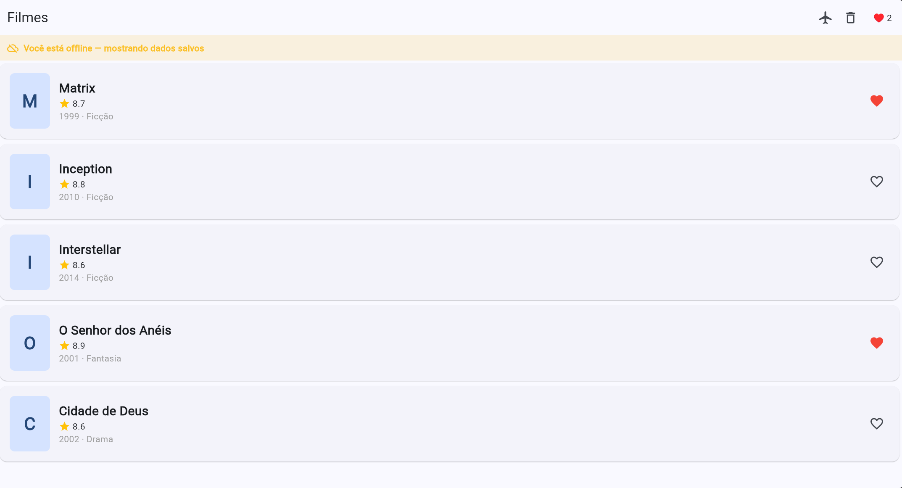

# Atividade 3 — Filmes Flutter

Aplicativo Flutter de catálogo de filmes desenvolvido para a disciplina de Arquitetura de
Aplicações Móveis e Multiplataforma. A atividade demonstra composição de widgets, estado
compartilhado com Riverpod, persistência no Firebase/Firestore e arquitetura offline-first.

## Pré-requisitos

- Flutter SDK instalado e disponível no `PATH`;
- Dart SDK, incluído no Flutter;
- uma conta Firebase configurada para a aplicação Web.

## Como executar

Na pasta `pratica/`, instale as dependências:

```bash
flutter pub get
```

Execute a aplicação Web usando a porta fixa:

```bash
flutter run -d chrome --web-port 5300
```

Caso o Chrome não esteja disponível como dispositivo Flutter, use o servidor Web:

```bash
flutter run -d web-server --web-port 5300
```

Abra [http://localhost:5300](http://localhost:5300) no navegador.

A porta `5300` é mantida fixa porque o cache do navegador é associado à origem, incluindo a
porta. Para testar o funcionamento offline, abra o aplicativo uma vez online antes de ativar
o modo avião.

## Firebase e Firestore

O projeto utiliza o Firebase Web para persistir os favoritos no documento
`favorites/meus-favoritos`. A configuração foi gerada com `flutterfire configure` e está em
[`lib/firebase_options.dart`](lib/firebase_options.dart).

No Firebase Console, é necessário criar o Firestore e publicar regras compatíveis com a
atividade:

```text
rules_version = '2';

service cloud.firestore {
  match /databases/{database}/documents {
    match /favorites/meus-favoritos {
      allow read, write: if true;
    }
  }
}
```

O estado local é atualizado de forma otimista para que a interface responda imediatamente.
Em seguida, a mesma alteração é persistida no Firestore. Dessa forma, o favorito continua
marcado após atualizar a página e pode ser sincronizado entre sessões do aplicativo.

## Funcionalidades implementadas

- `MovieCard` com título, nota, ano, pôster e ação de favoritar;
- estado compartilhado de favoritos com Riverpod;
- contador de favoritos e botão para limpar todos;
- teste unitário autoral do provider de favoritos;
- inicialização do Firebase e persistência dos favoritos no Firestore;
- persistência local do Firestore para uso offline;
- banner de modo offline;
- serialização `Movie.toJson()`/`Movie.fromJson()`;
- repositório cache-first com validade por TTL;
- fila de sincronização com deduplicação, cancelamento de ações opostas e envio ordenado;
- dados simulados de filmes, sem necessidade de API externa;
- TASK 8 (Remote Config) não implementada porque foi explicitamente adiada no enunciado.

## Evidências

O GIF abaixo mostra o favorito sendo selecionado e permanecendo marcado após o refresh da
página, comprovando a persistência no Firestore:


O print abaixo mostra a aplicação funcionando sem conexão, com o banner offline e os dados
salvos no dispositivo:



## Testes e análise estática

Execute a suíte completa:

```bash
flutter analyze
flutter test
```

Para executar somente os testes da arquitetura offline-first:

```bash
flutter test test/offline_test.dart
```

Os testes cobrem a UI, o estado compartilhado, a serialização, o cache-first, o TTL, o
tratamento offline e a fila de sincronização.

## Entrega

Os arquivos da atividade devem permanecer dentro de
`exercicios/03-flutter-ui-estado/pratica/`, sem criar uma subpasta de aluno. A entrega é feita
por meio de um Pull Request no fork do repositório, cujo link deve ser enviado no Canvas.

Não devem ser versionados arquivos gerados ou temporários como `.dart_tool/`, `build/` e
`pubspec.lock`.
