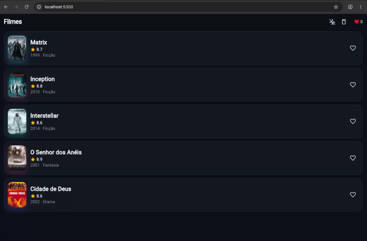
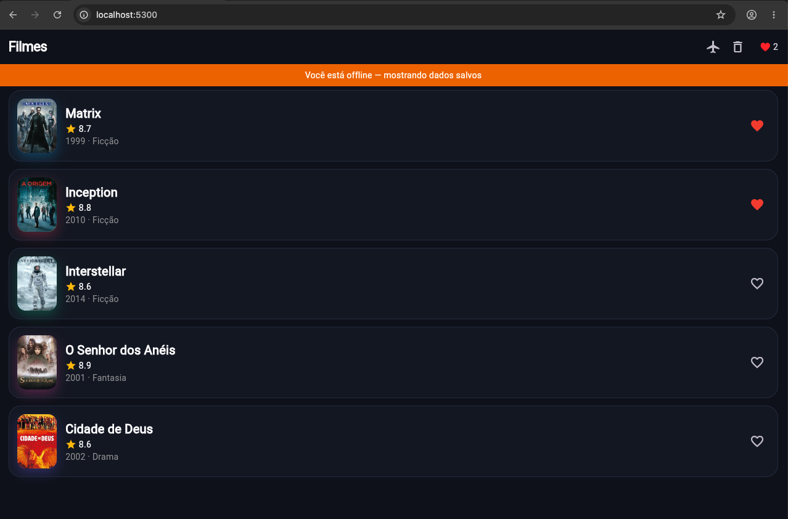

# Atividade 3 — App Flutter: UI + Estado + Firebase + Offline-first

**Aluno:** João Vítor Vieira Martins · **Matrícula:** 258850

## Como rodar

```bash
cd exercicios/03-flutter-ui-estado/pratica
flutter pub get
flutter run -d chrome --web-port 5300   # porta fixa: o cache offline é por endereço + porta
flutter test                            # todos os testes
flutter analyze                         # análise estática
```

O Firebase usa o meu projeto (`lib/firebase_options.dart`), com o documento `favorites/meus-favoritos` no Firestore.

## Prova: favoritos sobrevivem ao refresh (Firestore)



## Modo offline (banner + lista vinda do cache)



## Local × Cloud × Offline-first (trade-offs)

O estado **local** (Riverpod em memória, TASK 2) é o mais simples e instantâneo: não depende de
rede nem tem latência, mas morre com o reload e fica preso àquele aparelho. O estado **cloud**
(Firestore, TASK 7) resolve isso, porque os favoritos sobrevivem ao F5 e sincronizam entre abas e
dispositivos, mas passa a depender da rede: cada leitura tem latência, e sem conexão uma escrita
pode se perder ou a tela pode ficar vazia. O **offline-first** (TASKs 10–15) combina os dois: a
tela sempre lê primeiro o que está no aparelho (cache com TTL), revalida na API quando há rede, e
as escritas feitas offline vão para uma fila que é enviada na volta da conexão, com regras de
conflito. O custo é complexidade: é preciso decidir quando o cache vale, o que fazer com operações
opostas e como não perder nem duplicar envios quando a rede cai no meio.
