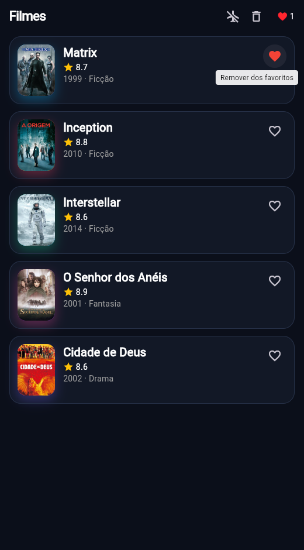
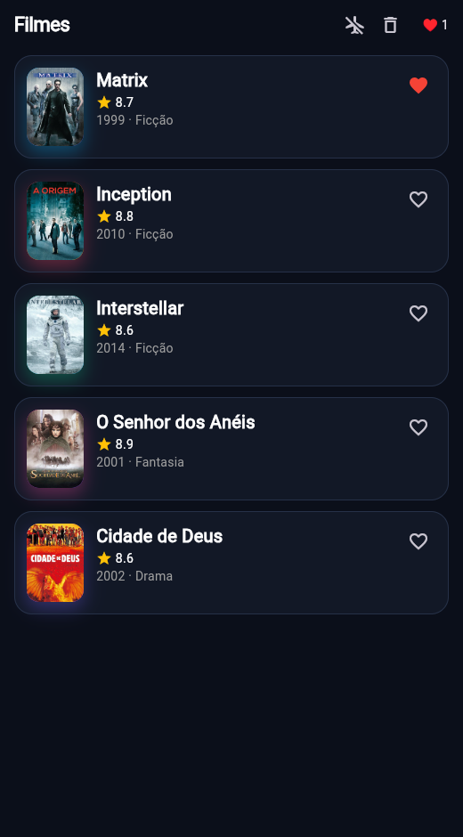
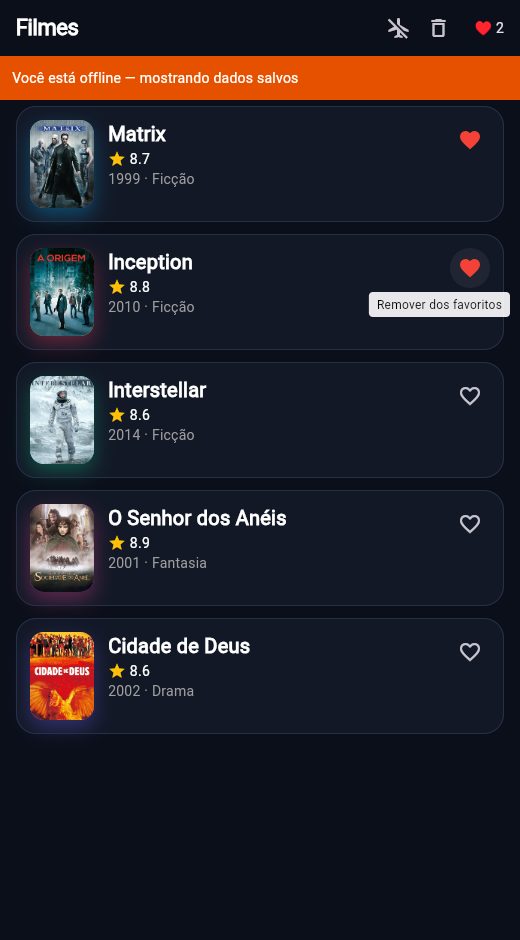
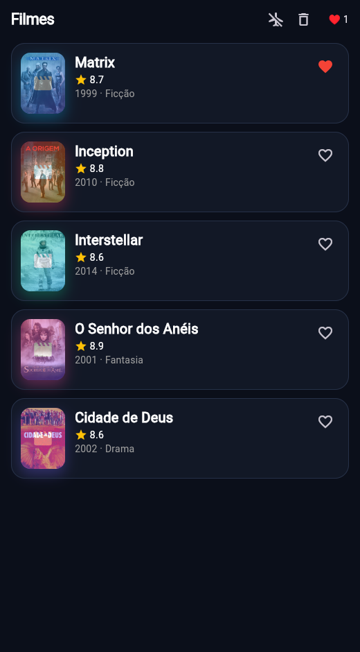
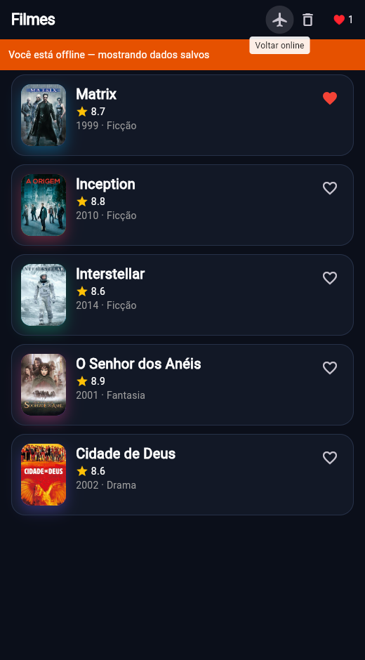

# Atividade 3 — Flutter, Riverpod, Firestore e offline-first

## Rodar localmente

```bash
cd exercicios/03-flutter-ui-estado/pratica
flutter pub get
# Terminal 1: Firestore local, sem conta Firebase ou serviços pagos
npx --yes firebase-tools@15.0.0 emulators:start --only firestore --project demo-puc-mobile
# Terminal 2: mantenha a porta fixa, pois o cache é por origem
flutter run -d chrome --web-port 5300
```

O padrão usa o emulador em `127.0.0.1:8085`, projeto `demo-puc-mobile`.
Os favoritos são lidos e gravados pelo SDK do Firestore no documento
`favorites/meus-favoritos`. O estado do emulador dura enquanto ele está iniciado.
A persistência offline do SDK está habilitada. O botão avião simula a conexão
da fonte de filmes; para cortar a rede do Firestore também, use Network → Offline.

## Usar seu projeto Firebase em nuvem

Crie um app Web e o Firestore no seu projeto Spark, conforme o enunciado.
Copie `firebase.local.example.json` para `firebase.local.json` e preencha os
quatro campos públicos da configuração Web. Mantenha `FIRESTORE_EMULATOR=false`.

```bash
flutter run -d chrome --web-port 5300 --dart-define-from-file=firebase.local.json
```

Aplique no console as regras de laboratório presentes em `firestore.rules`.
Elas liberam apenas o documento do exercício, mas **sem autenticação**: qualquer
pessoa que conheça o projeto pode ler/escrever esse documento. Não use dados pessoais.
O documento é compartilhado, e gravações simultâneas adotam a última escrita.

O projeto pessoal **`pos-puv`**, banco **`(default)`**, foi configurado e validado
na nuvem. A configuração Web fica em `firebase.local.json` (ignorado pelo Git).
As capturas abaixo distinguem o teste na nuvem dos testes locais com emulador.

## Verificações

```bash
flutter test
flutter test test/offline_test.dart
flutter analyze
flutter build web
```

28 testes passaram, análise sem problemas e build web concluído. Os testes
oficiais `app_test.dart`, `checklist_test.dart` e `offline_test.dart` correspondem
à versão atual do professor e não tiveram asserções alteradas.

| Requisito | Implementação / verificação |
|---|---|
| UI e estado compartilhado | card com pôster, título/nota/ano; contador e limpar; testes de widgets |
| Firestore | leitura/escrita no projeto real; refresh, leitura em contexto sem cache, escrita offline e sincronização entre sessões |
| Offline | persistência do Firestore; banner condicionado a `onlineProvider` |
| Serialização | `toJson`/`fromJson`, inclusive nota inteira e caminho do pôster |
| Cache-first e TTL | cache imediato; fresco evita API; vencido revalida; offline sem cache propaga erro |
| SyncQueue | deduplicação, cancelamento de ações opostas; flush ordenado e persistido a cada sucesso; para no primeiro erro |

### Evidências do Firestore real — pos-puv / (default)

O favorito foi gravado na nuvem e confirmado pela API REST do Firestore.
Depois do refresh, continuou selecionado:





Uma sessão nova, sem o IndexedDB/cache da primeira, também leu o favorito do
servidor. Com a rede real cortada, outro favorito foi atualizado localmente e
ficou pendente; o documento remoto permaneceu inalterado. Ao restabelecer a rede,
o SDK sincronizou a escrita e a segunda sessão recebeu a mudança via snapshots.



Os dados de confirmação, sem API key, estão em
[firestore-cloud.json](evidencias/firestore-cloud.json). Ao final do teste foi
mantido apenas o filme de id 1 nos favoritos do documento do laboratório.

### Evidências anteriores — Firestore emulado

Favorito antes do refresh:


Depois do refresh, o favorito permanece. Um novo contexto do navegador, sem o
cache do primeiro, também leu o mesmo favorito do servidor do emulador:



Lista em cache e banner com modo avião simulado:



## Decisões

Riverpod compartilha o estado entre card, contador e limpar sem repassar
parâmetros por widgets intermediários. O estado local reage rápido, mas sozinho
morre no refresh. O Firestore persiste e pode sincronizar dispositivos, ao custo
de latência, regras de acesso e conflitos. Offline-first combina cache local com
revalidação: mantém a tela útil sem rede, mas pode mostrar dados antigos. O TTL
limita as buscas e a fila guarda operações até que possam ser enviadas. Neste
exercício a SyncQueue é testada isoladamente; conectá-la aos favoritos é bônus,
e o SDK do Firestore já mantém sua própria fila de escritas offline.

Remote Config (TASK 8) foi adiado e não foi implementado.

## Uso de IA

As implementações tiveram assistência de IA. A revisão inicial usou uma versão
antiga do enunciado; esta revisão incorporou os requisitos atuais e executou
os testes e as verificações de navegador descritos acima.
