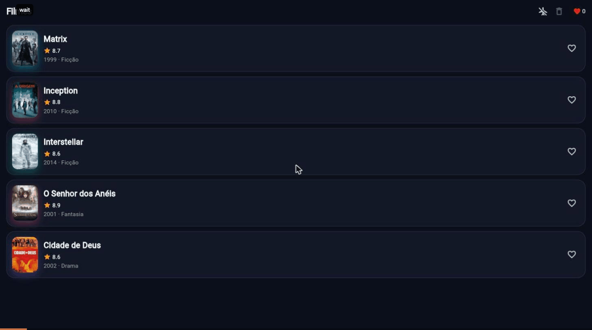
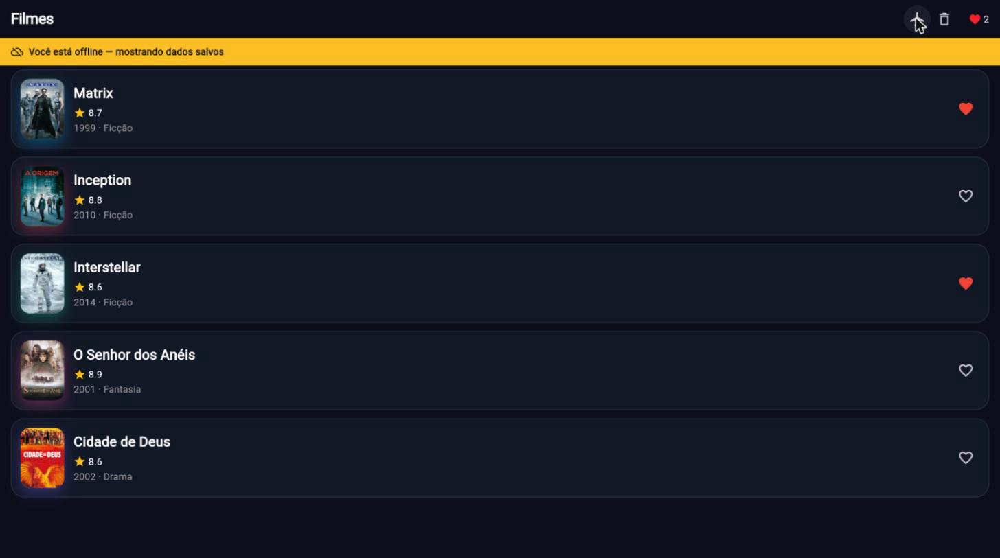

# Filmes (Flutter) — pratica/ da Atividade 3

App de catálogo de filmes em **Flutter**. Já roda; você completa os scaffolds (UI, estado, Firebase e offline-first) até `flutter test` ficar **verde**.

---

## ✅ Entrega — Guilherme Jeske

Todas as TASKs da atividade feitas (1–7, 9–15; a **TASK 8 / Remote Config foi adiada** pelo enunciado e ficou como estava).
`flutter analyze` → **No issues found** · `flutter test` → **30/30 verdes** (app, checklist, offline e o meu teste).

### Como rodar
```bash
cd exercicios/03-flutter-ui-estado/pratica
flutter pub get
flutter run -d chrome --web-port 5300   # porta FIXA: o cache offline (SharedPreferences/IndexedDB) é por porta
flutter test                            # 30 testes
flutter analyze                         # limpo
```
O Firebase já vem configurado para o **meu** projeto (`lib/firebase_options.dart`, projeto `cinefav-guilherme-jeske`, plano Spark).
Para usar outro projeto: `flutterfire configure --platforms=web` (sobrescreve o arquivo) e publique a regra abaixo.

**Regras do Firestore** (criei o banco em *modo produção* — nega tudo — e liberei só o documento do app):
```
rules_version = '2';
service cloud.firestore {
  match /databases/{database}/documents {
    match /favorites/meus-favoritos { allow read, write: if true; }
  }
}
```

### Prova do Firestore (Ex4) — o favorito sobrevive ao F5
Favorito **Matrix** e **Interstellar** → `F5` → continuam marcados (`♥ 2`) → no console do Firestore o documento
`favorites/meus-favoritos` tem `ids: [1, 3]`.



Testei também com **duas abas**: desfavoritar na aba 2 atualiza a aba 1 sozinha (o provider ouve o documento com
`snapshots()` em vez de um `get()` único).

### Offline (Ex6) — ✈️ ligado: banner + lista vinda do cache


### O que foi feito, por arquivo
| TASK | Arquivo | Resumo |
|---|---|---|
| 1 | `lib/widgets/movie_card.dart` | `Card → Padding(14) → Row(PosterArt · Expanded(Column(título · ⭐ nota · ano)))` |
| 2 · 7 | `lib/state/favorites.dart` | `Notifier<Set<int>>` com `toggle`/`clear`; ouve `favorites/meus-favoritos` (`snapshots()`) e grava com `.set({'ids': …})` — atualização **otimista** (a UI muda na hora). Sem Firebase inicializado (ex.: `flutter test`) vira o provider local do TASK 2. |
| 3 · 7 · 10 | `lib/main.dart` + `lib/firebase_options.dart` | `Firebase.initializeApp(...)` antes do `runApp` + `Settings(persistenceEnabled: true)` (na web vem desligada) |
| 4 | `lib/widgets/movie_card.dart` | `ConsumerWidget`; coração lê `ref.watch(favoritesProvider)` e chama `ref.read(...notifier).toggle(id)` |
| 5 · 6 | `lib/screens/home_screen.dart` | `ConsumerWidget`; `♥ N` (`.length`) + botão 🗑 (`delete_outline`) que chama `clear()` |
| 9 | `test/favorites_test.dart` | 3 testes com `ProviderContainer`: vazio → toggle adiciona → toggle remove → clear; ids independentes; cada mudança gera um **novo** `Set` e notifica |
| 11 | `lib/widgets/offline_banner.dart` | `ConsumerWidget` em `onlineProvider`; faixa âmbar só quando offline |
| 12 | `lib/models/movie.dart` | `toJson`/`fromJson` (`(rating as num).toDouble()`; `posterPath` só quando existe) |
| 13 · 14 | `lib/data/movie_repository.dart` | cache-first: emite o cache → se **fresco** (`now() - savedAt < ttl`) para; senão busca, grava e emite o fresco; `OfflineException` só sobe se **não** havia cache |
| 15 | `lib/data/sync_queue.dart` | `enqueue`: mesma ação no mesmo filme não duplica, ação oposta **cancela** as duas; `flush`: em ordem, `_save` a cada sucesso, para no 1º erro sem propagar e devolve a contagem |

### Local × cloud × offline-first (trade-offs)
Estado **local** (o `Set<int>` do TASK 2 em memória, ou o `SharedPreferences` do cache) é instantâneo, funciona sem rede
e não custa nada, mas fica **preso ao aparelho**: some no reload (se for só memória) e não aparece em outro device ou aba.
Estado **cloud** (Firestore) passa a ser a fonte da verdade compartilhada: sobrevive ao F5, sincroniza abas e dispositivos
em tempo real e permite backup e regras de acesso, mas depende de rede, adiciona latência a cada leitura e escrita, exige
configuração e regras de segurança, e no limite custa dinheiro. **Offline-first** é o meio-termo que apps reais usam: a
tela sempre lê primeiro o que está **no aparelho** (cache com TTL, persistência do Firestore) e trata a nuvem como algo que
**sincroniza quando dá** (stale-while-revalidate para leituras, fila de sincronização para escritas). O preço é
complexidade: dados podem ficar **velhos** por até um TTL, escritas offline precisam de **resolução de conflito** (mesma
ação deduplica, ação oposta cancela) e o envio precisa ser **idempotente e retomável** (persistir a fila a cada sucesso
para não reenviar depois de um crash). Neste app os favoritos usam Firestore com persistência offline e atualização
otimista, e a lista de filmes usa o repositório cache-first.

> Bônus (não pontua, não feito): ligar a `SyncQueue` ao `favoritesProvider`. Aqui a fila de escritas offline dos favoritos
> já é feita pela própria persistência do Firestore (TASK 10).

---

## Rodar
```bash
cd exercicios/03-flutter-ui-estado/pratica   # confirme: ls lib
flutter pub get
flutter run -d chrome --web-port 5300   # PORTA FIXA (o cache offline fica no navegador, por porta)
# 💡 Atalho no VS Code: aperte F5 (o .vscode/launch.json já fixa a porta 5300)
#    ou Ctrl/Cmd+Shift+B (terminal integrado: r = hot reload) · ./rodar.sh (Mac/Linux) · rodar.bat (Windows)
```

## Testar (é o seu checklist)
```bash
flutter test                         # tudo: Ex1–Ex3 (UI/estado) + offline (TASKs 11–15) + checklist
flutter test test/offline_test.dart  # só offline-first — cada grupo = 1 TASK
flutter analyze                      # precisa ficar limpo
```
Comece com os testes **vermelhos**; deixe-os **verdes**. `test/checklist_test.dart` e `test/offline_test.dart` são a **spec** (não edite).

## O que completar (🧑‍🏫 aula · 🧑‍💻 casa)
| TASK | Arquivo | O quê | |
|---|---|---|---|
| 1 | `lib/widgets/movie_card.dart` | compor o card (título + ⭐ nota + ano) | 🧑‍🏫 |
| 2 | `lib/state/favorites.dart` | `favoritesProvider` (`toggle` + `clear`) | 🧑‍🏫 |
| 3 | `lib/main.dart` | projeto Firebase + `flutterfire configure` | 🧑‍🏫 |
| 10 | `lib/main.dart` | persistência offline do Firestore (1 linha) | 🧑‍🏫 fácil |
| 4 | `lib/widgets/movie_card.dart` | coração favoritando (`ConsumerWidget` + `ref`) | 🧑‍💻 |
| 5 | `lib/screens/home_screen.dart` | contador `♥ N` no header | 🧑‍💻 |
| 6 | `lib/screens/home_screen.dart` | botão **limpar** favoritos | 🧑‍💻 |
| 7 | `lib/state/favorites.dart` | persistir favoritos no **Firestore** | 🧑‍💻 médio |
| 8 | `lib/services/remote_config.dart` + home | ⏸ **ADIADA** (Remote Config) — não faz parte desta atividade, pule | — |
| 9 | `test/favorites_test.dart` | **você escreve** um teste do provider | 🧑‍💻 |
| 11 | `lib/widgets/offline_banner.dart` | aviso "você está offline" | 🧑‍💻 fácil |
| 12 | `lib/models/movie.dart` | `toJson` / `fromJson` | 🧑‍💻 fácil |
| 13 | `lib/data/movie_repository.dart` | repositório **cache-first** | 🧑‍💻 médio |
| 14 | `lib/data/movie_repository.dart` | validade do cache (**TTL**) | 🧑‍💻 médio |
| 15 | `lib/data/sync_queue.dart` | **fila de sincronização** (conflitos + flush) | 🧑‍💻 🔴 difícil |

✈️ O botão de **avião** na barra do topo simula o modo offline. Veja o `guia-passo-a-passo.md` e o `enunciado.md` (rubrica).

## Entrega
Fork + PR no repo público; link no Canvas. O **J.A.R.V.I.S.** lê o seu código (estrutural) e posta uma nota **mínima**; a final sai no Canvas.
- ✏️ **Edite os arquivos dentro de `exercicios/03-flutter-ui-estado/pratica/` (no lugar)** — **não crie subpasta** `aluno-.../`.

> **CI no seu fork (opcional):** habilite o *Actions* do fork — o workflow *Flutter test — Atividade 3* roda `flutter analyze` + `flutter test` a cada push.
> **Versões:** precisa de Flutter **3.27+** (o `pubspec` já avisa se for mais antigo).

> **Não comite** `.dart_tool/`, `build/`, `pubspec.lock` (já no `.gitignore`).

## Dados reais do TMDB (opcional)

Sem chave, o app usa a lista simulada (5 filmes). Para filmes reais: copie `.env.local.example` → `.env.local`,
cole sua chave do TMDB (`TMDB_KEY=...`) e rode `./rodar.sh` / `rodar.bat` (ou F5 → "dados reais TMDB").
O `.env.local` não vai pro git. Os testes (`flutter test`) nunca usam a chave.
