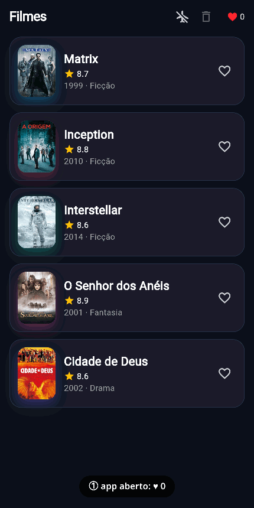
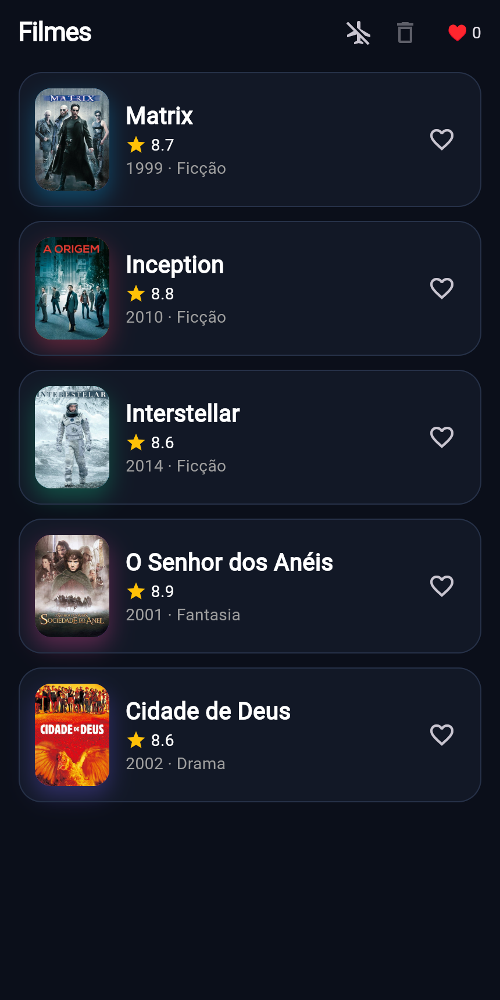
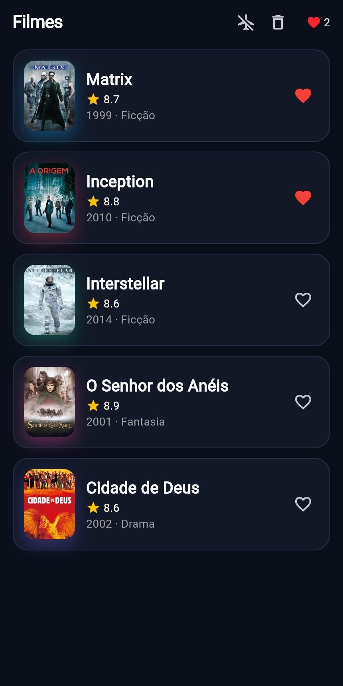
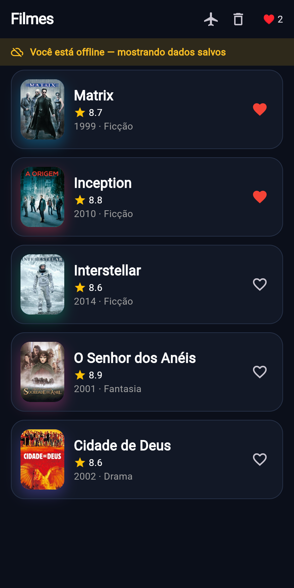

# Atividade 3 — App Flutter: UI + Estado + Firebase + Offline-first

## Identificação

- **Aluno:** Paulo Henrique Nunes Vanderley (GitHub: paulnune)
- **Projeto Firebase:** `cinefav-paulnune` (plano Spark) — documento `favorites/meus-favoritos` no Firestore
- **TASK 8 (Remote Config):** adiada pelo professor, não faz parte desta entrega
- **Bônus (SyncQueue ligada ao `favoritesProvider`):** não implementado (ver [Decisões técnicas](#decisões-técnicas))
- **Repo (meu fork):** https://github.com/paulnune/puc-iec-mobile-multiplataforma — branch `entrega/atividade-3-paulnune`

## Como rodar

```bash
cd exercicios/03-flutter-ui-estado/pratica
flutter pub get
flutter run -d chrome --web-port 5300   # porta FIXA: o cache offline fica no navegador, por porta
```

> Atalhos: **F5** no VS Code (o `.vscode/launch.json` já fixa a porta) ou `./rodar.sh` / `rodar.bat`.
> Dados reais do TMDB (opcional): copie `.env.local.example` → `.env.local`, cole a `TMDB_KEY` e rode `./rodar.sh`. Sem chave o app usa a lista simulada, que é a mesma do `flutter test`.

## Como testar

```bash
flutter analyze   # No issues found!
flutter test      # 32 testes, todos verdes
```

| Suíte | O que cobre | Testes |
|---|---|---|
| `test/app_test.dart` | spec do Ex1 e Ex2 (card, favoritar, limpar) | 3 |
| `test/checklist_test.dart` | checklist de conclusão do professor | 4 |
| `test/offline_test.dart` | spec das TASKs 11–15 (banner, JSON, cache-first, TTL, fila) | 20 |
| `test/favorites_test.dart` | **meu teste autoral** do `favoritesProvider` (Ex3 · TASK 9) | 5 |

```text
$ flutter analyze
No issues found! (ran in 47.1s)

$ flutter test
00:10 +32: All tests passed!
```

> Verificado localmente com Flutter 3.47.7 (Dart 3.13.5).

## O que o app faz

Catálogo de filmes com **favoritos compartilhados**: o coração de cada card, o contador `♥ N` e o botão **limpar** da barra do topo leem e escrevem o mesmo `favoritesProvider` (Riverpod). Os favoritos ficam no **Firestore**: sobrevivem ao F5 e aparecem em outro navegador ou dispositivo. A lista de filmes é **offline-first**. A tela mostra primeiro o cache do aparelho e revalida na API só quando o cache passou do TTL (10 min). Sem rede, um banner avisa e a lista continua vindo do cache. O ✈️ simula o modo avião.

## Evidências

> Capturadas do build web (`flutter build web`) servido na porta 5300, com um Chrome automatizado (Playwright) apontando para o meu Firestore real. As legendas existem só no GIF.

### Firestore: o favorito sobrevive ao F5 (Ex4)



| ① Início (`♥ 0`) | ② Favoritei 2 filmes | ③ Depois do F5 | ④ Outro navegador, zerado |
|---|---|---|---|
|  |  |  |  |

O quadro ④ é um perfil de navegador **novo**, sem `localStorage` e sem IndexedDB. Os 2 favoritos aparecem mesmo assim, então vieram do servidor, não de cache local. O documento no Firestore depois do teste, lido pela API REST:

```json
{
  "name": "projects/cinefav-paulnune/databases/(default)/documents/favorites/meus-favoritos",
  "fields": {
    "ids": {
      "arrayValue": {
        "values": [
          {
            "integerValue": "1"
          },
          {
            "integerValue": "2"
          }
        ]
      }
    }
  },
  "createTime": "2026-10-19T23:48:55.094926Z",
  "updateTime": "2026-10-19T23:50:44.309044Z"
}
```

Também verifiquei, com duas janelas do navegador apontando para o mesmo Firestore:

- **Tempo real:** um favorito feito numa janela aparece na outra em ~0,4 s, sem F5 (`snapshots()`).
- **Escrita offline (TASK 10):** com a rede cortada (`setOffline`), o coração muda na hora (otimista), mas o documento no Firestore **não** muda. Quando a rede volta, a escrita enfileirada pelo SDK chega ao servidor em ~0,9 s, e a outra janela atualiza junto.

### Offline (TASKs 11 e 13)

Com o ✈️ ligado, o banner aparece e a lista continua na tela, vinda do cache:



## Local × cloud × offline-first (trade-offs)

Estado **local** (o `Set<int>` em memória da TASK 2, ou o cache no `SharedPreferences`) é instantâneo e funciona sem rede, mas fica preso ao aparelho: em memória some no F5, e no disco não aparece em outro dispositivo. Estado **cloud** (o documento `favorites/meus-favoritos` no Firestore) resolve isso. Sobrevive a reload, a reinstalação e à troca de aparelho, e sincroniza abas em tempo real. Em troca, depende de rede e de latência: cada leitura é uma ida ao servidor e, sem conexão, a tela ficaria vazia ou presa num spinner. **Offline-first** combina os dois. A tela lê primeiro o que está no aparelho (cache-first, TASK 13). A nuvem continua sendo a fonte de verdade e é reconciliada em segundo plano (stale-while-revalidate), com TTL para não gastar rede à toa (TASK 14). As escritas feitas sem rede entram numa fila que é enviada quando a conexão volta: a `SyncQueue` da TASK 15, ou a fila interna do Firestore ligada na TASK 10. O custo é complexidade. Passa a existir mais de uma cópia do mesmo dado, e é preciso decidir o que é "fresco o bastante" (TTL) e o que fazer quando operações conflitam (mesma ação não duplica, ação oposta cancela). A consistência também passa a ser **eventual**, não imediata. É o trade-off de disponibilidade × consistência dos sistemas distribuídos, só que dentro do celular.

**Por que provider, e não prop drilling.** O coração está dentro de cada card, no `ListView`, e o contador e o "limpar" estão no `AppBar`, ou seja, em ramos diferentes da árvore de widgets. Com prop drilling, o `Set` e os callbacks teriam que descer por `HomeScreen → MovieList → MovieCard`. Isso acopla widgets intermediários que nem usam o dado, e cada mudança redesenharia a árvore inteira. Com o `favoritesProvider`, cada widget assina só o que lê (`ref.watch`). A prova é a TASK 7: a fonte de verdade trocou de memória para Firestore sem mudar uma linha das telas.

## Arquitetura

```
lib/
├── main.dart                    ← Firebase.initializeApp (TASK 3/7) + persistência offline do Firestore (TASK 10)
├── firebase_options.dart        ← config do meu projeto Firebase (TASK 3)
├── models/movie.dart            ← toJson / fromJson (TASK 12)
├── state/
│   ├── favorites.dart           ← favoritesProvider: Notifier<Set<int>> + Firestore (TASKs 2 e 7)
│   ├── movies_provider.dart     ← (pronto) store → API → repositório → tela
│   └── network.dart             ← (pronto) onlineProvider = rede real + ✈️ simulado
├── data/
│   ├── movie_repository.dart    ← cache-first (TASK 13) + TTL (TASK 14)
│   └── sync_queue.dart          ← fila de sincronização: conflitos + flush (TASK 15)
├── screens/home_screen.dart     ← contador ♥ N (TASK 5) + limpar (TASK 6)
└── widgets/
    ├── movie_card.dart          ← card composto (TASK 1) + coração (TASK 4)
    └── offline_banner.dart      ← aviso de offline (TASK 11)
test/
└── favorites_test.dart          ← meu teste do provider (TASK 9)
```

## Decisões técnicas

- **`snapshots()` em vez de um `get()` único (TASK 7).** O listener entrega o valor salvo ao abrir, que é o que sobrevive ao F5, e também as mudanças feitas em outra aba ou dispositivo, em tempo real. Com a persistência offline ligada (TASK 10), o primeiro snapshot sai do cache local do SDK, então os favoritos aparecem até sem rede.
- **Gravar o delta, não a lista inteira.** O `toggle` grava `FieldValue.arrayUnion([id])` / `arrayRemove([id])` com `merge: true`, em vez de `set({'ids': listaInteira})`. Reescrever a lista tem dois problemas de concorrência. Duas abas favoritando ao mesmo tempo se sobrescrevem (*lost update*). E um toque antes do primeiro snapshot chegar apagaria os favoritos já salvos. Com o delta, favoritar filmes diferentes em duas abas ao mesmo tempo dá o mesmo resultado em qualquer ordem: as duas escritas se somam. O `clear()` continua reescrevendo a lista porque "limpar tudo" é, de propósito, *last write wins*.
- **Atualização otimista.** O `state` muda na hora e a gravação vai em segundo plano (`unawaited`). Offline, o Firestore enfileira a escrita e reenvia na volta, então a UI nunca espera a rede.
- **`updateShouldNotify` com `setEquals`.** Quando o snapshot "ecoa" a própria escrita, chega um `Set` novo com o mesmo conteúdo. Esse eco não notifica ninguém, então não há redesenho à toa. Meu teste autoral cobre isso (`clear()` com a lista já vazia não notifica).
- **`ref.watch(favoritesProvider.select(...))` no card.** Cada card só é redesenhado quando o **próprio** filme entra ou sai dos favoritos, não a cada toque em outro card.
- **Sem Firebase, o app não trava.** O `main.dart` envolve o `initializeApp` em `try/catch`, e o provider confere `Firebase.apps.isEmpty`. Sem Firebase, que é o caso do `flutter test`, os favoritos funcionam só em memória, exatamente como na TASK 2. Por isso os testes não dependem de rede nem de mock do Firebase.
- **Cache-first (TASK 13) só engole `OfflineException`.** Falta de rede é esperada e, com cache, a tela segue. Qualquer outro erro (ex.: chave do TMDB inválida) é bug de configuração e precisa aparecer.
- **`SyncQueue` (TASK 15).** As regras de conflito mantêm o invariante "no máximo uma operação pendente por filme". O `flush` persiste a cada sucesso: se o app fechar no meio, o que já foi enviado não é reenviado. No primeiro erro ele para e preserva a ordem do restante.
- **Bônus não implementado, de propósito.** Com `persistenceEnabled: true`, o Firestore **já tem** a própria fila de escritas offline. Ligar a `SyncQueue` aos favoritos criaria duas filas para o mesmo dado. A `SyncQueue` é o mesmo padrão feito à mão, útil quando o backend é uma API REST própria, sem SDK offline.
- **✈️ × offline real.** O ✈️ derruba só a API simulada da lista, enquanto o Firestore continua online. Para ver o Firestore offline: DevTools → Network → **Offline**, com o app já aberto.

## Referência

- Riverpod — [Providers](https://riverpod.dev/docs/concepts2/providers) e [como reduzir rebuilds com `select`](https://riverpod.dev/docs/how_to/select)
- Firebase — [Acesso a dados offline no Firestore](https://firebase.google.com/docs/firestore/manage-data/enable-offline) e [atualizar arrays (`arrayUnion` / `arrayRemove`)](https://firebase.google.com/docs/firestore/manage-data/add-data#update_elements_in_an_array)
- web.dev — [Stale-while-revalidate](https://web.dev/articles/stale-while-revalidate)
