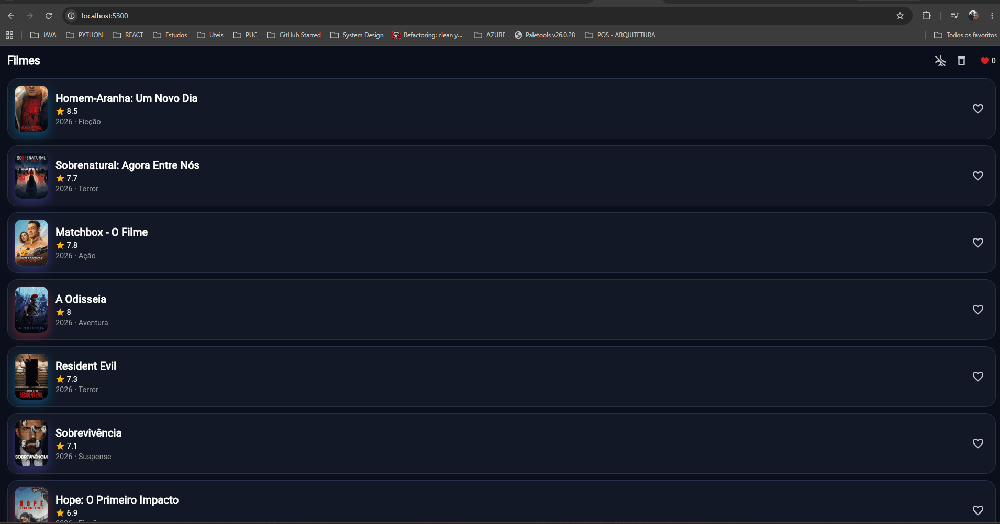

# Filmes (Flutter) — pratica/ da Atividade 3

App de catálogo de filmes em **Flutter**. Já roda; você completa os scaffolds (UI, estado, Firebase e offline-first) até `flutter test` ficar **verde**.

## Rodar
```bash
cd exercicios/03-flutter-ui-estado/pratica   # confirme: ls lib
flutter pub get
flutter run -d chrome --web-port 5300   # PORTA FIXA (o cache offline fica no navegador, por porta)
# 💡 Atalho no VS Code: aperte F5 (o .vscode/launch.json já fixa a porta 5300)
#    ou Ctrl/Cmd+Shift+B (terminal integrado: r = hot reload) · ./rodar.sh (Mac/Linux) · rodar.bat (Windows)
```

## Testar (é o seu checklist)
```bash
flutter test                         # tudo: Ex1–Ex3 (UI/estado) + offline (TASKs 11–15) + checklist
flutter test test/offline_test.dart  # só offline-first — cada grupo = 1 TASK
flutter analyze                      # precisa ficar limpo
```
Comece com os testes **vermelhos**; deixe-os **verdes**. `test/checklist_test.dart` e `test/offline_test.dart` são a **spec** (não edite).

## O que completar (🧑‍🏫 aula · 🧑‍💻 casa)
| TASK | Arquivo | O quê | |
|---|---|---|---|
| 1 | `lib/widgets/movie_card.dart` | compor o card (título + ⭐ nota + ano) | 🧑‍🏫 |
| 2 | `lib/state/favorites.dart` | `favoritesProvider` (`toggle` + `clear`) | 🧑‍🏫 |
| 3 | `lib/main.dart` | projeto Firebase + `flutterfire configure` | 🧑‍🏫 |
| 10 | `lib/main.dart` | persistência offline do Firestore (1 linha) | 🧑‍🏫 fácil |
| 4 | `lib/widgets/movie_card.dart` | coração favoritando (`ConsumerWidget` + `ref`) | 🧑‍💻 |
| 5 | `lib/screens/home_screen.dart` | contador `♥ N` no header | 🧑‍💻 |
| 6 | `lib/screens/home_screen.dart` | botão **limpar** favoritos | 🧑‍💻 |
| 7 | `lib/state/favorites.dart` | persistir favoritos no **Firestore** | 🧑‍💻 médio |
| 8 | `lib/services/remote_config.dart` + home | ⏸ **ADIADA** (Remote Config) — não faz parte desta atividade, pule | — |
| 9 | `test/favorites_test.dart` | **você escreve** um teste do provider | 🧑‍💻 |
| 11 | `lib/widgets/offline_banner.dart` | aviso "você está offline" | 🧑‍💻 fácil |
| 12 | `lib/models/movie.dart` | `toJson` / `fromJson` | 🧑‍💻 fácil |
| 13 | `lib/data/movie_repository.dart` | repositório **cache-first** | 🧑‍💻 médio |
| 14 | `lib/data/movie_repository.dart` | validade do cache (**TTL**) | 🧑‍💻 médio |
| 15 | `lib/data/sync_queue.dart` | **fila de sincronização** (conflitos + flush) | 🧑‍💻 🔴 difícil |

✈️ O botão de **avião** na barra do topo simula o modo offline. Veja o `guia-passo-a-passo.md` e o `enunciado.md` (rubrica).

## Entrega
Fork + PR no repo público; link no Canvas. O **J.A.R.V.I.S.** lê o seu código (estrutural) e posta uma nota **mínima**; a final sai no Canvas.
- ✏️ **Edite os arquivos dentro de `exercicios/03-flutter-ui-estado/pratica/` (no lugar)** — **não crie subpasta** `aluno-.../`.

> **CI no seu fork (opcional):** habilite o *Actions* do fork — o workflow *Flutter test — Atividade 3* roda `flutter analyze` + `flutter test` a cada push.
> **Versões:** precisa de Flutter **3.27+** (o `pubspec` já avisa se for mais antigo).

> **Não comite** `.dart_tool/`, `build/`, `pubspec.lock` (já no `.gitignore`).

## Dados reais do TMDB (opcional)

Sem chave, o app usa a lista simulada (5 filmes). Para filmes reais: copie `.env.local.example` → `.env.local`,
cole sua chave do TMDB (`TMDB_KEY=...`) e rode `./rodar.sh` / `rodar.bat` (ou F5 → "dados reais TMDB").
O `.env.local` não vai pro git. Os testes (`flutter test`) nunca usam a chave.

---

## Entrega — Rodrigo Maia

### Como rodar
```bash
cd exercicios/03-flutter-ui-estado/pratica
flutter pub get
flutter run -d chrome --web-port 5300   # ou ./rodar.sh · F5 no VS Code
flutter analyze                          # No issues found!
flutter test                             # 29 testes, todos verdes
```
Firebase: projeto pessoal `flutter-arq` (plano Spark), configurado com `flutterfire configure` (`lib/firebase_options.dart`).
Os favoritos ficam no documento `favorites/meus-favoritos` do Firestore, no campo `ids`.

### O que foi feito
- **Ex1/Ex2:** `MovieCard` composto (pôster + título + ⭐ nota + ano + ❤️). Card, contador `♥ N` e botão **limpar** usam o **mesmo** `favoritesProvider`.
- **Ex3:** `test/favorites_test.dart` testa o provider isolado com `ProviderContainer`.
- **Ex4 (Firestore):** o `build()` do provider lê o documento; `toggle`/`clear` atualizam o `state` na hora (otimista) e gravam no Firestore.
- **Ex6 (offline-first):** persistência offline do Firestore (T10), banner offline (T11), `toJson`/`fromJson` (T12), repositório cache-first com TTL (T13/T14) e `SyncQueue` com regras de conflito e `flush` em ordem (T15).
- **Bônus:** a `SyncQueue` está ligada ao `favoritesProvider`. Cada `toggle` vira uma `PendingOp`. Com rede, a fila é enviada na hora; sem rede (✈️), ela espera e o `flush` roda quando o `onlineProvider` volta a `true`. Cada operação vira `arrayUnion`/`arrayRemove`, que são idempotentes: reenviar não estraga nada. Favoritar e desfavoritar offline se cancelam e nem chegam ao servidor.

### Prova: o favorito sobrevive ao refresh (Ex4)


### Local × cloud × offline-first (trade-offs)
O estado **local** (o `Notifier` do Riverpod em memória) é o mais simples e instantâneo e funciona sem rede, mas fica preso a uma aba e a um aparelho e se perde no F5. O estado **cloud** (Firestore) resolve isso: os favoritos persistem e aparecem em outra aba ou dispositivo. Em troca, passamos a depender de rede, latência, regras de segurança e cota, e cada leitura pode demorar ou falhar. O **offline-first** junta os dois: a tela sempre lê primeiro o que está no aparelho (cache com TTL, persistência do Firestore) e escreve de forma otimista, guardando as escritas numa fila que sincroniza quando a rede volta. O usuário ganha velocidade e uso sem internet; o custo é complexidade. Passamos a lidar com dados possivelmente velhos (TTL), conflitos (ações opostas se cancelam), falhas no meio do envio (parar no primeiro erro e persistir a cada sucesso) e idempotência (reenviar não pode duplicar).
