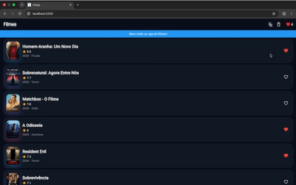
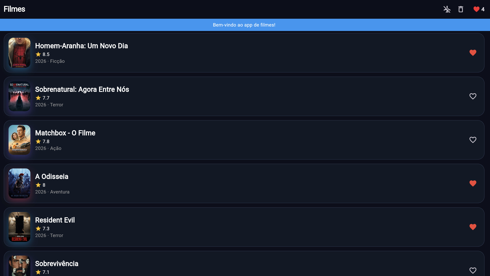

# Filmes (Flutter) — pratica/ da Atividade 3

App de catálogo de filmes em **Flutter**. Já roda; você completa os scaffolds (UI, estado, Firebase e offline-first) até `flutter test` ficar **verde**.

---

## 📦 Entrega — Amir Andrade

Todas as TASKs (1 a 15) estão implementadas: `flutter analyze` sem problemas e `flutter test` com **28 testes verdes**
(Ex1–Ex3, offline-first 11–15 e checklist).

### Como rodar (no meu setup)
```bash
cd exercicios/03-flutter-ui-estado/pratica
flutter pub get
./rodar.sh          # Chrome na porta fixa 5300 (Windows: rodar.bat)
flutter test        # 28 testes
flutter analyze
```
- **Dados reais do TMDB (opcional):** crie `.env.local` a partir do `.env.local.example` com `TMDB_KEY=<sua chave v3>`.
  O `rodar.sh` detecta o arquivo sozinho. No VS Code, use F5 com a configuração **"dados reais TMDB"**.
  Sem a chave, o app usa a lista simulada de 5 filmes.
- **Firebase:** o projeto já vem configurado em `lib/firebase_options.dart`. Para usar um projeto seu, rode
  `flutterfire configure` e, no console do Firebase:
  - crie o **Firestore** com regras que liberem `favorites/meus-favoritos` (ver `enunciado.md`);
  - crie o parâmetro `banner_message` no **Remote Config** e clique em **Publicar alterações**.
- **Cache da lista:** fica no navegador por 10 min (TTL). Para forçar uma busca nova, use DevTools → Application →
  **Clear site data** e dê F5.

### Evidências

**Ex4 · Firestore — favorito sobrevive ao modo avião + F5**
(favorito marcado com o ✈️ ligado; depois do refresh ele continua lá)



**Ex5 · Remote Config — mensagem do banner alterada no console, sem recompilar**


**App rodando** (filmes reais do TMDB, banner do Remote Config, contador ♥ igual aos corações marcados)



### Local × cloud × offline-first (trade-offs)
O estado **local** (o `favoritesProvider` em memória da TASK 2) é o mais simples e rápido: a UI reage na hora e
funciona sem rede, mas vive só naquela execução, naquele aparelho, e some no F5. O estado na **cloud** (Firestore,
TASK 7) resolve isso: os favoritos persistem e sincronizam entre abas e dispositivos. Em troca, ele depende de rede,
adiciona latência e exige configuração (projeto, regras de acesso), e uma regra errada faz o dado sumir sem aviso.
O **offline-first** (TASKs 10 a 15) combina os dois: a tela lê primeiro o que está no aparelho (cache com TTL,
persistência offline do Firestore) e sincroniza quando a rede volta, então o app continua útil sem internet. O preço é
complexidade. É preciso decidir quando o cache está velho (TTL), aceitar mostrar dados desatualizados por um tempo e
resolver conflitos de escritas feitas offline. Por exemplo, favoritar e desfavoritar o mesmo filme sem rede se
cancelam na `SyncQueue`, e se a rede cair no meio do envio o `flush` para e guarda o resto, sem reenviar o que já foi.

---

## Rodar
```bash
cd exercicios/03-flutter-ui-estado/pratica   # confirme: ls lib
flutter pub get
flutter run -d chrome --web-port 5300   # PORTA FIXA (o cache offline fica no navegador, por porta)
# 💡 Atalho no VS Code: aperte F5 (o .vscode/launch.json já fixa a porta 5300)
#    ou Ctrl/Cmd+Shift+B (terminal integrado: r = hot reload) · ./rodar.sh (Mac/Linux) · rodar.bat (Windows)
```

## Testar (é o seu checklist)
```bash
flutter test                         # tudo: Ex1–Ex3 (UI/estado) + offline (TASKs 11–15) + checklist
flutter test test/offline_test.dart  # só offline-first — cada grupo = 1 TASK
flutter analyze                      # precisa ficar limpo
```
Comece com os testes **vermelhos**; deixe-os **verdes**. `test/checklist_test.dart` e `test/offline_test.dart` são a **spec** (não edite).

## O que completar (🧑‍🏫 aula · 🧑‍💻 casa)
| TASK | Arquivo | O quê | |
|---|---|---|---|
| 1 | `lib/widgets/movie_card.dart` | compor o card (título + ⭐ nota + ano) | 🧑‍🏫 |
| 2 | `lib/state/favorites.dart` | `favoritesProvider` (`toggle` + `clear`) | 🧑‍🏫 |
| 3 | `lib/main.dart` | projeto Firebase + `flutterfire configure` | 🧑‍🏫 |
| 10 | `lib/main.dart` | persistência offline do Firestore (1 linha) | 🧑‍🏫 fácil |
| 4 | `lib/widgets/movie_card.dart` | coração favoritando (`ConsumerWidget` + `ref`) | 🧑‍💻 |
| 5 | `lib/screens/home_screen.dart` | contador `♥ N` no header | 🧑‍💻 |
| 6 | `lib/screens/home_screen.dart` | botão **limpar** favoritos | 🧑‍💻 |
| 7 | `lib/state/favorites.dart` | persistir favoritos no **Firestore** | 🧑‍💻 médio |
| 8 | `lib/services/remote_config.dart` + home | banner via **Remote Config** | 🧑‍💻 médio |
| 9 | `test/favorites_test.dart` | **você escreve** um teste do provider | 🧑‍💻 |
| 11 | `lib/widgets/offline_banner.dart` | aviso "você está offline" | 🧑‍💻 fácil |
| 12 | `lib/models/movie.dart` | `toJson` / `fromJson` | 🧑‍💻 fácil |
| 13 | `lib/data/movie_repository.dart` | repositório **cache-first** | 🧑‍💻 médio |
| 14 | `lib/data/movie_repository.dart` | validade do cache (**TTL**) | 🧑‍💻 médio |
| 15 | `lib/data/sync_queue.dart` | **fila de sincronização** (conflitos + flush) | 🧑‍💻 🔴 difícil |

✈️ O botão de **avião** na barra do topo simula o modo offline. Veja o `guia-passo-a-passo.md` e o `enunciado.md` (rubrica).

## Entrega
Fork + PR no repo público; link no Canvas. O **J.A.R.V.I.S.** lê o seu código (estrutural) e posta uma nota **mínima**; a final sai no Canvas.
- ✏️ **Edite os arquivos dentro de `exercicios/03-flutter-ui-estado/pratica/` (no lugar)** — **não crie subpasta** `aluno-.../`.

> **CI no seu fork (opcional):** habilite o *Actions* do fork — o workflow *Flutter test — Atividade 3* roda `flutter analyze` + `flutter test` a cada push.
> **Versões:** precisa de Flutter **3.27+** (o `pubspec` já avisa se for mais antigo).

> **Não comite** `.dart_tool/`, `build/`, `pubspec.lock` (já no `.gitignore`).

## Dados reais do TMDB (opcional)

Sem chave, o app usa a lista simulada (5 filmes). Para filmes reais: copie `.env.local.example` → `.env.local`,
cole sua chave do TMDB (`TMDB_KEY=...`) e rode `./rodar.sh` / `rodar.bat` (ou F5 → "dados reais TMDB").
O `.env.local` não vai pro git. Os testes (`flutter test`) nunca usam a chave.
