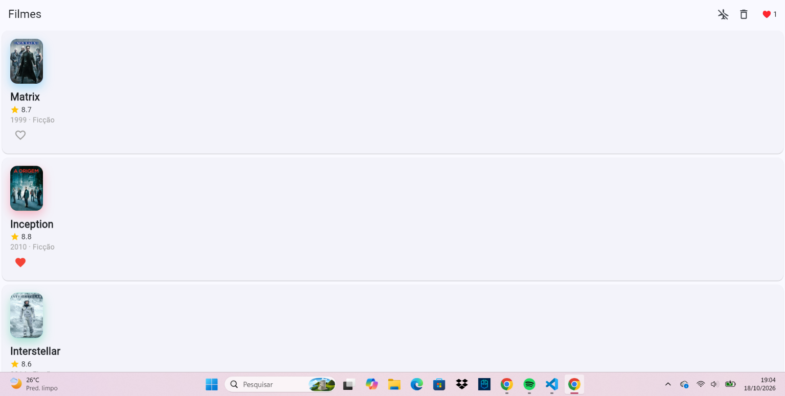
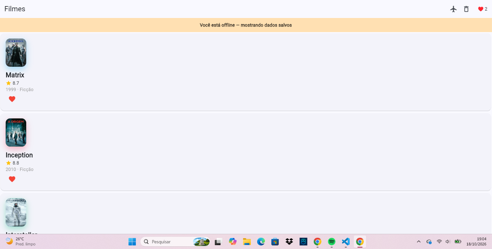

# Filmes (Flutter) — pratica/ da Atividade 3

App de catálogo de filmes em **Flutter**. Já roda; você completa os scaffolds (UI + estado) até `flutter test` ficar verde.

## Rodar
```bash
flutter pub get
flutter run -d chrome   # abre no navegador — sem emulador, sem rede/token
```

## Testar (é o gate da Atividade 3)
```bash
flutter test            # Ex1 (card) · Ex2 (favoritar/limpar) · Ex3 (seu teste) · checklist (auto-verificação)
flutter analyze         # precisa ficar limpo
```
Comece com os testes **vermelhos**; deixe-os **verdes**.

> `test/checklist_test.dart` é sua **auto-verificação** (não edite): tudo verde = você terminou.

## O que completar (🧑‍🏫 aula · 🧑‍💻 casa)
| TASK | Arquivo | O quê | |
|---|---|---|---|
| 1 | `lib/widgets/movie_card.dart` | compor o card (título + ⭐ nota + ano) | 🧑‍🏫 |
| 2 | `lib/state/favorites.dart` | `favoritesProvider` (`toggle` + `clear`) | 🧑‍🏫 |
| 3 | `lib/widgets/movie_card.dart` | coração favoritando (`ConsumerWidget` + `ref`) | 🧑‍💻 |
| 4 | `lib/screens/home_screen.dart` | contador `♥ N` no header | 🧑‍💻 |
| 5 | `lib/screens/home_screen.dart` | botão **limpar** favoritos | 🧑‍💻 |
| 6 | `test/favorites_test.dart` | **você escreve** um teste do provider | 🧑‍💻 |

Veja o `guia-passo-a-passo.md` (na pasta do exercício) e o `enunciado.md` (rubrica).

## Entrega
Fork + PR no repo público; link no Canvas. O **J.A.R.V.I.S.** roda `flutter test` no seu PR.
- ✏️ **Edite os arquivos dentro de `exercicios/03-flutter-ui-estado/pratica/` (no lugar)** — **não crie subpasta** `aluno-.../`. O autograder roda `flutter test` nessa pasta.

> **Não comite** `.dart_tool/`, `build/`, `pubspec.lock` (já no `.gitignore`).


## Estado, local, Cloud e Offline-first:

O estado local com Riverpod permite atualizar a interface rapidamente e compartilhar informações entre widgets sem precisar repassar dados de maneira manual. Entretando, informações salvas somente na memória podem ser perdidas ao reiniciar o aplicativo. O firebase store, permite persistir os favoritos em nuvem e sincronizar-los entre os dispositivos, mas depende de conexão e pode apresentar uma pequena latência. De forma a reduzir essa dependência, a arquitetura offline-first utiliza cache local com validade (TTL) e uma fila de sincronização, permitindo consultar dados salvos, mesmo sem conexão com a internet. Como contrapartida, exige maior cuidado com a resolução de conflitos e a consistência dos dados. 


## Evidências

### Persistência dos favoritos após F5



[Assistir ao vídeo da persistência dos favoritos](../screenshots/persistencia-likes-pos-f5.mp4)

### Funcionamento offline



[Assistir ao vídeo do funcionamento offline](../screenshots/persistencia-offline.mp4)
