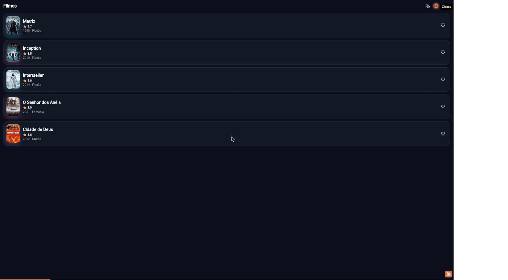

# Filmes (Flutter) — pratica/ da Atividade 3

App de catálogo de filmes em **Flutter**. Já roda; você completa os scaffolds (UI, estado, Firebase e offline-first) até `flutter test` ficar **verde**.

## Rodar
```bash
cd exercicios/03-flutter-ui-estado/pratica   # confirme: ls lib
flutter pub get
flutter run -d chrome --web-port 5300   # PORTA FIXA (o cache offline fica no navegador, por porta)
# 💡 Atalho no VS Code: aperte F5 (o .vscode/launch.json já fixa a porta 5300)
#    ou Ctrl/Cmd+Shift+B (terminal integrado: r = hot reload) · ./rodar.sh (Mac/Linux) · rodar.bat (Windows)
```

## Testar (é o seu checklist)
```bash
flutter test                         # tudo: Ex1–Ex3 (UI/estado) + offline (TASKs 11–15) + checklist
flutter test test/offline_test.dart  # só offline-first — cada grupo = 1 TASK
flutter analyze                      # precisa ficar limpo
```
Comece com os testes **vermelhos**; deixe-os **verdes**. `test/checklist_test.dart` e `test/offline_test.dart` são a **spec** (não edite).

## O que completar (🧑‍🏫 aula · 🧑‍💻 casa)
| TASK | Arquivo | O quê | |
|---|---|---|---|
| 1 | `lib/widgets/movie_card.dart` | compor o card (título + ⭐ nota + ano) | 🧑‍🏫 |
| 2 | `lib/state/favorites.dart` | `favoritesProvider` (`toggle` + `clear`) | 🧑‍🏫 |
| 3 | `lib/main.dart` | projeto Firebase + `flutterfire configure` | 🧑‍🏫 |
| 10 | `lib/main.dart` | persistência offline do Firestore (1 linha) | 🧑‍🏫 fácil |
| 4 | `lib/widgets/movie_card.dart` | coração favoritando (`ConsumerWidget` + `ref`) | 🧑‍💻 |
| 5 | `lib/screens/home_screen.dart` | contador `♥ N` no header | 🧑‍💻 |
| 6 | `lib/screens/home_screen.dart` | botão **limpar** favoritos | 🧑‍💻 |
| 7 | `lib/state/favorites.dart` | persistir favoritos no **Firestore** | 🧑‍💻 médio |
| 8 | `lib/services/remote_config.dart` + home | ⏸ **ADIADA** (Remote Config) — não faz parte desta atividade, pule | — |
| 9 | `test/favorites_test.dart` | **você escreve** um teste do provider | 🧑‍💻 |
| 11 | `lib/widgets/offline_banner.dart` | aviso "você está offline" | 🧑‍💻 fácil |
| 12 | `lib/models/movie.dart` | `toJson` / `fromJson` | 🧑‍💻 fácil |
| 13 | `lib/data/movie_repository.dart` | repositório **cache-first** | 🧑‍💻 médio |
| 14 | `lib/data/movie_repository.dart` | validade do cache (**TTL**) | 🧑‍💻 médio |
| 15 | `lib/data/sync_queue.dart` | **fila de sincronização** (conflitos + flush) | 🧑‍💻 🔴 difícil |

✈️ O botão de **avião** na barra do topo simula o modo offline. Veja o `guia-passo-a-passo.md` e o `enunciado.md` (rubrica).

## Entrega
Fork + PR no repo público; link no Canvas. O **J.A.R.V.I.S.** lê o seu código (estrutural) e posta uma nota **mínima**; a final sai no Canvas.
- ✏️ **Edite os arquivos dentro de `exercicios/03-flutter-ui-estado/pratica/` (no lugar)** — **não crie subpasta** `aluno-.../`.

> **CI no seu fork (opcional):** habilite o *Actions* do fork — o workflow *Flutter test — Atividade 3* roda `flutter analyze` + `flutter test` a cada push.
> **Versões:** precisa de Flutter **3.27+** (o `pubspec` já avisa se for mais antigo).

> **Não comite** `.dart_tool/`, `build/`, `pubspec.lock` (já no `.gitignore`).

## Dados reais do TMDB (opcional)

Sem chave, o app usa a lista simulada (5 filmes). Para filmes reais: copie `.env.local.example` → `.env.local`,
cole sua chave do TMDB (`TMDB_KEY=...`) e rode `./rodar.sh` / `rodar.bat` (ou F5 → "dados reais TMDB").
O `.env.local` não vai pro git. Os testes (`flutter test`) nunca usam a chave.

---

## Entrega — José Ricardo Ciola Bricio (1669938)

### Como rodar
```bash
cd exercicios/03-flutter-ui-estado/pratica
flutter pub get
flutter run -d web-server --web-port 5300   # abra http://localhost:5300 (ou: flutter run -d chrome --web-port 5300)
flutter test                                # 32 testes verdes (app, checklist, favorites, offline)
flutter analyze                             # sem issues
```
O `lib/firebase_options.dart` aponta para o meu projeto Firebase (`filmes-flutter-atv3`, plano Spark), com Firestore em modo teste.
A porta fixa (`5300`) importa: o cache offline e a fila ficam no armazenamento do navegador, que é separado por porta.

### O que foi feito
| Ex / TASK | Arquivo | Implementação |
|---|---|---|
| Ex1 · T1 | `widgets/movie_card.dart` | `Card` → `Row` com `PosterArt` + `Column` (título, ⭐ nota, ano) |
| Ex2 · T2, T4–T6 | `state/favorites.dart`, `movie_card.dart`, `home_screen.dart` | `favoritesProvider` (`Notifier<Set<int>>`) como fonte única: coração do card, contador `♥ N` e botão limpar, sem prop drilling |
| Ex3 · T9 | `test/favorites_test.dart` | 5 testes com `ProviderContainer` (vazio, toggle, toggle de novo, vários ids, clear, imutabilidade) |
| Ex4 · T3, T7 | `main.dart`, `state/favorites.dart` | favoritos no documento `favorites/meus-favoritos`; UI otimista (muda na hora) e gravação em paralelo |
| T10 | `main.dart` | `Settings(persistenceEnabled: true)`: escritas feitas offline sincronizam sozinhas na volta |
| T11 | `widgets/offline_banner.dart` | aviso "Você está offline — mostrando dados salvos" observando `onlineProvider` |
| T12 | `models/movie.dart` | `toJson`/`fromJson` (rating inteiro vira `double`; `posterPath` preservado quando existe) |
| T13 | `data/movie_repository.dart` | `watchMovies` cache-first: emite o cache na hora, revalida na API e grava o fresco; offline segue com o cache, sem cache o erro sobe |
| T14 | `data/movie_repository.dart` | `cacheStatus` (none/fresh/stale) pelo `ttl` e relógio injetável; cache fresco não gasta rede |
| T15 | `data/sync_queue.dart` | conflitos (ação repetida é ignorada, ações opostas se cancelam) e `flush` em ordem, persistindo a cada sucesso e parando no 1º erro |

O autograder estrutural (rodado localmente) dá **12/12** na parte automática.

### Estado local × cloud × offline-first
O estado **local** (o `Set<int>` em memória do TASK 2) é instantâneo, funciona sem rede e não depende de nada externo, mas morre no reload e fica preso a uma aba/dispositivo. O estado **na nuvem** (Firestore) sobrevive ao F5 e sincroniza entre abas e dispositivos, porém passa a depender de rede, adiciona latência e cria novos modos de falha (offline, regras de acesso, cota). O **offline-first** combina os dois: a tela lê primeiro o que está no aparelho (cache com TTL) e só depois revalida na rede, e as escritas feitas sem conexão vão para uma fila que sincroniza na volta. O custo é complexidade: é preciso decidir quando o cache ainda vale, o que fazer quando duas ações se contradizem (favoritar e desfavoritar offline se cancelam) e como não perder nem reenviar operações se a rede cair no meio do envio.

### Prova do Firestore funcionando
Zera os favoritos, marca **Matrix** e **Interstellar** (`♥ 2`), recarrega a página (F5) e os dois continuam favoritados — o estado veio do documento `favorites/meus-favoritos` no Firestore:


