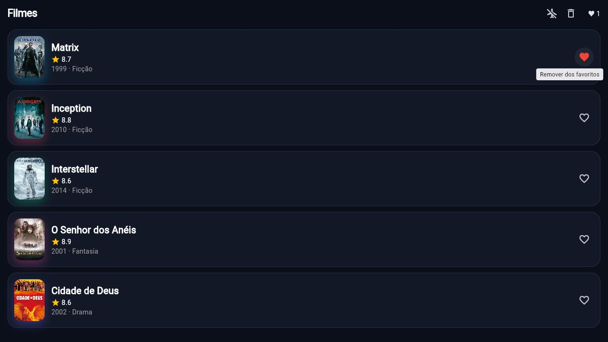
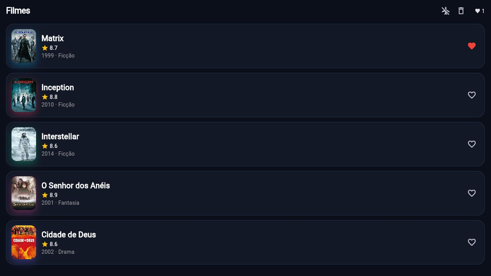

# Atividade 3 - Filmes em Flutter

Catálogo com cards, favoritos compartilhados (Riverpod), Firestore e cache offline.
A TASK 8 (Remote Config) foi adiada e não foi alterada.

## Executar

Validado com Flutter 3.35.7 e Dart 3.9.2.

```sh
cd exercicios/03-flutter-ui-estado/pratica
flutter pub get
flutter run -d chrome --web-port 5300
```

A porta fixa preserva o armazenamento do navegador. Abra primeiro online para
preencher o cache e use o botão de avião para simular a falta de rede.
Sem cache e sem conexão, o app informa que ainda não há dados salvos.

## Firebase

Projeto pessoal: `filmes-aula-3`, plano Spark gratuito. O app Web está configurado
em `lib/firebase_options.dart`. A persistência offline do Firestore está habilitada
em `lib/main.dart`. O documento `favorites/meus-favoritos` guarda `ids`, uma lista
de inteiros. Snapshots sincronizam o provider entre abas; adições e remoções usam
transformações atômicas para preservar alterações de outras abas. A UI reage
imediatamente. Nos testes sem Firebase inicializado, o provider fica em memória.

As regras permitem ler e gravar somente esse documento, conforme o enunciado;
os demais caminhos ficam bloqueados. O documento é público e contém apenas IDs
de filmes. Essa configuração didática não serve para dados pessoais.

## Testar

```sh
flutter analyze
flutter test --reporter expanded
```

Resultado: análise sem problemas e 28 testes aprovados. Os testes fornecidos em
`app_test.dart`, `checklist_test.dart` e `offline_test.dart` foram preservados.
O teste autoral em `favorites_test.dart` verifica o estado inicialmente vazio,
a inclusão e remoção com toggle, e a limpeza de dois favoritos.

O repositório emite o cache primeiro. Cache com menos de 10 minutos evita nova
consulta; cache vencido é exibido e revalidado. Sem rede, preserva o cache existente;
sem cache, propaga o erro. A serialização também preserva o pôster opcional.
A fila não duplica ações iguais, cancela ações opostas e envia em ordem, persistindo
a remoção após cada sucesso. No primeiro erro, mantém as operações restantes.
A SyncQueue é testada isoladamente; os favoritos usam a fila offline do Firestore.
A ligação da fila própria ao provider é bônus e não foi incluída.

## Evidências

Matrix foi favoritado e a página foi recarregada completamente. O coração e o
contador foram mantidos após o refresh.

Antes do refresh:



Depois do refresh:



Modo avião simulado com banner e lista do cache:


## Local, cloud e offline-first: trade-offs

O estado local em memória reage imediatamente e funciona sem internet, mas se perde
ao recarregar o app e não é compartilhado entre dispositivos. O Firestore persiste
os favoritos e sincroniza dispositivos e abas, com custos de latência, limites de
uso e necessidade de regras de acesso. A abordagem offline-first combina resposta
rápida com persistência: mostra primeiro o cache do aparelho e sincroniza quando a
rede permite. Em contrapartida, exige controlar validade dos dados (TTL), conflitos,
filas e falhas parciais; enquanto a sincronização não ocorre, os dados locais e
remotos podem divergir temporariamente.

## Entrega

Enviar as alterações desta pasta em um fork e Pull Request no repositório da
disciplina e colar o link no Canvas. As imagens acima documentam a execução local.
