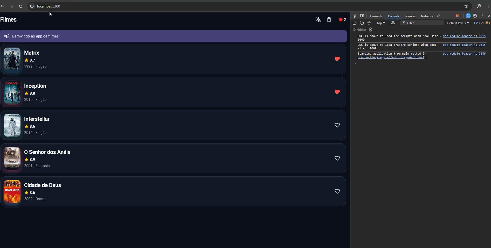
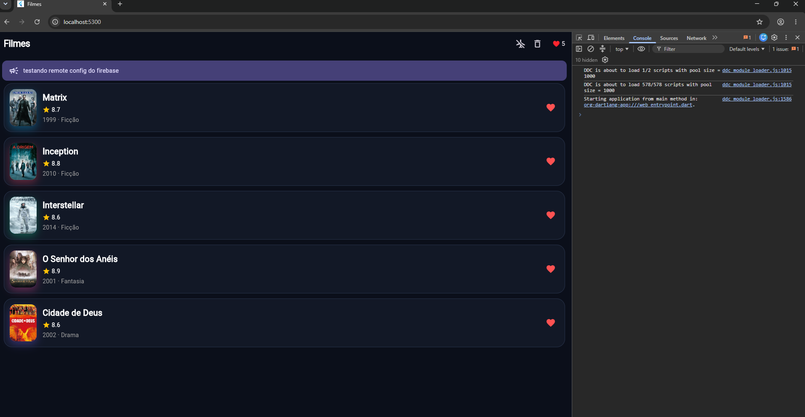
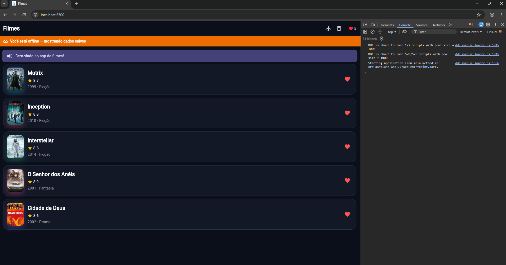

# Filmes (Flutter) — pratica/ da Atividade 3

App de catálogo de filmes em **Flutter**. Já roda; você completa os scaffolds (UI, estado, Firebase e offline-first) até `flutter test` ficar **verde**.

## Entrega — João Pedro Correia Barros

**Como rodar**
```bash
cd exercicios/03-flutter-ui-estado/pratica
flutter pub get
flutter run -d chrome --web-port 5300   # porta fixa: o cache offline fica no navegador, por porta
flutter test                            # 30 testes verdes (Ex1–Ex3 + offline TASKs 11–15 + checklist)
flutter analyze                         # sem issues
```

**O que foi feito**
- **Ex1/Ex2** — `MovieCard` composto (pôster, título, ⭐ nota, ano) e favoritos com Riverpod (`favoritesProvider`): o coração do card, o contador `♥ N` e o botão limpar leem/escrevem o mesmo provider.
- **Ex3** — `test/favorites_test.dart`: toggle/clear, imutabilidade do `Set` e notificação de quem escuta.
- **Ex4** — o `favoritesProvider` lê e grava o documento `favorites/meus-favoritos` no Firestore (atualização otimista: a UI muda na hora, a gravação vai em paralelo).
- **Ex5** — `fetchBannerMessage()` busca `banner_message` no Remote Config e o banner aparece no topo da `HomeScreen` (cai no texto padrão se offline).
- **Ex6** — banner offline, `toJson`/`fromJson`, repositório *cache-first* com TTL (cache fresco não chama a API) e `SyncQueue` com cancelamento de ações opostas e `flush` em ordem que persiste a cada sucesso e para no 1º erro.

**Local × cloud × offline-first.** O estado **local** (Riverpod em memória) é instantâneo e funciona sem rede, mas vive preso a uma aba/aparelho e morre no reload. O estado **cloud** (Firestore) persiste e sincroniza entre abas e dispositivos, mas cada leitura depende de rede, tem latência, custo e regras de acesso — sem conexão, um app "só cloud" fica vazio. O **offline-first** combina os dois: a tela lê sempre o que está no aparelho (cache com TTL) e a rede vira um detalhe de sincronização — atualiza quando dá, e escritas feitas offline vão para uma fila que é enviada na volta. O preço é complexidade: decidir quando o cache está velho, aceitar que o usuário pode ver dado desatualizado e resolver conflitos (ex.: favoritar e desfavoritar offline se cancelam em vez de gerar duas escritas).

**Prova do Firestore** — favoritos gravados em `favorites/meus-favoritos` sobrevivem ao refresh (F5):



**Prova do Remote Config** — `banner_message` alterado e publicado no console do Firebase; o banner mostra o novo texto após o refresh, sem recompilar:



**Offline** — modo avião ✈️ ligado: banner de offline + lista vinda do cache local:



## Rodar
```bash
cd exercicios/03-flutter-ui-estado/pratica   # confirme: ls lib
flutter pub get
flutter run -d chrome --web-port 5300   # PORTA FIXA (o cache offline fica no navegador, por porta)
# 💡 Atalho no VS Code: aperte F5 (o .vscode/launch.json já fixa a porta 5300)
#    ou Ctrl/Cmd+Shift+B (terminal integrado: r = hot reload) · ./rodar.sh (Mac/Linux) · rodar.bat (Windows)
```

## Testar (é o seu checklist)
```bash
flutter test                         # tudo: Ex1–Ex3 (UI/estado) + offline (TASKs 11–15) + checklist
flutter test test/offline_test.dart  # só offline-first — cada grupo = 1 TASK
flutter analyze                      # precisa ficar limpo
```
Comece com os testes **vermelhos**; deixe-os **verdes**. `test/checklist_test.dart` e `test/offline_test.dart` são a **spec** (não edite).

## O que completar (🧑‍🏫 aula · 🧑‍💻 casa)
| TASK | Arquivo | O quê | |
|---|---|---|---|
| 1 | `lib/widgets/movie_card.dart` | compor o card (título + ⭐ nota + ano) | 🧑‍🏫 |
| 2 | `lib/state/favorites.dart` | `favoritesProvider` (`toggle` + `clear`) | 🧑‍🏫 |
| 3 | `lib/main.dart` | projeto Firebase + `flutterfire configure` | 🧑‍🏫 |
| 10 | `lib/main.dart` | persistência offline do Firestore (1 linha) | 🧑‍🏫 fácil |
| 4 | `lib/widgets/movie_card.dart` | coração favoritando (`ConsumerWidget` + `ref`) | 🧑‍💻 |
| 5 | `lib/screens/home_screen.dart` | contador `♥ N` no header | 🧑‍💻 |
| 6 | `lib/screens/home_screen.dart` | botão **limpar** favoritos | 🧑‍💻 |
| 7 | `lib/state/favorites.dart` | persistir favoritos no **Firestore** | 🧑‍💻 médio |
| 8 | `lib/services/remote_config.dart` + home | banner via **Remote Config** | 🧑‍💻 médio |
| 9 | `test/favorites_test.dart` | **você escreve** um teste do provider | 🧑‍💻 |
| 11 | `lib/widgets/offline_banner.dart` | aviso "você está offline" | 🧑‍💻 fácil |
| 12 | `lib/models/movie.dart` | `toJson` / `fromJson` | 🧑‍💻 fácil |
| 13 | `lib/data/movie_repository.dart` | repositório **cache-first** | 🧑‍💻 médio |
| 14 | `lib/data/movie_repository.dart` | validade do cache (**TTL**) | 🧑‍💻 médio |
| 15 | `lib/data/sync_queue.dart` | **fila de sincronização** (conflitos + flush) | 🧑‍💻 🔴 difícil |

✈️ O botão de **avião** na barra do topo simula o modo offline. Veja o `guia-passo-a-passo.md` e o `enunciado.md` (rubrica).

## Entrega
Fork + PR no repo público; link no Canvas. O **J.A.R.V.I.S.** lê o seu código (estrutural) e posta uma nota **mínima**; a final sai no Canvas.
- ✏️ **Edite os arquivos dentro de `exercicios/03-flutter-ui-estado/pratica/` (no lugar)** — **não crie subpasta** `aluno-.../`.

> **CI no seu fork (opcional):** habilite o *Actions* do fork — o workflow *Flutter test — Atividade 3* roda `flutter analyze` + `flutter test` a cada push.
> **Versões:** precisa de Flutter **3.27+** (o `pubspec` já avisa se for mais antigo).

> **Não comite** `.dart_tool/`, `build/`, `pubspec.lock` (já no `.gitignore`).

## Dados reais do TMDB (opcional)

Sem chave, o app usa a lista simulada (5 filmes). Para filmes reais: copie `.env.local.example` → `.env.local`,
cole sua chave do TMDB (`TMDB_KEY=...`) e rode `./rodar.sh` / `rodar.bat` (ou F5 → "dados reais TMDB").
O `.env.local` não vai pro git. Os testes (`flutter test`) nunca usam a chave.
