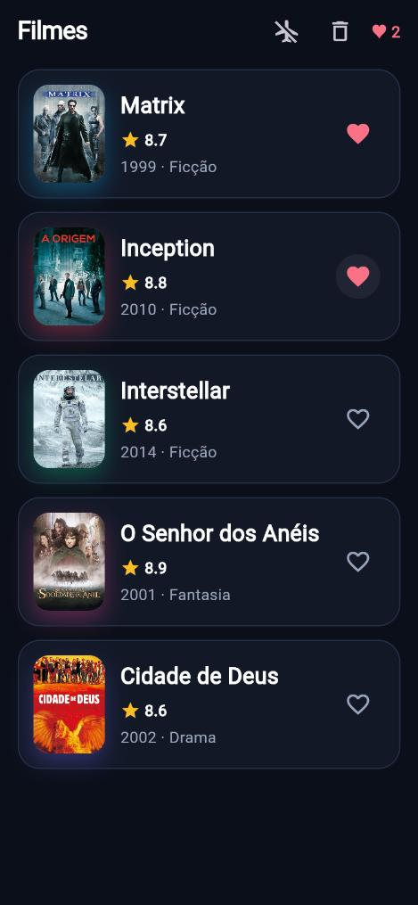

# CineFav (Flutter): Atividade 3

**Aluno:** Sesaque Cruz

Catálogo de filmes em Flutter com estado compartilhado em Riverpod, favoritos sincronizados no Firestore e arquitetura offline-first (cache com TTL, banner de conexão e fila de sincronização).

## Como rodar

Requer Flutter 3.27 ou mais novo (testado com 3.35.7).

```bash
cd exercicios/03-flutter-ui-estado/pratica
flutter pub get
flutter run -d chrome --web-port 5300   # porta fixa: o cache offline fica no navegador, por porta
```

Verificação:

```bash
flutter analyze   # sem issues
flutter test      # 36 testes verdes
```

O app usa o projeto Firebase pessoal `cinefav-atividade3` (plano Spark), configurado em `lib/firebase_options.dart`. As regras do Firestore liberam apenas o documento `favorites/meus-favoritos`. Dados reais do TMDB são opcionais: crie `.env.local` a partir de `.env.local.example` e rode `./rodar.sh`.

## Evidências

| Favoritos antes do F5 | Depois do F5 (vieram do Firestore) | Offline (✈️ ligado) |
|---|---|---|
|  |  |  |

## O que foi implementado

| TASK | Entrega |
|---|---|
| 1 | `MovieCard` com pôster, título, nota (⭐) e ano |
| 2, 4, 5, 6 | `favoritesProvider` único lido pelo card, pelo contador `♥ N` e pelo botão limpar |
| 3, 7 | Firebase inicializado no `main.dart`; favoritos gravados e observados em tempo real no Firestore |
| 9 | `test/favorites_test.dart`: toggle, clear e imutabilidade do estado com `ProviderContainer` |
| 10 | Persistência offline do Firestore ligada no web |
| 11 | `OfflineBanner` visível só sem conexão |
| 12 | `Movie.toJson` / `Movie.fromJson`, incluindo `posterPath` e rating inteiro |
| 13, 14 | Repositório cache-first: emite o cache, revalida na API e não busca enquanto o cache está fresco |
| 15 | `SyncQueue`: no máximo uma operação por filme (mesma ação não duplica, ação oposta cancela) e `flush` em ordem, persistindo a cada envio e parando no primeiro erro |

A TASK 8 (Remote Config) foi adiada pelo professor e não faz parte desta entrega.

## Decisões técnicas

- **Firestore em tempo real:** em vez de ler o documento uma vez no `build()`, o provider observa `snapshots()`. Isso evita a corrida em que uma leitura atrasada sobrescreve um toque feito logo após abrir o app, e propaga a mudança para outras abas e aparelhos sem recarregar.
- **Atualização otimista:** `toggle` e `clear` atualizam o estado na hora e gravam no Firestore em segundo plano. Falhas de gravação aparecem no console (`permission-denied` indica regras erradas).
- **Firestore injetável:** o `firestoreProvider` devolve `null` quando o Firebase não foi inicializado, então os testes de UI rodam só em memória e `test/favorites_firestore_test.dart` valida a sincronização com um Firestore falso (`fake_cloud_firestore`).

## Local vs cloud vs offline-first

Estado **local** (o `Set<int>` do Riverpod) é instantâneo e não depende de rede, mas morre no F5 e fica preso a um aparelho. Estado **cloud** (Firestore) sobrevive ao reload e sincroniza entre abas e aparelhos, mas cada leitura e escrita depende de rede e tem latência, e sem conexão o usuário fica sem dados. **Offline-first** combina os dois: a tela sempre lê primeiro o que está no aparelho (cache da lista, cache local do Firestore) e trata a rede como sincronização em segundo plano, com TTL para não buscar à toa e fila para reenviar escritas feitas offline. O custo é complexidade: o app passa a conviver com dados possivelmente desatualizados e precisa de regras de conflito, como as da `SyncQueue`, para decidir o que vale quando a rede volta.
