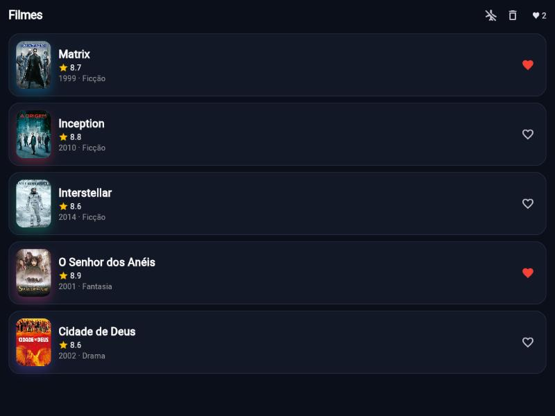
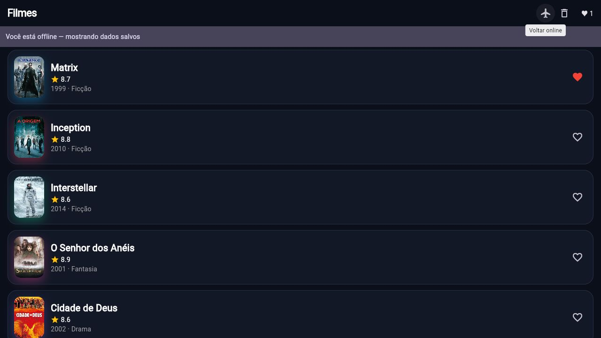

# Entrega da Atividade 3 · Pedro Correa

- **Aluno:** Pedro Correa
- **Repo (fork):** https://github.com/PedroAC18/puc-iec-mobile-multiplataforma
- **Ambiente:** Flutter 3.35.7 · Dart 3.9.2 (mesma versão do CI do professor)
- **Firebase:** projeto `projeto-mobile-multiplataforma` (plano Spark), config em `lib/firebase_options.dart`

## Como rodar

```bash
cd exercicios/03-flutter-ui-estado/pratica
flutter pub get
flutter run -d chrome --web-port 5300   # porta fixa: o cache offline do navegador é por porta
```

Testes e análise:

```bash
flutter test      # 29 testes, todos verdes
flutter analyze   # No issues found!
```

O Firestore usa o documento `favorites/meus-favoritos`. Regras publicadas no console:

```
rules_version = '2';
service cloud.firestore {
  match /databases/{database}/documents {
    match /favorites/meus-favoritos { allow read, write: if true; }
  }
}
```

## O que foi feito

| TASK | Arquivo | O que fiz |
|---|---|---|
| 1 · 4 | `widgets/movie_card.dart` | `ConsumerWidget` com pôster, título, ⭐ nota, ano e o coração que chama `toggle` |
| 2 · 7 | `state/favorites.dart` | `Notifier<Set<int>>` com `toggle`/`clear`, sincronizado com o Firestore |
| 5 · 6 | `screens/home_screen.dart` | contador `♥ N` e botão limpar, lendo o mesmo provider do card |
| 9 | `test/favorites_test.dart` | 2 testes com `ProviderContainer`: toggle/clear e imutabilidade do `Set` |
| 3 · 10 | `main.dart` + `firebase_options.dart` | `Firebase.initializeApp` e `persistenceEnabled: true` |
| 11 | `widgets/offline_banner.dart` | aviso quando `onlineProvider` é `false` |
| 12 | `models/movie.dart` | `toJson`/`fromJson`, com `rating` inteiro virando `double` |
| 13 · 14 | `data/movie_repository.dart` | cache-first com TTL: emite o cache, para se estiver fresco, revalida se estiver velho |
| 15 | `data/sync_queue.dart` | conflitos no `enqueue` e `flush` em ordem, persistindo a cada envio |

A TASK 8 (Remote Config) foi adiada pelo professor e ficou como estava.

Pontos em que saí do modelo comentado:

- **Leitura com `snapshots()` em vez de `.get()`.** O provider ouve o documento. Com duas abas abertas, favoritar numa atualiza a outra sem F5.
- **Escrita com `arrayUnion`/`arrayRemove`.** Gravar a lista inteira com `.set` deixa uma aba apagar o favorito que a outra acabou de salvar. Mexendo só no id, isso não acontece.
- **`Firebase.initializeApp` dentro de `try/catch`.** Se o Firebase falhar, o app abre do mesmo jeito, com favoritos só em memória.
- **`watchMovies` engole qualquer erro quando há cache**, não só `OfflineException`. Um timeout ou um 500 do TMDB também não tira da tela a lista que o usuário já está vendo. Sem cache, o erro sobe e a tela mostra "sem dados".
- **`posterPath` entra no JSON quando existe**, para o pôster real do TMDB aparecer offline.

## Local, cloud e offline-first

Estado local, o `Set<int>` do TASK 2, é o mais simples e o mais rápido. A UI muda no mesmo frame do toque e nada depende de rede. O problema é que ele morre no F5 e fica preso a uma aba de um aparelho. Estado na nuvem resolve isso. Com o Firestore o favorito sobrevive ao reload e aparece em outra aba sozinho. Em troca, cada mudança passa a depender de rede e de latência, e a fonte de verdade sai do meu controle. Uma regra errada no console vira um `permission-denied` silencioso e o favorito some no F5. Offline-first junta as duas coisas. A tela sempre lê primeiro o que está no aparelho, seja o cache da lista com TTL ou o cache do Firestore no IndexedDB, e a rede só atualiza quando dá. O preço é complexidade, porque agora existem duas cópias do dado e alguém precisa decidir o que vale quando elas discordam. É o trabalho da `SyncQueue`. Favoritar e desfavoritar offline se cancelam, e o `flush` para no primeiro erro sem perder a ordem. Para favoritos de filmes eu fico com offline-first em cima do Firestore. É dado pequeno, conflito é raro e "vale a última intenção do usuário" basta. Num app de estoque ou de pagamento essa regra seria perigosa e eu não a usaria.

O provider também evitou prop drilling. Card, contador e botão limpar leem e escrevem o mesmo `favoritesProvider`. A `HomeScreen` não repassa nada para o `MovieCard`. Quando troquei a memória pelo Firestore no TASK 7, nenhum desses widgets mudou.

## Prints

**Favoritos sobrevivendo ao F5.** Favoritei Matrix e O Senhor dos Anéis e recarreguei a página. Os dois continuam marcados e o contador continua em ♥ 2.

| Antes do F5 | Depois do F5 |
|---|---|
|  |  |

O cache local do Firestore (TASK 10) também faria os favoritos voltarem depois do F5, mesmo sem nada no servidor. Por isso conferi o documento direto na API REST do Firestore, que respondeu com os ids 1 (Matrix) e 4 (O Senhor dos Anéis):

```json
"fields": { "ids": { "arrayValue": { "values": [
  { "integerValue": "1" },
  { "integerValue": "4" }
] } } }
```

**Offline.** Com o modo avião ligado aparece o banner, e a lista e os favoritos continuam na tela.



---

# Filmes (Flutter) — pratica/ da Atividade 3

App de catálogo de filmes em **Flutter**. Já roda; você completa os scaffolds (UI, estado, Firebase e offline-first) até `flutter test` ficar **verde**.

## Rodar
```bash
cd exercicios/03-flutter-ui-estado/pratica   # confirme: ls lib
flutter pub get
flutter run -d chrome --web-port 5300   # PORTA FIXA (o cache offline fica no navegador, por porta)
# 💡 Atalho no VS Code: aperte F5 (o .vscode/launch.json já fixa a porta 5300)
#    ou Ctrl/Cmd+Shift+B (terminal integrado: r = hot reload) · ./rodar.sh (Mac/Linux) · rodar.bat (Windows)
```

## Testar (é o seu checklist)
```bash
flutter test                         # tudo: Ex1–Ex3 (UI/estado) + offline (TASKs 11–15) + checklist
flutter test test/offline_test.dart  # só offline-first — cada grupo = 1 TASK
flutter analyze                      # precisa ficar limpo
```
Comece com os testes **vermelhos**; deixe-os **verdes**. `test/checklist_test.dart` e `test/offline_test.dart` são a **spec** (não edite).

## O que completar (🧑‍🏫 aula · 🧑‍💻 casa)
| TASK | Arquivo | O quê | |
|---|---|---|---|
| 1 | `lib/widgets/movie_card.dart` | compor o card (título + ⭐ nota + ano) | 🧑‍🏫 |
| 2 | `lib/state/favorites.dart` | `favoritesProvider` (`toggle` + `clear`) | 🧑‍🏫 |
| 3 | `lib/main.dart` | projeto Firebase + `flutterfire configure` | 🧑‍🏫 |
| 10 | `lib/main.dart` | persistência offline do Firestore (1 linha) | 🧑‍🏫 fácil |
| 4 | `lib/widgets/movie_card.dart` | coração favoritando (`ConsumerWidget` + `ref`) | 🧑‍💻 |
| 5 | `lib/screens/home_screen.dart` | contador `♥ N` no header | 🧑‍💻 |
| 6 | `lib/screens/home_screen.dart` | botão **limpar** favoritos | 🧑‍💻 |
| 7 | `lib/state/favorites.dart` | persistir favoritos no **Firestore** | 🧑‍💻 médio |
| 8 | `lib/services/remote_config.dart` + home | ⏸ **ADIADA** (Remote Config) — não faz parte desta atividade, pule | — |
| 9 | `test/favorites_test.dart` | **você escreve** um teste do provider | 🧑‍💻 |
| 11 | `lib/widgets/offline_banner.dart` | aviso "você está offline" | 🧑‍💻 fácil |
| 12 | `lib/models/movie.dart` | `toJson` / `fromJson` | 🧑‍💻 fácil |
| 13 | `lib/data/movie_repository.dart` | repositório **cache-first** | 🧑‍💻 médio |
| 14 | `lib/data/movie_repository.dart` | validade do cache (**TTL**) | 🧑‍💻 médio |
| 15 | `lib/data/sync_queue.dart` | **fila de sincronização** (conflitos + flush) | 🧑‍💻 🔴 difícil |

✈️ O botão de **avião** na barra do topo simula o modo offline. Veja o `guia-passo-a-passo.md` e o `enunciado.md` (rubrica).

## Entrega
Fork + PR no repo público; link no Canvas. O **J.A.R.V.I.S.** lê o seu código (estrutural) e posta uma nota **mínima**; a final sai no Canvas.
- ✏️ **Edite os arquivos dentro de `exercicios/03-flutter-ui-estado/pratica/` (no lugar)** — **não crie subpasta** `aluno-.../`.

> **CI no seu fork (opcional):** habilite o *Actions* do fork — o workflow *Flutter test — Atividade 3* roda `flutter analyze` + `flutter test` a cada push.
> **Versões:** precisa de Flutter **3.27+** (o `pubspec` já avisa se for mais antigo).

> **Não comite** `.dart_tool/`, `build/`, `pubspec.lock` (já no `.gitignore`).

## Dados reais do TMDB (opcional)

Sem chave, o app usa a lista simulada (5 filmes). Para filmes reais: copie `.env.local.example` → `.env.local`,
cole sua chave do TMDB (`TMDB_KEY=...`) e rode `./rodar.sh` / `rodar.bat` (ou F5 → "dados reais TMDB").
O `.env.local` não vai pro git. Os testes (`flutter test`) nunca usam a chave.
