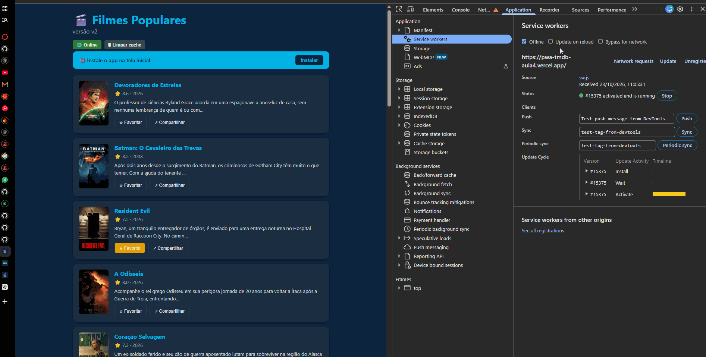
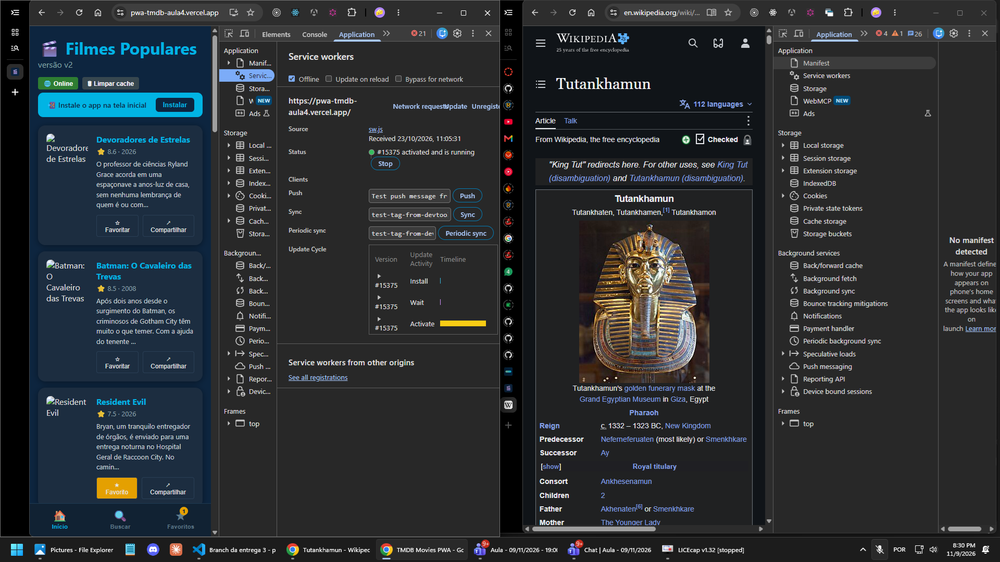
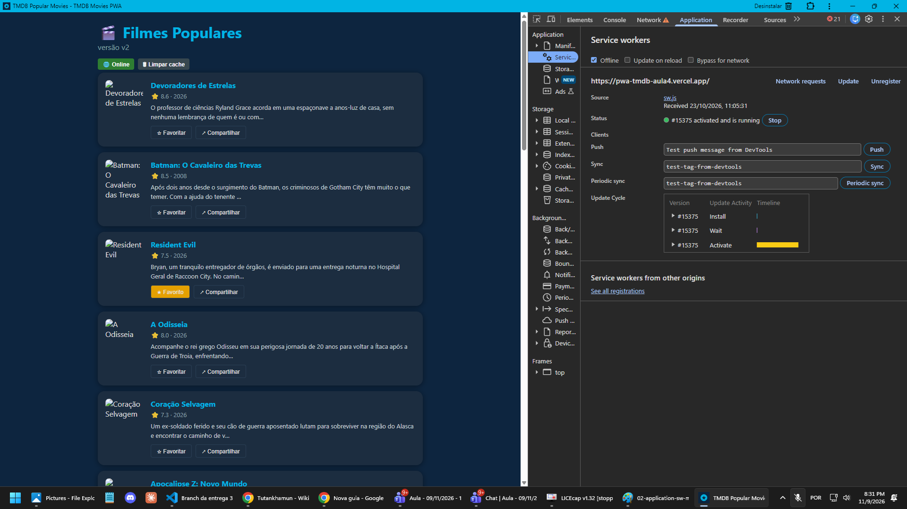
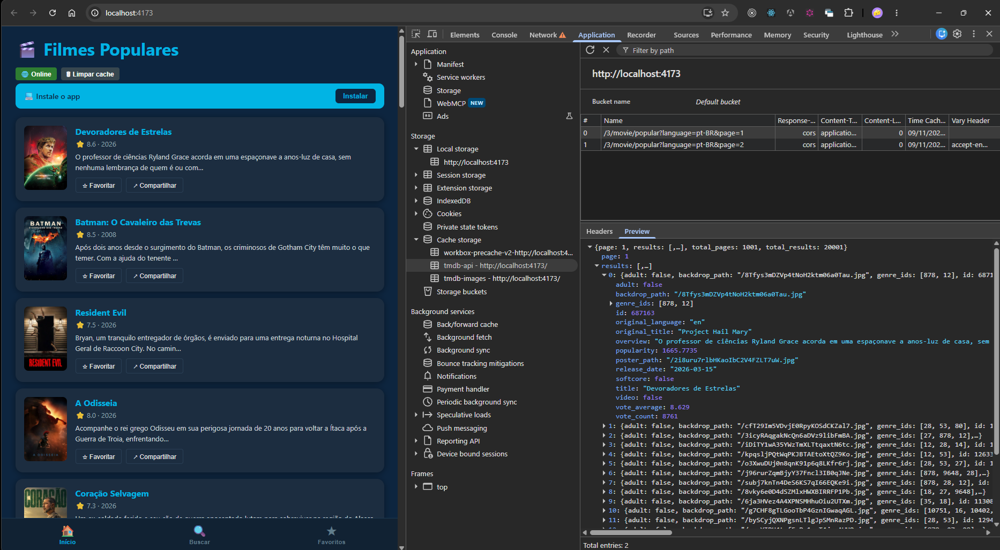
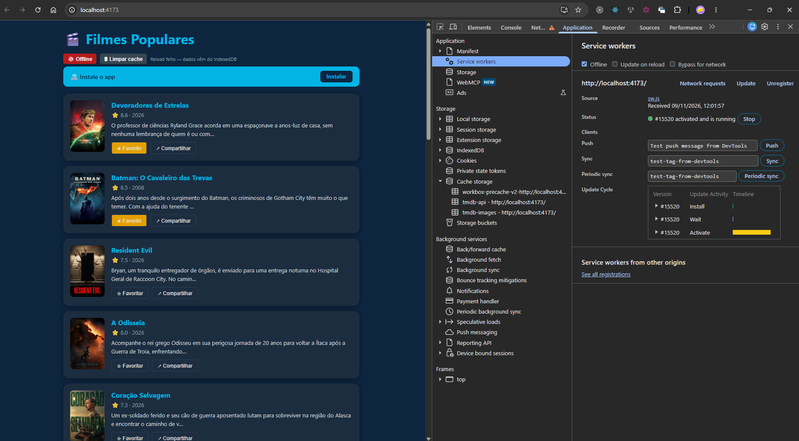
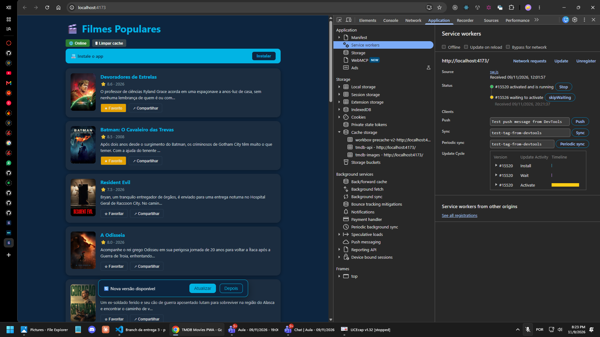
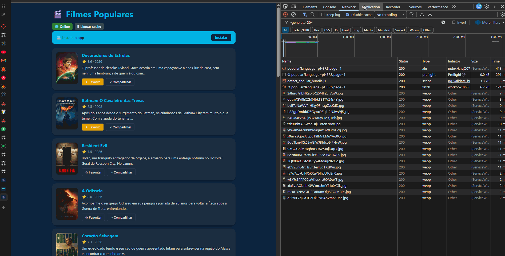

# ENTREGA — Atividade 4 (PWA)

> Preencha e faça commit junto com o código. Esta parte vale 3 pts (avaliação manual no Canvas).

**Nome:** João Pedro Correia Barros · **GitHub:** joaobarros1

---

## 1. Site comum × PWA — o que EU vi (3 diferenças)

Abra `https://pwa-tmdb-aula4.vercel.app` e compare com um site comum (ex.: themoviedb.org). Modo avião → recarregar; fechar e reabrir; instalar.

| # | Site comum (Wikipedia) | PWA (pwa-tmdb-aula4) | Print/evidência |
|---|---|---|---|
| 1 | Em modo avião, recarregar mostra a página de erro do navegador ("Sem internet"). | Em modo avião (DevTools → Offline), recarregar abre o app normalmente: o shell vem do precache do Service Worker e a lista vem do cache/IndexedDB. |  |
| 2 | DevTools → Application → Manifest: **"No manifest detected"** — não é instalável. | O Service Worker aparece *activated and running* e o app tem Manifest (nome, ícones, `display: standalone`) e o banner "Instale o app na tela inicial". |  |
| 3 | Só abre como aba do navegador, com barra de endereço. | Dá para **instalar**: vira um app com ícone próprio, abre em janela *standalone* (sem barra de endereço, com opção "Desinstalar") e reabre direto pelo ícone. |  |

## 2. Prova do offline no SEU build

- [x] Print do **DevTools → Application → Cache Storage** com `tmdb-api` e `tmdb-images` (com itens) — [evidencias/04-cache-storage.png](evidencias/04-cache-storage.png)
- [x] Print do app em **modo avião** carregando a lista — [evidencias/05-app-offline.png](evidencias/05-app-offline.png)
- [x] Print do aviso **"Nova versão disponível"** — [evidencias/06-nova-versao.png](evidencias/06-nova-versao.png)

Extra — DevTools → Network: os pôsteres (`image.tmdb.org`) são servidos pelo **(ServiceWorker)**, vindos do cache `tmdb-images` (regra CacheFirst):

**O que foi implementado:** `runtimeCaching` com duas regras — API (`api.themoviedb.org`) em **NetworkFirst** (timeout de 3 s, `tmdb-api`, 50 entradas / 1 dia) e pôsteres (`image.tmdb.org`, outro host) em **CacheFirst** (`tmdb-images`, 200 entradas / 7 dias, `cacheableResponse` com status `0` porque a `` cross-origin sem CORS chega como resposta opaca). Atualização com `registerType: 'prompt'` + `UpdatePrompt` ("App pronto para uso offline" e "Nova versão disponível" com **Atualizar** / **Depois**). Aba Favoritos com lista, estado vazio e banner offline via `useOfflineStatus`.

## 3. Reflexão (5–8 linhas)

Para um app de **checkout** eu escolheria **`prompt`**: com `autoUpdate` o Service Worker novo assume e a página recarrega sozinha, o que pode acontecer no meio do pagamento — perdendo o formulário preenchido ou, pior, misturando o JS antigo com uma API que já mudou e gerando um pedido inconsistente. Com `prompt` o usuário termina a compra e atualiza quando quiser. O risco do `prompt` é o usuário clicar "Depois" para sempre e ficar numa versão velha (com bug ou incompatível com o backend) — por isso vale forçar a atualização quando a versão for crítica, ou atualizar na próxima abertura. Para um app de **notícias** eu escolheria **`autoUpdate`**: o conteúdo é só leitura, não há estado importante a perder, e o usuário quer ver sempre a versão mais recente sem ser interrompido por avisos. O que pode dar errado é um reload acontecer no meio da leitura de uma matéria (perde a posição de rolagem) ou um deploy com bug chegar a todo mundo de uma vez, sem chance de "ficar na versão anterior".

## 4. Declaração de uso de IA

Sim. Usei o **Claude Code** (assistente de programação no VS Code) para implementar os TODOs 1–5 e redigir este arquivo. Revisei o código, rodei `npm test`, `npm run build` e o validador do `grader/` (12/12 no piso automático), e fiz eu mesmo os testes manuais no navegador (Cache Storage, modo avião, instalação e "Nova versão disponível") que geraram os prints em `evidencias/`.
