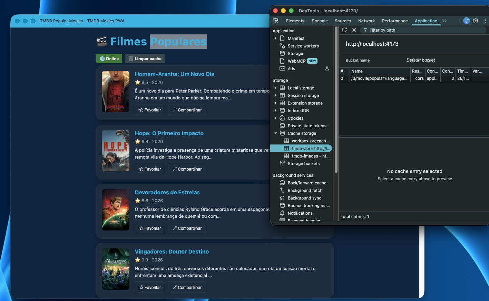
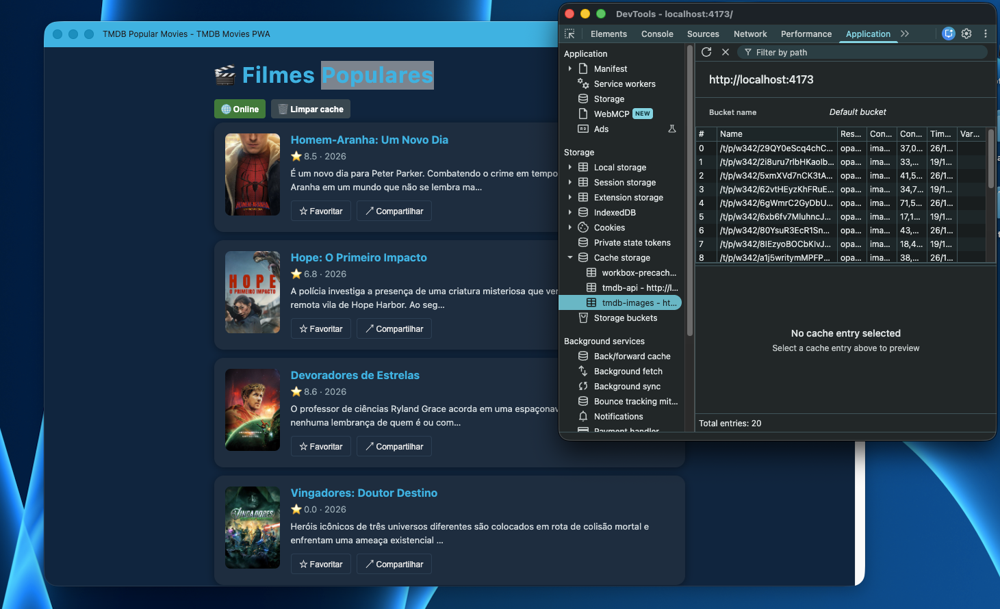
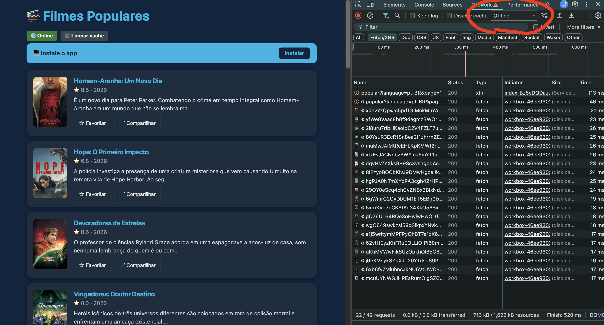
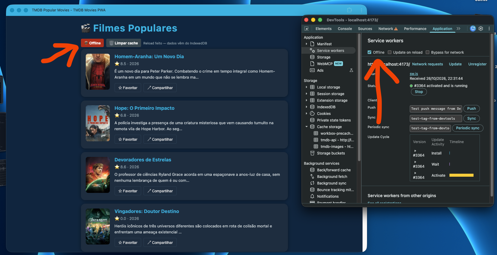
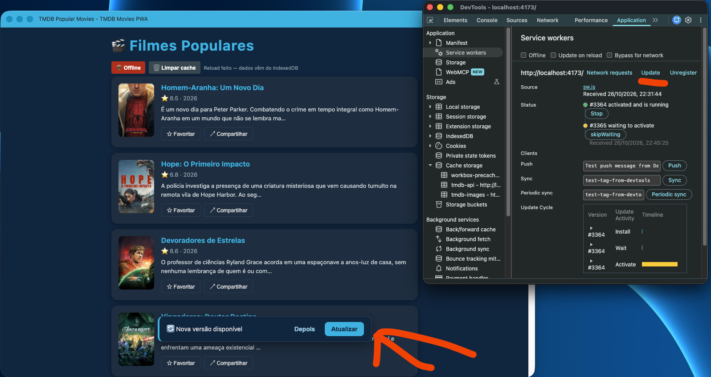
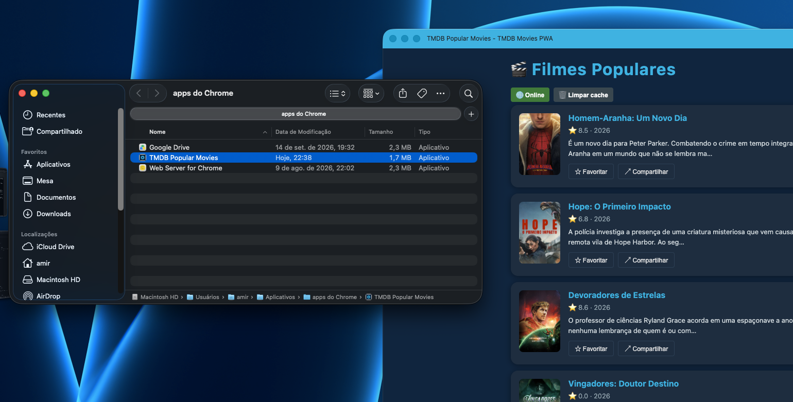

# ENTREGA — Atividade 4 (PWA)

> Preencha e faça commit junto com o código. Esta parte vale 3 pts (avaliação manual no Canvas).

**Nome:** Amir Andrade · **GitHub:** roymas100

---

## 1. Site comum × PWA — o que EU vi (3 diferenças)

Abra `https://pwa-tmdb-aula4.vercel.app` e compare com um site comum (ex.: themoviedb.org). Modo avião → recarregar; fechar e reabrir; instalar.

| # | Site comum | PWA | Print/evidência |
|---|---|---|---|
| 1 | Em modo avião o site não abre | No modo avião o site abre | [modo-aviao.png](evidencias/modo-aviao.png), [modo-aviao-offline.png](evidencias/modo-aviao-offline.png) |
| 2 | Usado somente como site | pode ser instalado no computador ou celular | [pode-ser-instalado.png](evidencias/pode-ser-instalado.png) |
| 3 | Por não ter Service Worker, ao recarregar, já pega a versão nova automaticamente, sem perguntar ao usuário | Com o Service Worker, a versão nova fica esperando e o usuário decide quando atualizar, clicando em "Atualizar" | [nova-versao-prova.png](evidencias/nova-versao-prova.png) |

## 2. Prova do offline no SEU build

- [x] Print do **DevTools → Application → Cache Storage** com `tmdb-api` e `tmdb-images` (com itens)
- [x] Print do app em **modo avião** carregando a lista
- [x] Print do aviso **"Nova versão disponível"** (ou explique por que não conseguiu reproduzir)

**Cache Storage — `tmdb-api`** (resposta de `/3/movie/popular` guardada pela regra NetworkFirst):

**Cache Storage — `tmdb-images`** (20 pôsteres de `image.tmdb.org`, respostas opacas aceitas via `cacheableResponse`):

**Modo offline — Network em "Offline"**: a lista carrega e as requisições são atendidas pelo Service Worker (coluna Size = *disk cache*):

**Modo offline — app instalado**, Service Worker em "Offline", badge 📡 Offline e lista vinda do cache/IndexedDB:

**Aviso "Nova versão disponível"** — SW #3365 *waiting to activate* após `npm run build` + Update:

**App instalado** (aparece em *Aplicativos → apps do Chrome* e abre em janela própria):

## 3. Reflexão (5–8 linhas)

`autoUpdate` × `prompt`: qual você escolheria para um app de **checkout** e para um app de **notícias**, e por quê? O que pode dar errado em cada escolha?

Em um app de checkout eu escolheria o metodo prompt, porque caso houvesse um carregamento automatico do app quando tivesse uma atualização seria muito ruim para a UX da aplicacao que o usuario perdesse todo o progresso do formulario a fazer o checkout.

E para o app de noticias, um autoIpdate faz mais sentido pois a ideia é manter o usuário o mais atualizado possível da ultima noticia ou atualização. Se fosse prompt neste caso, o usuario estaria apertando em atualizar a pagina quase o tempo inteiro.

## 4. Declaração de uso de IA

Usei IA? Onde e como? (uso transparente é incentivado)

Descobri com a IA que estava fazendo atividade com a lib desatualizada.
Descobri tambem que estava o token errado para a API de filmes. Eu estava usando o token curto quando era o longo.
Fui aconselhado pela IA para não usar o skeleton loading nos favoritos para nao dar a impressão de tela piscando.
Utilizei a IA para me guiar para a configuração do vitest.config.ts
Pedi para a IA estilizar a implementacao dos alertas no UpdatePrompt.tsx