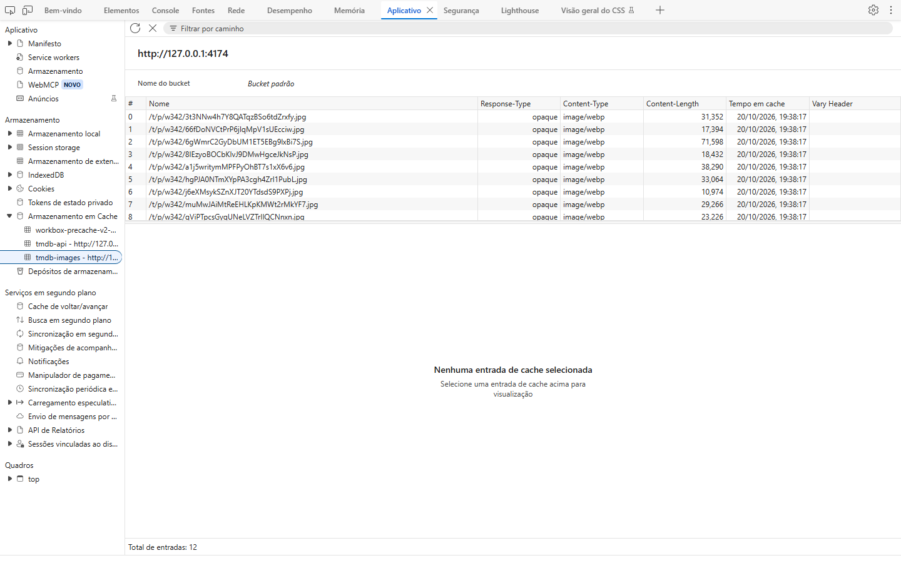
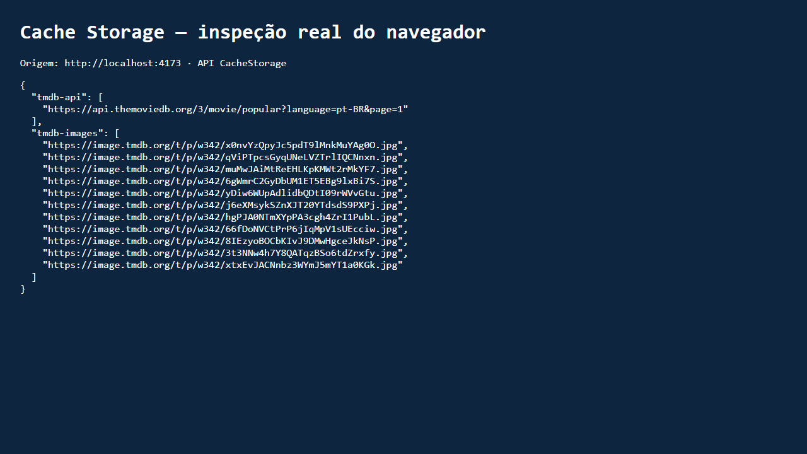
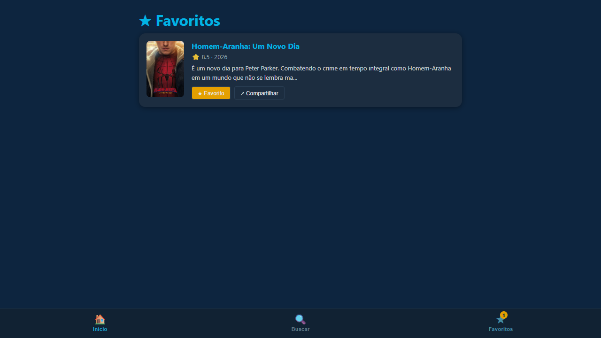
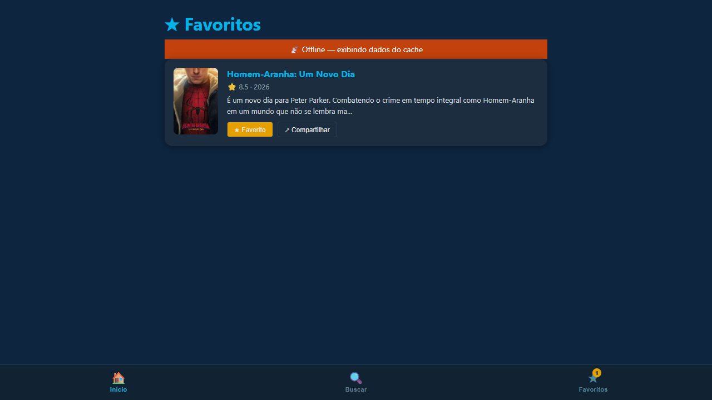

# ENTREGA — Atividade 4 (PWA)

**Nome:** Rafael Corrêa Zart · **GitHub:** 1665760

## 1. Site comum × PWA — comparação observada

A comparação foi executada no Edge por automação, usando o site simples
https://example.com e a PWA https://pwa-tmdb-aula4.vercel.app indicada no enunciado.
O registro bruto está em [comparacao.json](evidencias/comparacao.json).

| # | Site comum | PWA do professor | Evidência |
|---|---|---|---|
| 1 | Não registra Service Worker (0 registros). | Registra um Service Worker. | [Registro da inspeção](evidencias/comparacao.json) |
| 2 | Recarregar com a conexão desligada falhou. | Recarregar com a conexão desligada continuou funcionando. | [Site offline](evidencias/site-comum-offline.png) · [PWA offline](evidencias/pwa-professor-offline.png) |
| 3 | Não apresenta Web App Manifest. | Apresenta manifest com display standalone, permitindo abertura como aplicativo quando instalado. | [Registro da inspeção](evidencias/comparacao.json) |

A instalação no sistema operacional não foi automatizada: a terceira diferença
comprova a configuração do manifest, e não uma instalação realizada.
Capturas online: [site comum](evidencias/site-comum-online.png) e
[PWA do professor](evidencias/pwa-professor-online.png).

## 2. Prova do offline no meu build

As capturas foram obtidas no build de produção local, com dados reais do TMDB,
em Edge headless. Não foram inseridos filmes falsos nem simulada a resposta da API.

- O Service Worker fica ativo após o primeiro carregamento e um reload online.
- Os caches tmdb-api e tmdb-images contêm respostas e pôsteres reais.
- Um filme foi favoritado, a conexão foi desligada pelo contexto do navegador e
  a página foi recarregada. O favorito e seu pôster permaneceram visíveis.
- Ao reconectar, o banner sumiu. Ao remover o último favorito, surgiu a mensagem
  de estado vazio.
- Para verificar a atualização, o teste alterou temporariamente o arquivo gerado
  dist/sw.js, solicitou registration.update(), confirmou o aviso e clicou em
  Atualizar. O arquivo original foi restaurado ao final.

### Cache Storage






A captura acima é uma visualização dos dados reais lidos pela API CacheStorage,
não uma reprodução gráfica do DevTools.
As URLs completas estão em [cache-storage.json](evidencias/cache-storage.json).

### Favoritos online e após reload offline





### Nova versão disponível


## 3. Reflexão — autoUpdate × prompt

Para um checkout, escolheria prompt para o usuário concluir a compra antes de atualizar.
Uma recarga automática pode interromper o preenchimento e perder estado que não foi salvo.
O aviso permite adiar a atualização e evita interromper uma etapa importante.
Para notícias, autoUpdate pode ser adequado quando a leitura é simples e o estado é preservado.
Assim, correções e mudanças chegam sem exigir que cada leitor confirme.
Mesmo em notícias, uma atualização abrupta pode perder a posição de leitura ou um comentário.
Usaria prompt se houver formulários ou conteúdo em edição, e planejaria a persistência desses dados.

## 4. Declaração de uso de IA

Usei o Codex para implementar as tarefas, investigar a navegação no desktop,
escrever testes, executar a validação e coletar as capturas de navegador desta entrega.
Também auxiliou na comparação automatizada e na redação deste documento.
O funcionamento inicial de favoritos, mensagens vazias e banner foi conferido
manualmente pelo aluno no navegador.

## 5. Reproduzir a validação

Validação final: 20 testes unitários, 10 testes no navegador e build de produção
aprovados. O validador estrutural atual atribuiu 12/12 pontos automáticos;
os outros 3 pontos dependem da avaliação manual deste documento.

Na pasta pratica, com VITE_TMDB_TOKEN em .env.local:

```powershell
npm.cmd ci
npm.cmd test
npm.cmd run build
$env:PLAYWRIGHT_CHANNEL = 'msedge'
npm.cmd run test:e2e -- --workers=1
```

Sem a variável PLAYWRIGHT_CHANNEL, o Playwright usa seu Chromium padrão.
Os testes de navegador acessam o TMDB real e precisam de rede durante a preparação;
uma falha externa de conexão não equivale a uma falha do cache offline.
As rotas e dados de testes unitários são isolados da API real.
