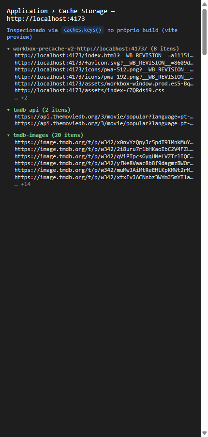
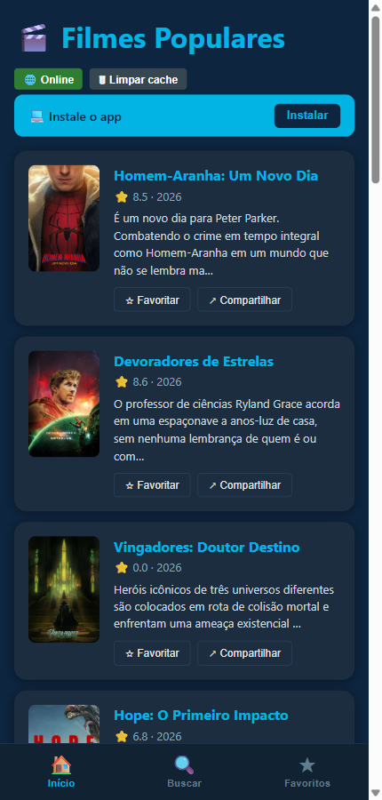
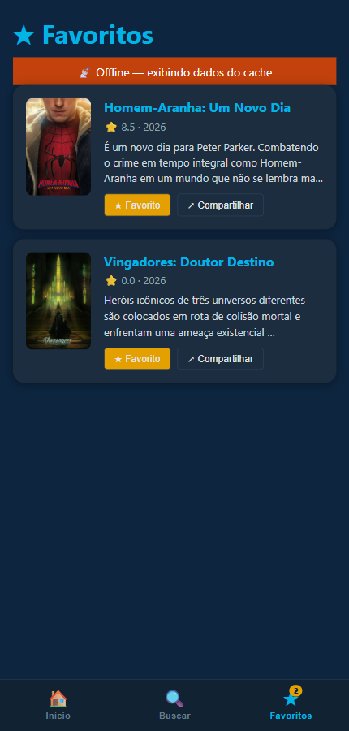

# ENTREGA — Atividade 4 (PWA)

> Preencha e faça commit junto com o código. Esta parte vale 3 pts (avaliação manual no Canvas).

**Nome:** Lucas Gabriel Lisboa · **GitHub:** (https://github.com/lucaszlisboa)

---

## 1. Site comum × PWA — o que EU vi (3 diferenças)

Comparei o app da aula (`https://pwa-tmdb-aula4.vercel.app`) com o site do The Movie Database (`https://www.themoviedb.org`), abrindo os dois no tamanho de tela de um celular e desligando a internet do navegador.

| # | Site comum | PWA | Print/evidência |
|---|---|---|---|
| 1 | **Sem internet:** ao recarregar, a página simplesmente não abre e aparece a tela de erro do navegador dizendo que não há conexão. | **Sem internet:** o app abre normalmente e continua mostrando a lista de filmes, porque ele guardou uma cópia do conteúdo da última vez que foi usado. | [06-site-comum-offline](evidencias/06-site-comum-offline.png) · [08-pwa-aula-offline](evidencias/08-pwa-aula-offline.png) |
| 2 | **Instalar:** é só um site comum. No máximo dá para criar um atalho, que continua abrindo uma aba do navegador e depende da internet. | **Instalar:** o próprio app mostra um botão "Instalar". Depois de instalado, ele ganha ícone e abre em uma janela própria, sem a barra do navegador, como um aplicativo de celular. | [07-pwa-aula-online](evidencias/07-pwa-aula-online.png) · [01-app-online-offline-ready](evidencias/01-app-online-offline-ready.png) |
| 3 | **Fechar e reabrir:** toda vez que abre, baixa tudo de novo. Quando o site muda, a versão nova aparece sem aviso. | **Fechar e reabrir:** abre rápido porque já tem o conteúdo guardado e lembra dos meus filmes favoritos, mesmo sem internet. Quando sai uma versão nova, o app avisa "Nova versão disponível" e eu escolho a hora de atualizar. | [05-favoritos-offline](evidencias/05-favoritos-offline.png) · [04-nova-versao](evidencias/04-nova-versao.png) |

## 2. Prova do offline no SEU build

Build próprio rodando com `npm run build && npm run preview` em `http://localhost:4173`.

- [x] Print do **Cache Storage** com `tmdb-api` e `tmdb-images` (com itens): `tmdb-api` com 2 respostas (`/movie/popular` páginas 1 e 2), `tmdb-images` com 20 pôsteres de `image.tmdb.org` e o `workbox-precache` com 8 arquivos.
  
- [x] Print do app em **modo avião** carregando a lista (rede do navegador desligada, `navigator.onLine = false`, 20 cards carregados após o reload):
  
  Banner do TODO 5 na aba Favoritos, offline:
  
- [x] Print do aviso **"Nova versão disponível"**: simulei um novo deploy alterando o `dist/sw.js` (o navegador compara o arquivo byte a byte), chamei `registration.update()` e o novo SW ficou em *waiting*, disparando o `needRefresh` do `useRegisterSW`. Depois restaurei o `sw.js` original.
  

Evidência extra: aviso "App pronto para uso offline" (`offlineReady`) na primeira visita: [01-app-online-offline-ready](evidencias/01-app-online-offline-ready.png).

## 3. Reflexão (5–8 linhas)

Para um app de **checkout** eu escolheria `prompt`: trocar o JS no meio de um pagamento pode recarregar a página, perder o carrinho/estado do formulário ou misturar a versão antiga do front com uma API já alterada, então o usuário (ou o próprio app, num momento seguro, como depois de concluir o pedido) decide quando atualizar. O risco do `prompt` é o usuário ignorar o aviso e ficar dias numa versão velha, inclusive com bug ou incompatível com o backend, por isso a API precisa ser retrocompatível. Para um app de **notícias** eu escolheria `autoUpdate`: o conteúdo muda o tempo todo, não há transação crítica em andamento e ter sempre a versão mais nova vale mais que o incômodo de um reload. O risco do `autoUpdate` é recarregar enquanto a pessoa lê ou digita um comentário (perda de posição/texto) e, se sair uma versão com bug, ela chega a todos imediatamente.

## 4. Declaração de uso de IA

Sim. Usei o Claude (Anthropic) para executar o app no navegador via Playwright (build em `localhost:4173`), gerar os prints da pasta `evidencias/` (cache, modo offline simulado pelo navegador, aviso de nova versão simulando um novo `sw.js`) e redigir um rascunho desta entrega, que revisei. O print do Cache Storage foi gerado listando `caches.keys()` na própria página, e não pela aba Application do DevTools.
