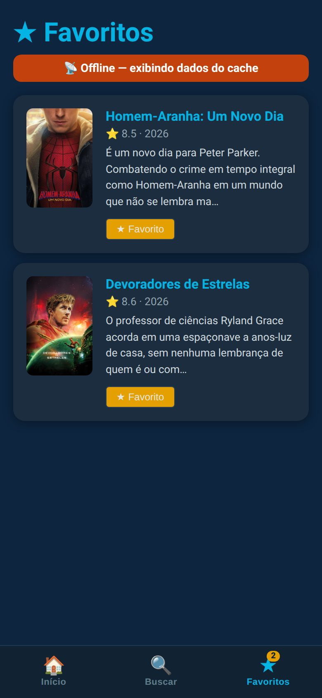

# ENTREGA: Atividade 4 (PWA)

**Nome:** Sesaque Cruz · **GitHub:** sesaquecruz

As evidências foram coletadas no Google Chrome com viewport de celular (390 x 844). O modo avião foi simulado com o offline do próprio navegador, o mesmo do DevTools → Network → Offline.

---

## 1. Site comum × PWA: o que eu vi (3 diferenças)

Comparei o PWA do professor (`https://pwa-tmdb-aula4.vercel.app`) com o site oficial do TMDB (`https://www.themoviedb.org`), abrindo cada um online, recarregando uma vez e depois recarregando sem rede.

| # | Site comum (themoviedb.org) | PWA (pwa-tmdb-aula4) | Print/evidência |
|---|---|---|---|
| 1 | Recarregar sem rede mostra a página de erro do Chrome (`ERR_INTERNET_DISCONNECTED`) | Recarregar sem rede abre o app com a lista de filmes | [08-site-comum-offline](evidencias/08-site-comum-offline.jpg) × [07-pwa-professor-offline](evidencias/07-pwa-professor-offline.jpg) |
| 2 | Nenhum Service Worker registrado e nenhum cache no Cache Storage | 1 Service Worker ativo e a página inicial servida do Cache Storage | `navigator.serviceWorker.getRegistrations()` e `caches.match('/')` no console: site 0 SW e sem cache; PWA 1 SW e página em cache |
| 3 | Também tem manifest com `display: standalone` e o Chrome o considera instalável, mas instalado continua dependendo da rede para abrir | Instalável e, por ter Service Worker e cache, o app instalado abre mesmo sem rede | `Page.getInstallabilityErrors` (Chrome DevTools Protocol) vazio para os dois; diferença aparece no item 1 |

A diferença 3 foi a que mais me surpreendeu: o manifest sozinho deixa o site "instalável", mas é o Service Worker com cache que faz o app instalado funcionar como app de verdade quando a rede cai.

## 2. Prova do offline no MEU build

Build de produção (`npm run build && npm run preview`, http://localhost:4173).

- [x] **Cache Storage** com `tmdb-api` e `tmdb-images` preenchidos, lido no navegador com `caches.keys()` após navegar pela lista:

  | Cache | Itens | Exemplo |
  |---|---|---|
  | `tmdb-api` | 3 | `https://api.themoviedb.org/3/movie/popular?language=pt-BR&page=1` |
  | `tmdb-images` | 49 | `https://image.tmdb.org/t/p/w342/...jpg` (respostas opacas, status 0) |
  | `workbox-precache-v2-...` | 8 | `index.html`, JS, CSS e ícones do app shell |

- [x] **App em modo avião carregando a lista:** 20 filmes e 20 pôsteres vindos do cache, com o banner de offline ([03-offline-lista](evidencias/03-offline-lista.jpg)). Na aba Favoritos, os 2 favoritos e o banner ([04-offline-favoritos](evidencias/04-offline-favoritos.jpg)).
- [x] **Aviso "Nova versão disponível":** com o app aberto, mudei o título do cabeçalho, gerei um novo build e pedi ao Service Worker para checar atualização. O aviso apareceu ([05-nova-versao](evidencias/05-nova-versao.jpg)) e, ao tocar em Atualizar, a página recarregou com o título novo ([06-atualizado](evidencias/06-atualizado.jpg)). A mudança de título foi só para o teste e não está no commit.
- [x] **Primeira visita:** aviso "App pronto para uso offline" depois que o precache terminou ([01-app-pronto-offline](evidencias/01-app-pronto-offline.jpg)).

| Pronto offline | Online | Offline | Favoritos offline | Nova versão | Atualizado |
|---|---|---|---|---|---|
|  |  |  |  |  |  |

## 3. Reflexão (5 a 8 linhas)

Para um app de **checkout** eu escolheria `prompt`. Com `autoUpdate`, a nova versão pode assumir e recarregar a página no meio do pagamento, perdendo o formulário ou, pior, reenviando um pedido. O risco do `prompt` é o contrário: o usuário clica em "Depois" e fica dias numa versão antiga que pode não conversar mais com a API. Por isso, mudanças incompatíveis precisariam de uma checagem de versão no backend que obrigue a atualizar. Para um app de **notícias** eu escolheria `autoUpdate`, porque o conteúdo é só leitura e correções e mudanças de layout devem chegar a todos rápido, sem depender de um clique que muita gente ignora. O que pode dar errado é a troca de versão no meio da leitura, perdendo a posição na página; dá para reduzir aplicando a atualização na próxima navegação ou quando a aba volta do segundo plano.

## 4. Declaração de uso de IA

Usei o Claude Code (Anthropic) como assistente para implementar os TODOs, automatizar a coleta das evidências com Playwright no Chrome e revisar o texto deste arquivo. Revisei o código e os resultados, rodei `npm test` e `npm run build` e conferi o comportamento offline e de atualização no navegador.
