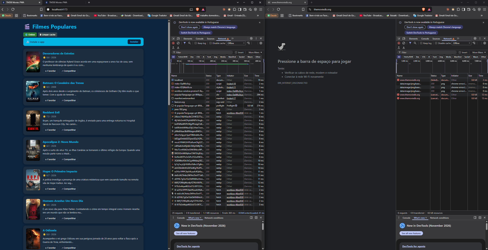
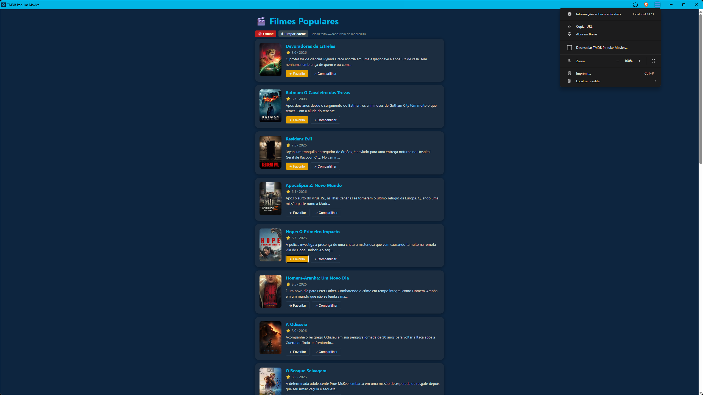
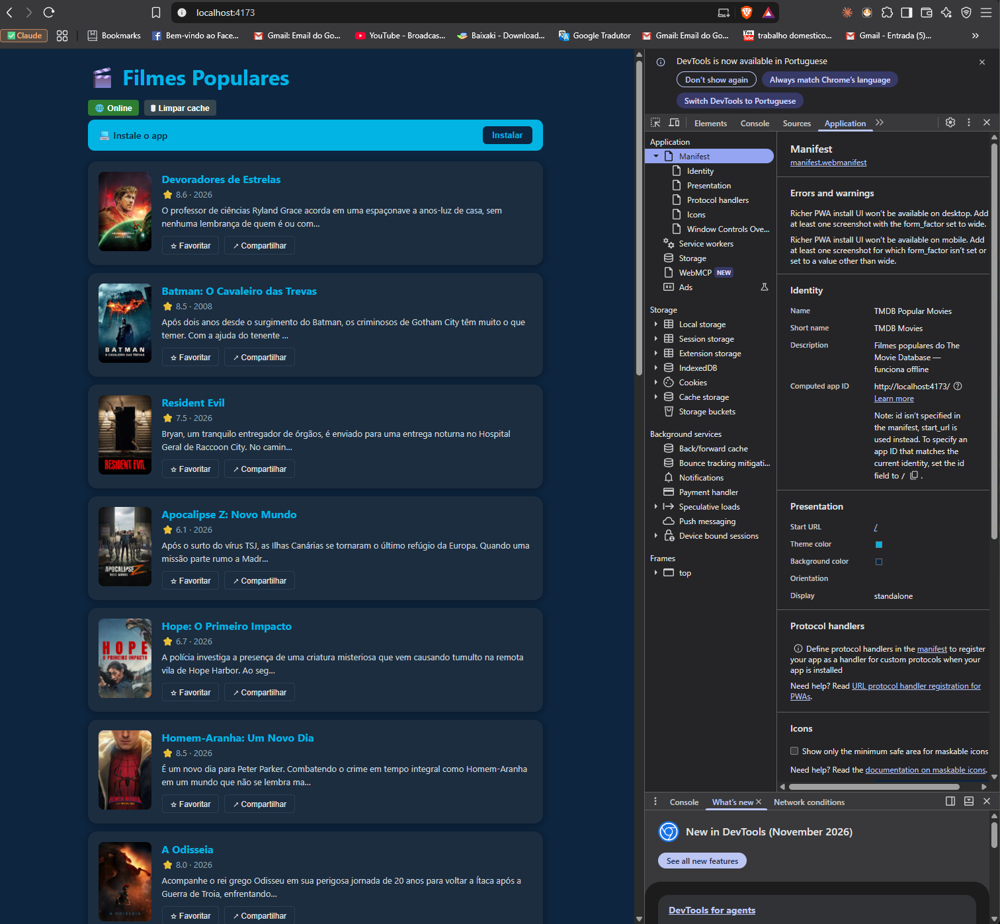
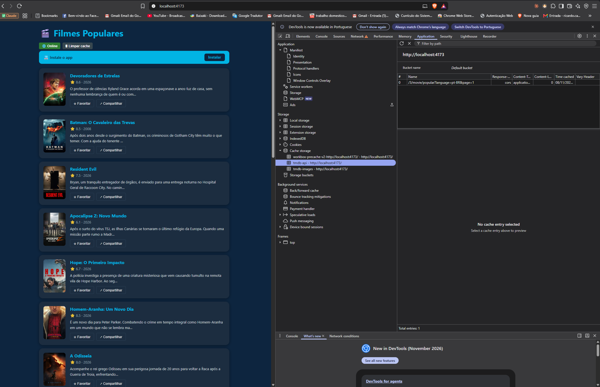
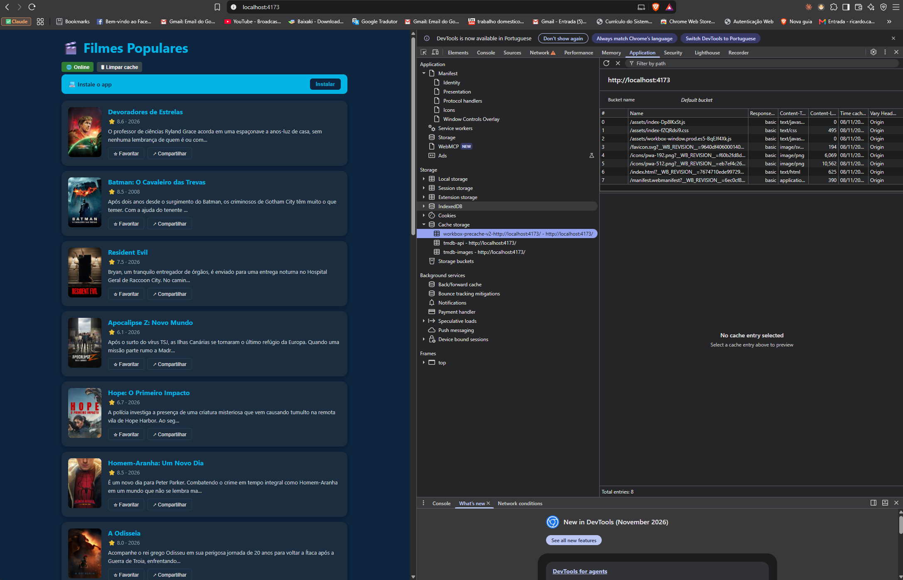
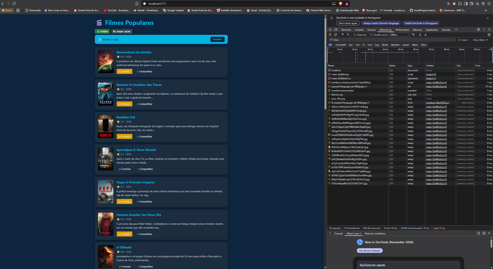
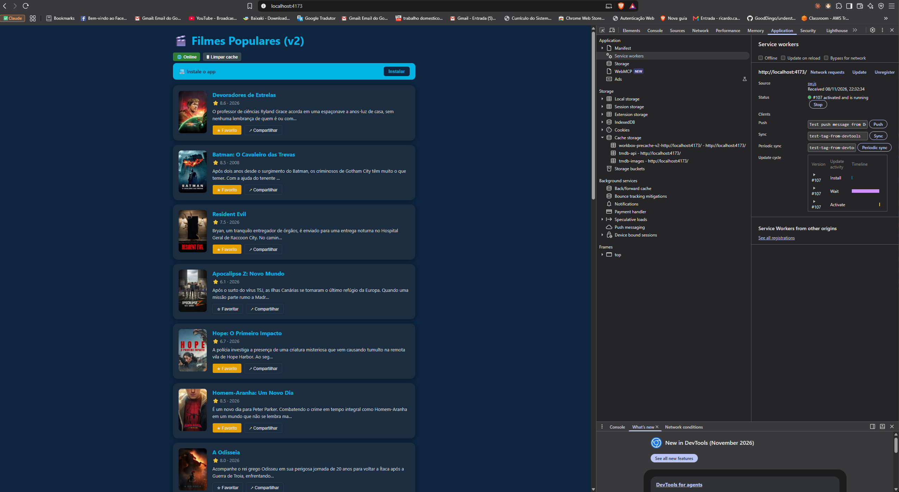

# ENTREGA — Atividade 4 (PWA)

> Preencha e faça commit junto com o código. Esta parte vale 3 pts (avaliação manual no Canvas).

**Nome:** José Ricardo Ciola Bricio · **GitHub:** zeciola

---

## 1. Site comum × PWA — o que EU vi (3 diferenças)

Abra `https://pwa-tmdb-aula4.vercel.app` e compare com um site comum (ex.: themoviedb.org). Modo avião → recarregar; fechar e reabrir; instalar.

| # | Site comum | PWA | Print/evidência |
|---|---|---|---|
| 1 | Offline: não abre (`ERR_INTERNET_DISCONNECTED`) | Offline: abre com a lista e os pôsteres, servidos pelo Service Worker (0 B transferidos) |  |
| 2 | Não oferece instalação; roda só dentro da aba | Instala como app e abre em janela própria, sem barra de endereço |  |
| 3 | Sem manifest de app nem Service Worker | Manifest com nome, ícones e `display: standalone` + Service Worker ativo |  |

## 2. Prova do offline no SEU build

- [X] Print do **DevTools → Application → Cache Storage** com `tmdb-api` e `tmdb-images` (com itens)
  
  
  
- [X] Print do app em **modo avião** carregando a lista
  
- [X] Print do aviso **"Nova versão disponível"** (ou explique por que não conseguiu reproduzir)
  
  

## 3. Reflexão (5–8 linhas)

`autoUpdate` × `prompt`: qual você escolheria para um app de **checkout** e para um app de **notícias**, e por quê? O que pode dar errado em cada escolha?

**Checkout → `prompt`.** O usuário está no meio de uma transação; um recarregamento automático poderia perder o formulário ou interromper o pagamento. No meu teste, o SW novo ficou em *waiting* até eu clicar em "Atualizar". Risco: o usuário adiar para sempre e ficar numa versão incompatível com a API. Mitigação: oferecer a atualização após concluir a compra.

**Notícias → `autoUpdate`.** O usuário só lê, então recarregar custa pouco e todos recebem correções rápido. Risco: perder a posição de leitura no meio de um artigo e um bug novo chegar a todos de uma vez.

## 4. Declaração de uso de IA

Usei IA? Onde e como? (uso transparente é incentivado)

Sim. Utilizei IA (Claude Code, da Anthropic) como tutora para explicar e realizar as atividades.
