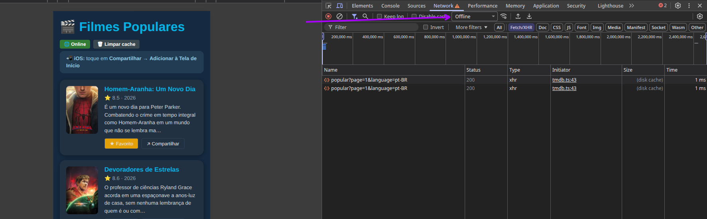
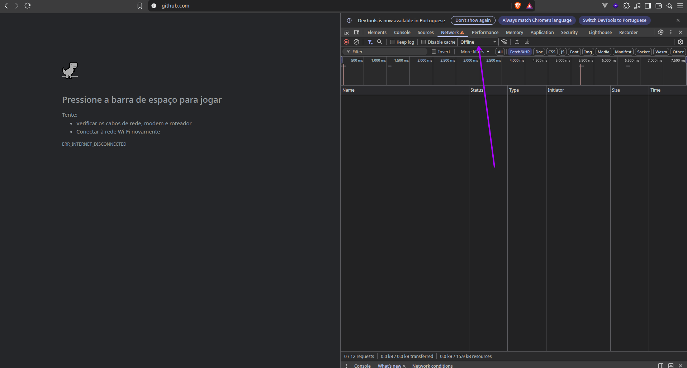
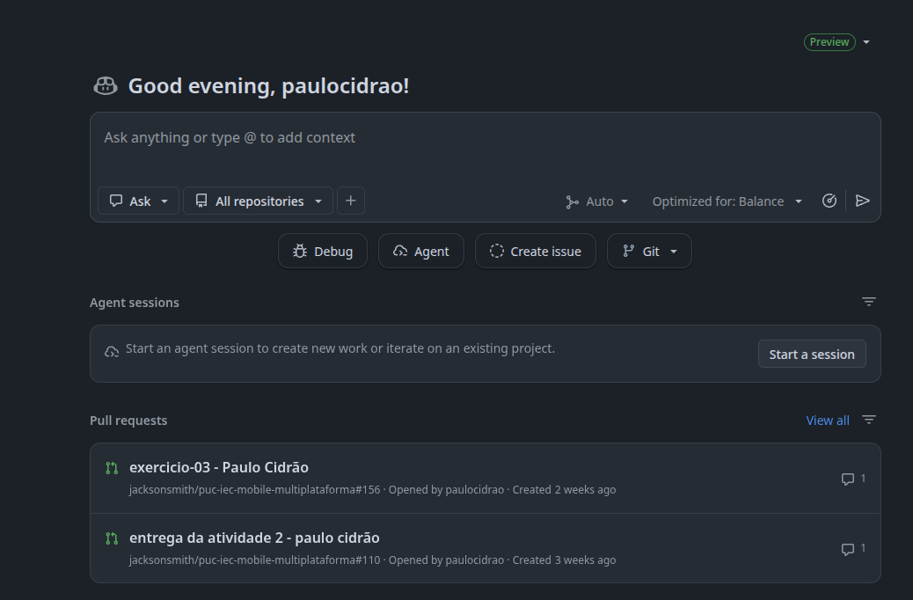
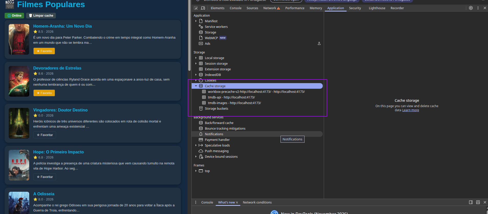
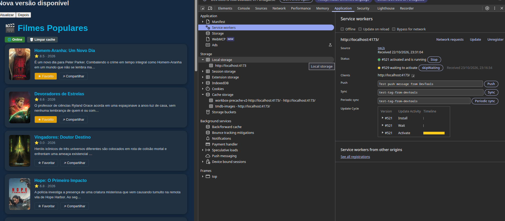

# ENTREGA — Atividade 4 (PWA)

> Preencha e faça commit junto com o código. Esta parte vale 3 pts (avaliação manual no Canvas).

**Nome:** Paulo Ciddrão Gomes Torres · **GitHub:** paulocidrao

---

## 1. Site comum × PWA — o que EU vi (3 diferenças)

Abra `https://pwa-tmdb-aula4.vercel.app` e compare com um site comum (ex.: themoviedb.org). Modo avião → recarregar; fechar e reabrir; instalar.

| #   | Site comum                                                 | PWA                                                                    | Print/evidência                                                                             |
| --- | ---------------------------------------------------------- | ---------------------------------------------------------------------- | ------------------------------------------------------------------------------------------- |
| 1   | Vai sempre necessitar de conexão estável com a internet    | Consegue funcionar com conexões instáveis ou offline por meio de cache |   |
| 2   | Não tem uma experiência adaptada ao dispositivo do usuário | Permite a personalização e adaptação da aplicação ao dispositivo       |                             |
| 3   | Atualizações dependem do navegador e da recarga manual     | Pode mostrar aviso de nova versão ou atualizar em segundo plano        |                   |

## 2. Prova do offline no SEU build

- [ ] Print do **DevTools → Application → Cache Storage** com `tmdb-api` e `tmdb-images` (com itens)
- [x] Print do app em **modo avião** carregando a lista
- [x] Print do aviso **"Nova versão disponível"** (ou explique por que não conseguiu reproduzir)
      
      
      

## 3. Reflexão (5–8 linhas)

`autoUpdate` × `prompt`: qual você escolheria para um app de **checkout** e para um app de **notícias**, e por quê? O que pode dar errado em cada escolha?

**checkout**: Usaria o **prompt** visto que é arriscado demais ter um reload inesperando já que é uma aplicação critica, é mais seguro o usuário decidir quando ele deve atualizar. Algo que pode dar errado é que usuários podem ficar presos em versões antigas ou até mesmo ficarem estrassados com a mensagem de aviso de atualização.

**notícias**: Por não ser algo tão critico é viavel sempre manter o usuário atualziado com o **autoUpdate**, no maximo algo que poderia acontecer de errado é um reload em plena leitura de uma noticia ou durante o uso do feed.

## 4. Declaração de uso de IA

Usei IA? Onde e como? (uso transparente é incentivado)

Usei a IA para me explicar alguns conceitos do React na qual eu não lembrava como a tratativa de estado com o useState e o uso do UseEffect. Na tarefa 5 com o seguinte prompt

`Preciso de uma explicação breve como o react faz o gerenciamento de estado usando o useState desde a coleta dos dados que estão nele como a inserção de dados para ele, e como o UseEffect funciona a explicação deve ser em ASD-STE100`

OBS: O ASD-STE100 Simplified Technical English (STE) é uma linguagem natural controlada criada para eliminar ambiguidades e facilitar a leitura e tradução de manuais técnicos, especialmente na indústria aeroespacial e de defesa. E ao ser usada na IA ela deixa as explicações extremamente mais simples e faceis de serem entendidas.

Esse foi o meu retorno da IA:

# useState

`useState` é uma função do React. Ela permite que um componente mantenha dados entre renderizações.

```jsx
const [count, setCount] = useState(0);
```

Chame `useState` com um valor inicial. O React retorna um array com dois itens:

1. `count` é o valor atual.
2. `setCount` é a função que altera o valor.

## Ler dados

Use a variável `count`. Ela contém o valor da renderização atual.

## Inserir (alterar) dados

Chame `setCount(novoValor)`. Não altere `count` diretamente. O React não percebe uma alteração direta.

```jsx
setCount(5); // define um novo valor
setCount((prev) => prev + 1); // usa o valor anterior
```

Use a forma com função quando o novo valor depende do valor antigo.

## O que o React faz

1. O React guarda o valor em uma lista interna. A lista pertence ao componente.
2. O React encontra cada valor pela ordem de chamada dos hooks. Por isso, chame os hooks somente no nível superior. Não os chame dentro de loops ou condições.
3. Quando você chama a função setter, o React salva o novo valor. Em seguida, o React agenda uma nova renderização.
4. O componente executa novamente. Agora `useState` retorna o novo valor.

**Nota:** A alteração não é imediata. Na renderização atual, a variável mantém o valor antigo.

**Nota:** O React compara objetos e arrays por referência. Crie um novo objeto ou array. Não altere o antigo.

```jsx
setUser({ ...user, name: "Ana" });
```

# useEffect

`useEffect` executa código depois que o React atualiza a tela. Use-o para efeitos colaterais. Exemplos são busca de dados, temporizadores e event listeners.

```jsx
useEffect(() => {
  document.title = `Count: ${count}`;
  return () => {
    // código de limpeza
  };
}, [count]);
```
