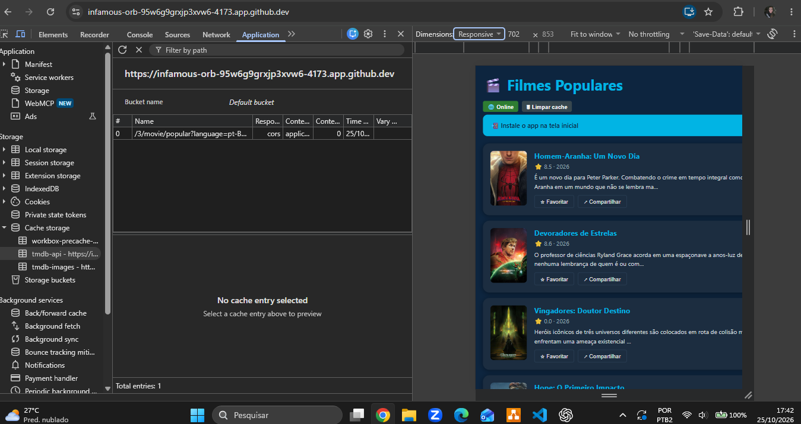
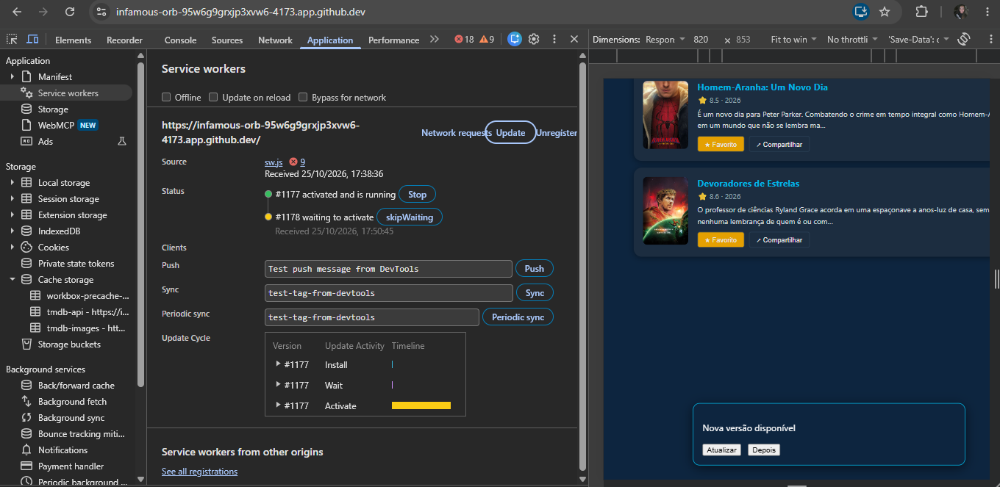
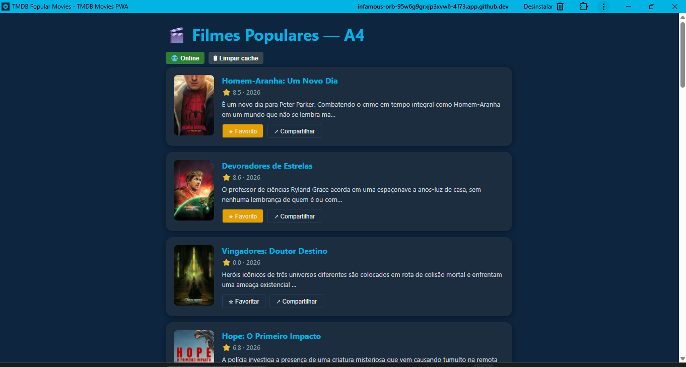
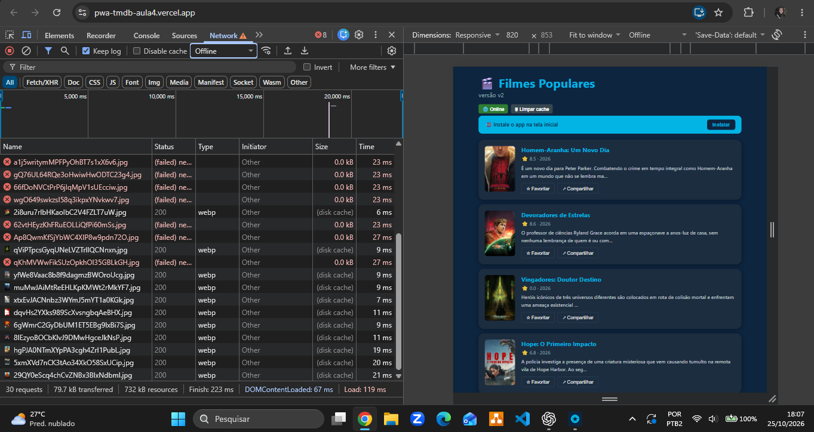
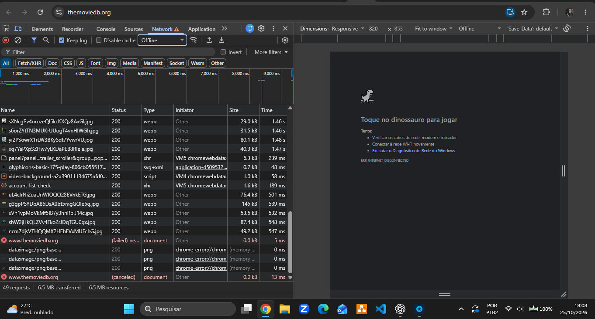

# ENTREGA — Atividade 4 (PWA)

**Nome:** Amanda Santos Pereira Bouzan · **GitHub:** AmandaBouzan

## Ambiente de desenvolvimento e testes

Utilizei o GitHub Codespaces porque meu notebook estava travando ao executar o
projeto localmente. A instalação das dependências, o build e os testes automatizados
foram executados no Codespaces. A validação visual, os testes offline e a instalação
do PWA foram realizados no Chrome do meu computador, acessando a porta 4173
encaminhada pelo Codespaces.

## 1. Site comum × PWA — três diferenças observadas

Em 25/10/2026, comparei o PWA do professor
(`https://pwa-tmdb-aula4.vercel.app`) com o site TMDB
(`https://www.themoviedb.org/`). Carreguei online e depois selecionei Offline no
DevTools e recarreguei cada página. Também instalei meu próprio PWA e o abri pelo
menu Iniciar. Os resultados abaixo se limitam às condições desse teste.

| # | Site TMDB aberto como site comum | PWA observado | Evidência |
|---|---|---|---|
| 1 — Recarregar sem rede | A navegação falhou e o Chrome mostrou `ERR_INTERNET_DISCONNECTED`. | O PWA do professor continuou renderizando a lista após o reload offline. | Prints 8 e 9. |
| 2 — Conteúdo disponível sem rede | Na página de erro não foi possível consultar os cards do catálogo. | O PWA do professor manteve títulos, notas e pôsteres já carregados; no meu app, os favoritos e o banner offline também ficaram disponíveis. | Prints 3, 8 e 9. |
| 3 — Forma de abrir e retomar o uso | O site foi acessado em uma aba com a interface do Chrome. | Meu PWA foi instalado, apareceu no menu Iniciar e abriu em janela própria sem abas/barra de endereço, mantendo os favoritos. | Print 7 e sequência de instalação. |

As duas primeiras diferenças descrevem, respectivamente, a navegação e o conteúdo
retido no mesmo teste offline. A terceira compara a forma de uso observada, sem
afirmar que o site TMDB não possa oferecer instalação. Não é uma regra universal:
um site comum também pode implementar manifest, Service Worker e cache offline.

## 2. Evidências do meu build

Os prints são capturas originais da execução no navegador da aluna, sem alterações.
O token TMDB foi configurado somente no `.env.local`, ignorado pelo Git.

### 1 — API em cache

O cache `tmdb-api` contém uma resposta de `/3/movie/popular` em português.

### 2 — Pôsteres em cache

O cache `tmdb-images` contém 12 imagens com respostas opacas, aceitas pela regra
`cacheableResponse: { statuses: [0, 200] }`.

### 3 — Favoritos offline

Com o DevTools em Offline, a aba Favoritos manteve dois filmes e seus pôsteres,
exibindo “Offline — exibindo dados do cache”. As tentativas de rede que falharam
aparecem em vermelho no painel Network. O print demonstra o estado offline;
a abertura do aplicativo instalado em janela própria também foi registrada no print 7.

### 4 — Nova versão aguardando confirmação

Após alterar o título e gerar outro build, o worker #1178 ficou aguardando
ativação, enquanto o #1177 continuou ativo. O aplicativo mostrou o aviso e os
botões Atualizar/Depois. O botão Depois tem cobertura unitária; sua execução
manual não foi registrada.

### 5 — Atualização aplicada

Após clicar em Atualizar no aplicativo, o worker #1178 passou a ativo e o título
mudou para “Filmes Populares — A4”. Os dois favoritos continuaram marcados.
A alteração temporária do título foi usada para tornar a atualização visível.

### 6 — Testes automatizados

`npm test`: 6 arquivos e 19 testes aprovados no Codespaces.
`npm run build`: concluído com geração do Service Worker.
O validador estrutural local aprovou os 12 pontos automáticos; isso não substitui
a correção manual nem representa a nota final no Canvas.

### 7 — Aplicativo instalado em janela própria

Os prints enviados pela aluna registram a instalação pelo Chrome, o aplicativo
“TMDB Popular Movies” no menu Iniciar e sua abertura em janela própria.
O título atualizado e os dois favoritos foram mantidos. A captura abaixo mostra
o app instalado sem a barra de endereço e sem as abas de uma janela comum.

### 8 — PWA do professor após recarregar offline

O DevTools está em Offline, mas a lista de filmes e os pôsteres continuam visíveis.
Há tentativas de rede falhas e imagens atendidas pelo cache de disco; o print não
permite atribuir todo o conteúdo exclusivamente ao Service Worker. O indicador
interno do professor ainda mostra Online, por isso o estado de rede usado como
referência é o DevTools.

### 9 — Site comum após recarregar offline

No mesmo procedimento com o TMDB, a navegação do documento falhou e o navegador
mostrou o dinossauro e `ERR_INTERNET_DISCONNECTED`. As respostas 200 anteriores
continuam na lista porque Preserve log está habilitado; elas não significam que
a nova navegação offline tenha funcionado.

## 3. Reflexão: autoUpdate × prompt

Para um checkout eu escolheria `prompt`, evitando recarregar a página durante o pagamento.
O aviso permite concluir a compra antes de ativar a nova versão.
O risco é manter uma versão antiga, então o servidor deve preservar compatibilidade e validar a transação.
Para um app de notícias eu escolheria `autoUpdate`, pois simplifica a adoção de correções e melhorias.
Mesmo nesse caso, uma recarga pode interromper a leitura e perder a posição do artigo.
Eu preservaria artigo e posição, e separaria a atualização das notícias da atualização do código do app.
Se o produto priorizasse leitura sem interrupções, usaria `prompt` também para notícias.

## 4. Declaração de uso de IA

Usei ChatGPT/Codex para interpretar o enunciado, implementar os TODOs, acrescentar
testes e preparar a documentação. Executei o projeto no Codespaces com meu token
TMDB e forneci os prints de cache, favoritos offline, atualização e testes.
Também comparei o PWA do professor com o site TMDB em modo offline.
A documentação descreve os resultados e os limites das capturas, sem generalizar para todos os sites.
