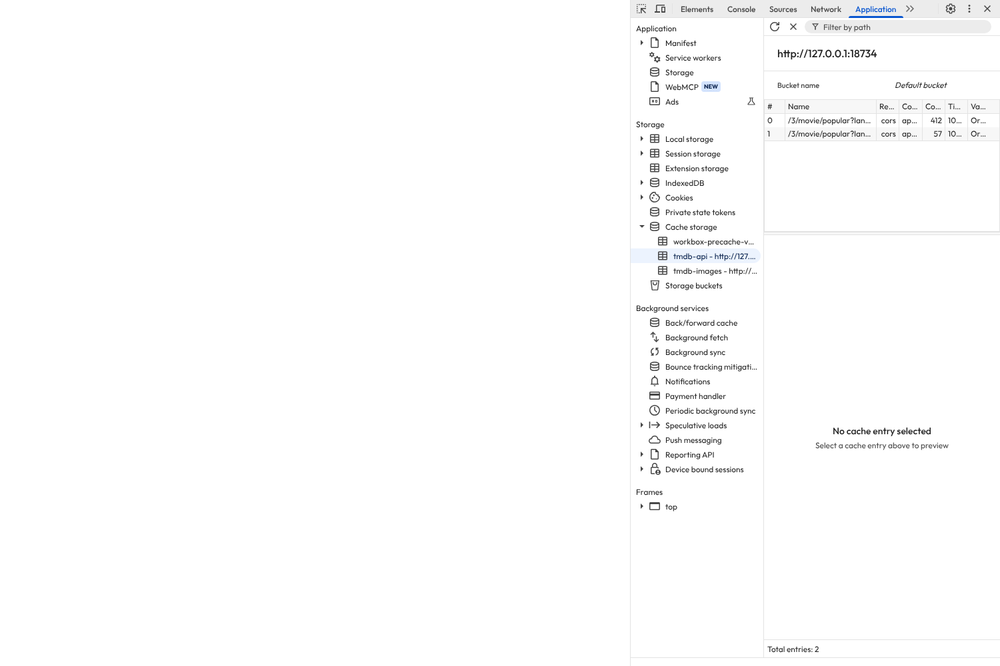
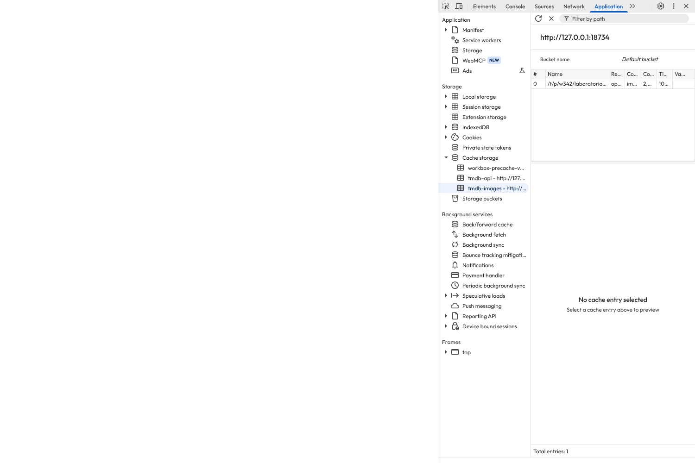
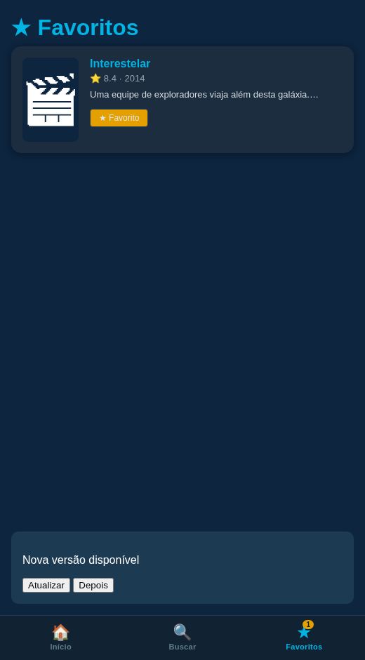
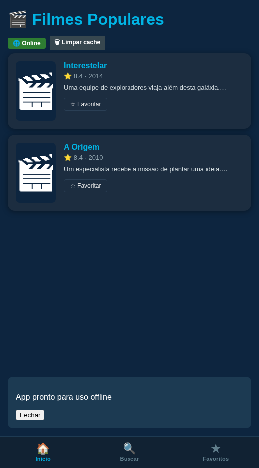

# ENTREGA — Atividade 4 (PWA)

**Nome:** Igor Suzart · **GitHub:** is-suzart

## 1. Site comum × PWA — diferenças verificadas

A referência publicada do professor foi aberta em
https://pwa-tmdb-aula4.vercel.app. Ela apresentou manifest, Service Worker ativo,
precache e o aviso “App pronto para uso offline”. A comparação abaixo usa
https://example.com como página comum e o build local desta entrega como PWA.
As verificações foram feitas com assistência de IA, em Chrome automatizado.

| # | Página comum (example.com) | PWA desta entrega | Evidência |
|---|---|---|---|
| 1 | Não apresentou manifest | Manifest define nome, modo standalone e ícones 192/512 | [DevTools Application](evidencias/devtools-application.png) e `vite.config.ts` |
| 2 | Nenhum Service Worker registrado | SW ativo controla o app e mantém precache e caches de recursos | [Cache da API](evidencias/devtools-application.png) e [cache de pôsteres](evidencias/devtools-images.png) |
| 3 | Nenhuma entrada no Cache Storage | O build reabriu sem rede com favorito, texto e imagem em cache | [Reload offline](evidencias/favoritos-offline.png) |

[Referência do professor](evidencias/referencia-professor.png) ·
[Página comum](evidencias/site-comum.png).

Não foi feita uma instalação no sistema operacional. As capturas demonstram o
manifest e o funcionamento no navegador; não representam uma janela instalada.

## 2. Prova do offline no build

- [x] DevTools → Application → Cache Storage, com itens em `tmdb-api` e `tmdb-images`.
- [x] App recarregado sem rede, mantendo filme, favorito e pôster.
- [x] Aviso de nova versão e ativação pelo botão Atualizar.

O teste usou respostas **simuladas do TMDB**, com dois filmes e a claquete do
projeto como imagem de teste. O Service Worker, o Cache Storage, o IndexedDB e
o localStorage são reais, executados pelo Chrome. O cache da API recebeu status
200; o pôster cross-origin recebeu status opaco 0, aceito por `cacheableResponse`.
As URLs e os status estão em [cache-storage.json](evidencias/cache-storage.json).
Não foi validado acesso ao TMDB com um token pessoal.

Para a atualização, o build recebeu temporariamente uma revisão de HTML;
o SW novo ficou aguardando, o aviso apareceu e Atualizar recarregou a página
com a revisão nova. A modificação temporária foi revertida e não integra o código.

## 3. Reflexão — autoUpdate × prompt

Para checkout, escolheria `prompt`: recarregar no meio pode interromper um formulário.
O usuário deve poder concluir a operação e atualizar em seguida.
Para notícias, `autoUpdate` pode favorecer a chegada de correções sem exigir uma decisão.
Ainda assim, uma troca inesperada pode perder a posição de leitura ou um comentário.
`prompt` dá controle, mas permite adiar uma correção e manter uma versão antiga.
`autoUpdate` reduz essa demora, mas o app deve preservar o estado antes de recarregar.
Nesta atividade o modo é `prompt`, e a nova versão só é ativada pelo botão Atualizar.

## 4. Uso de IA

Foi usada IA na implementação inicial, na revisão dos requisitos, nas correções,
nos testes de navegador e na organização deste relatório. A primeira revisão
comparou o código com o enunciado antigo do fork; esta usa os requisitos atuais.
As observações descritas são verificações automatizadas, não uma sessão manual
realizada pelo aluno. A reflexão deve ser revisada e compreendida pelo autor
antes da entrega no Canvas.
