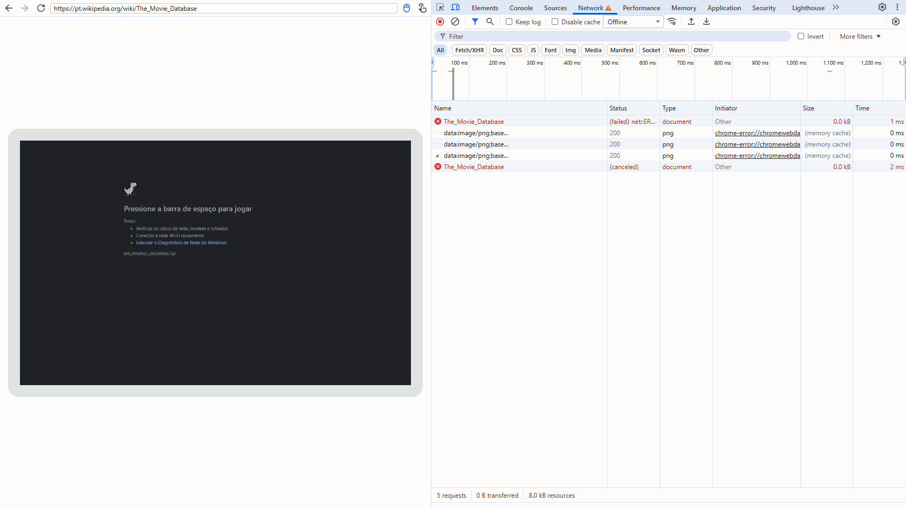
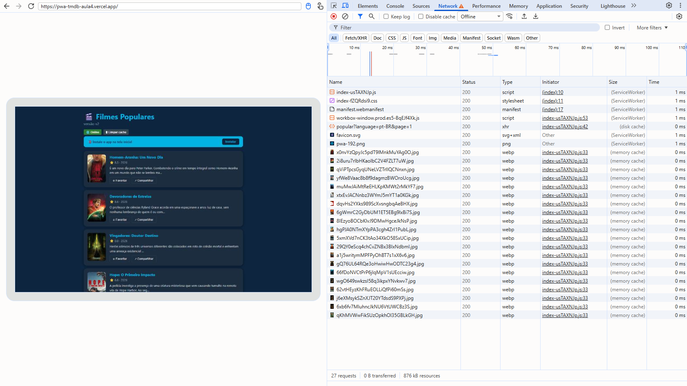
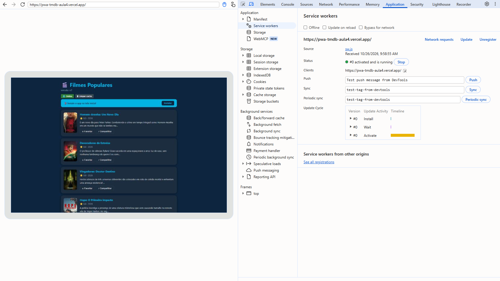
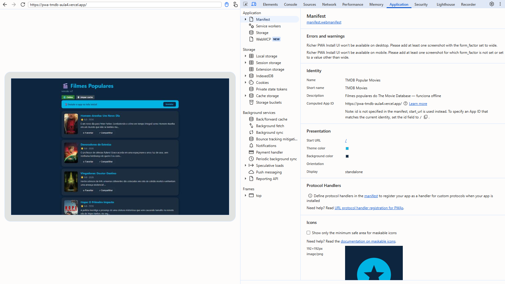
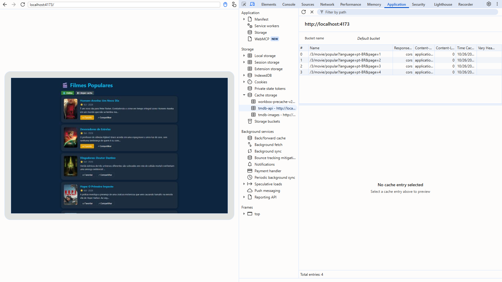
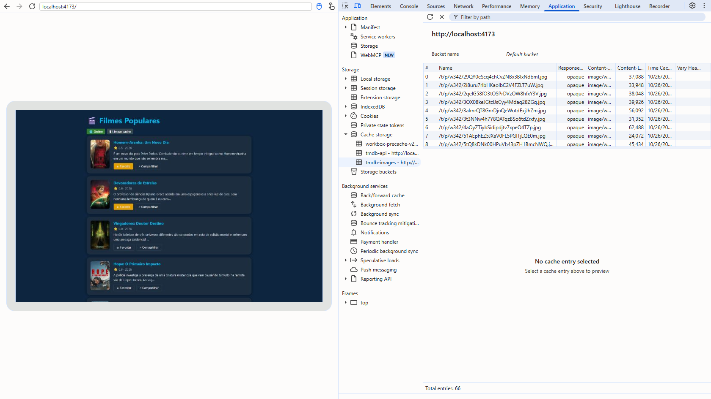
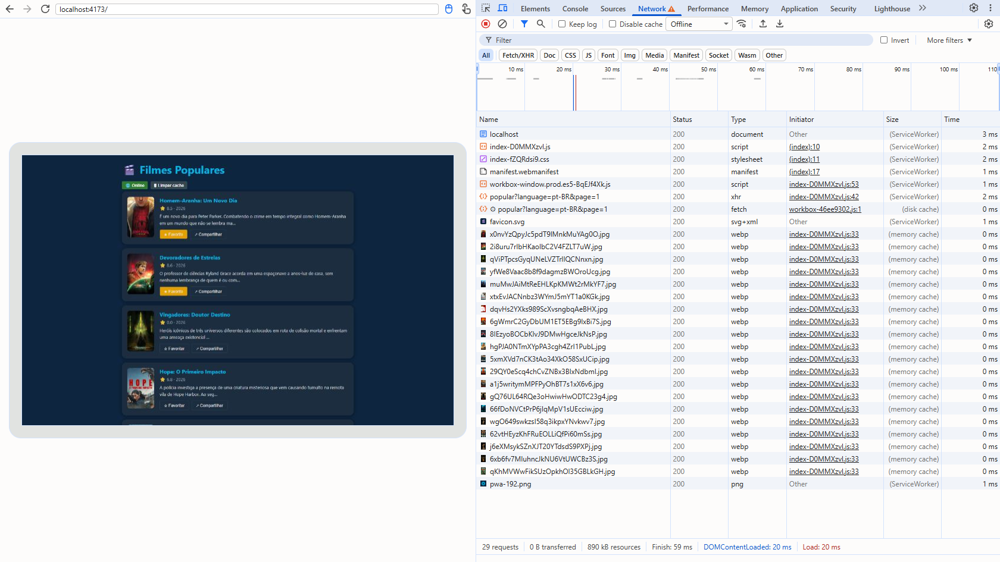
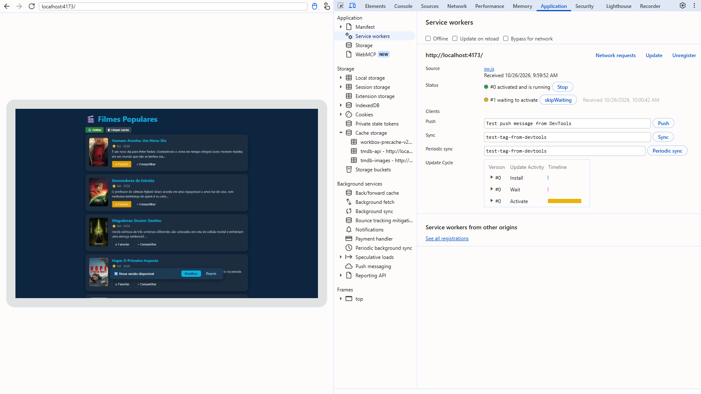

# ENTREGA — Atividade 4 (PWA)

**Nome:** Pedro Correa · **GitHub:** PedroAC18

---

## 1. Site comum × PWA — 3 diferenças observadas

Comparei o PWA publicado pelo professor (`https://pwa-tmdb-aula4.vercel.app`) com um site comum, a [página da Wikipédia sobre o TMDB](https://pt.wikipedia.org/wiki/The_Movie_Database). O themoviedb.org, sugerido como exemplo, responde à navegação automatizada com uma tela de verificação anti-robô ("Just a moment..."), por isso troquei de site.

Roteiro igual nos dois: abrir, fechar e reabrir a aba, olhar o DevTools → Application e, por fim, DevTools → Network → **Offline** e recarregar.

| # | Site comum | PWA | Print/evidência |
|---|---|---|---|
| 1 | **Sem rede, não abre.** Ao recarregar offline o Chrome mostra a página de erro `ERR_INTERNET_DISCONNECTED`: o documento falha na rede e não existe nada para respondê-lo. | **Sem rede, abre normalmente.** HTML, JS, CSS, manifest e a chamada `popular?page=1` vêm do Service Worker ou do cache: a aba Network mostra "0 B transferred" e a lista aparece inteira. | [01a](evidencias/01a-site-comum-offline.png) · [01b](evidencias/01b-pwa-offline.png) |
| 2 | **Nenhum Service Worker.** Application → Service workers vazio e Cache storage sem nenhum cache. Reabrir a aba busca tudo na rede de novo. | **Service Worker ativo** (`#0 activated and is running`) controlando a página. Ao reabrir a aba, a página já nasce controlada por ele, que intercepta as requisições e decide se responde do cache ou da rede. | [02b](evidencias/02b-pwa-service-workers.png) |
| 3 | **Não é instalável.** Application → Manifest: "No manifest detected". No máximo vira um favorito do navegador. | **Instalável.** Manifest com nome, ícones 192/512, cores e `display: standalone`, sem erros de instalabilidade. O Chrome disparou o `beforeinstallprompt` e o app mostrou o banner "Instale o app na tela inicial" com o botão **Instalar**. O `standalone` faz o app instalado abrir em janela própria, sem barra de endereço. | [03b](evidencias/03b-pwa-manifest.png) |

| Offline: site comum (Wikipédia) | Offline: PWA |
|---|---|
|  |  |

| PWA: Service Worker ativo | PWA: manifest e banner de instalação |
|---|---|
|  |  |

## 2. Prova do offline no MEU build

Build local (`npm run build && npm run preview`, http://localhost:4173), com o código desta entrega.

- [x] **DevTools → Application → Cache Storage** com `tmdb-api` e `tmdb-images` (com itens)
  - `tmdb-api`: respostas de `/3/movie/popular?language=pt-BR&page=1..4`, tipo `cors` (regra NetworkFirst). → [05](evidencias/05-cache-tmdb-api.png)
  - `tmdb-images`: 66 pôsteres de `image.tmdb.org`, todos do tipo **`opaque`** (status 0). Eles só entram no cache porque a regra CacheFirst tem `cacheableResponse: { statuses: [0, 200] }`. → [06](evidencias/06-cache-tmdb-images.png)
- [x] **App offline carregando a lista** (DevTools → Network → **Offline**, que deixa `navigator.onLine = false`, como o modo avião)
  - Tela inicial: documento, JS, CSS e a chamada à API servidos pelo `(ServiceWorker)`, "0 B transferred" e 20 filmes na tela. → [07](evidencias/07-offline-lista.png)
- [x] **Aviso "Nova versão disponível"** (`registerType: 'prompt'`)
  - Com o preview rodando, mudei o título para "Filmes Populares · v2", rodei `npm run build` de novo e pedi ao Service Worker que procurasse atualização (`registration.update()`, o mesmo que o botão **Update** do DevTools). O SW novo ficou em `#1 waiting to activate` e o aviso apareceu. → [09](evidencias/09-nova-versao.png)
  - Depois de clicar em **Atualizar**, a página recarregou já com o título "· v2" e o SW `#1` ativo.
  - A mudança do título foi só para o teste e foi desfeita: não está no código entregue.

| Cache `tmdb-api` | Cache `tmdb-images` |
|---|---|
|  |  |

| Offline: lista | Nova versão esperando |
|---|---|
|  |  |

## 3. Reflexão

Para o **checkout** eu escolheria `prompt`. Com `autoUpdate` a página recarrega sozinha quando sai versão nova, e isso no meio de uma compra pode apagar o carrinho ou o formulário de pagamento, ou repetir um pedido se o reload cair durante o envio. Com `prompt` o usuário termina a compra e atualiza quando quiser. O risco é o contrário: quem nunca clica em "Atualizar" continua numa versão antiga, que pode quebrar se a API de pagamento mudar. Por isso eu combinaria o `prompt` com uma versão mínima exigida pelo backend.

Para o app de **notícias** eu escolheria `autoUpdate`. É conteúdo de leitura, sem estado importante a perder, e o leitor quer o layout e as correções mais recentes sem ser interrompido por avisos. O que pode dar errado é o reload acontecer enquanto alguém lê e a pessoa perder a posição no texto, ou uma versão com bug chegar a todo mundo de uma vez, sem ninguém ter "aceitado" a atualização.

## 4. Declaração de uso de IA

Sim. Usei o **Claude Code** (Anthropic, modelo Claude Opus 5.5) durante toda a atividade:

- **Análise:** leitura do enunciado, do código base e do validator do bot para levantar o que implementar.
- **Código:** implementação dos TODOs 1 a 5 (`tmdb.ts`, `vite.config.ts`, `UpdatePrompt.tsx`, `HomeScreen.tsx`, `useOfflineStatus.ts`), verificada com `npm test`, `npm run build` e o validator rodado localmente (12/12 na parte automática).
- **Prints:** gerados pelo Claude automatizando um Google Chrome real com o Playwright do próprio projeto e abrindo o DevTools do Chrome via remote debugging. São capturas reais das telas e do DevTools, não montagens. O "modo avião" foi simulado pelo DevTools → Network → Offline.
- **Texto:** este `ENTREGA.md`, incluindo a reflexão da seção 3, também foi redigido com o Claude.
