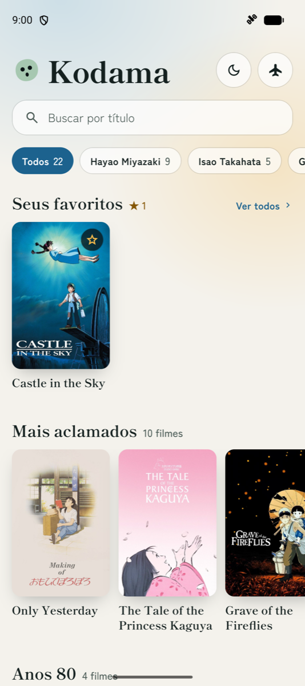
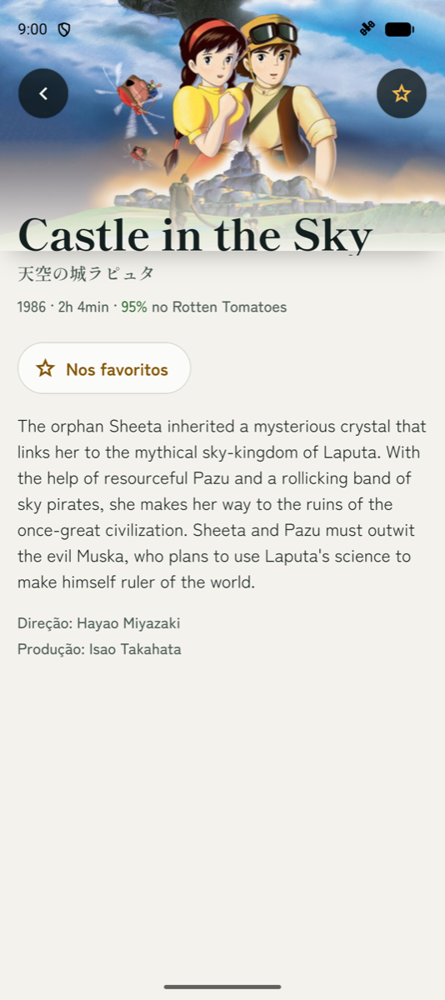
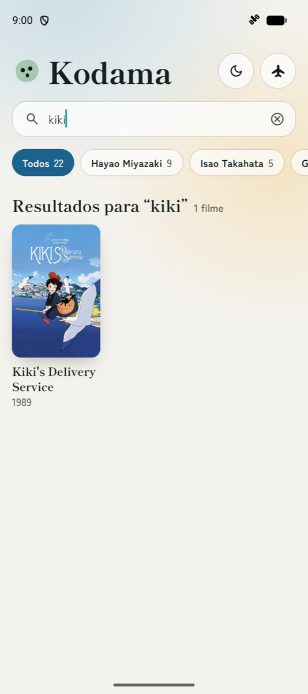
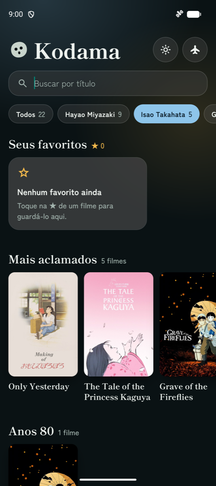

# Kodama

[](https://github.com/roymas100/puc-iec-mobile-multiplataforma/actions/workflows/projeto-final-ghibli-rn.yml)

Catálogo dos filmes do **Studio Ghibli** para Android, iOS e web, feito com Expo e React Native. O nome vem dos kodamas, os espíritos da floresta de _Princesa Mononoke_.

Trabalho final da disciplina **Arquitetura de Aplicações Móveis e Multiplataforma** (PUC Minas IEC, Prof. Jackson Smith), feito por Amir Andrade.

| Lista e favoritos                                     | Detalhe do filme                                        | Busca                                                | Filtro no tema escuro                                                  |
| ----------------------------------------------------- | ------------------------------------------------------- | ---------------------------------------------------- | ---------------------------------------------------------------------- |
|  |  |  |  |

## O que o app faz

- **Lista de filmes** organizada em fileiras: favoritos, mais aclamados e décadas.
- **Detalhe do filme** com banner, título original, ano, duração, nota, sinopse, direção e produção.
- **Busca por título**, que ignora maiúsculas e acentos.
- **Filtro por diretor**, que recalcula as fileiras para mostrar só os filmes daquele diretor.
- **Favoritos** que continuam salvos depois de fechar o app.
- **Tema claro e escuro**, com um botão no cabeçalho para trocar.
- **Modo avião simulado**, também no cabeçalho, para testar o app usando só o que já foi carregado.

Na web, o detalhe abre como uma janela sobre a lista e mantém o próprio endereço (`/film/<id>`).

## Como rodar

### Pré-requisitos

- [Node.js](https://nodejs.org) 22
- Para Android: [Android Studio](https://developer.android.com/studio) com um emulador criado e JDK 21
- Para iOS: macOS com [Xcode](https://developer.apple.com/xcode/)
- Para web: apenas um navegador

### Instalação

```bash
git clone --branch entrega/projeto-final-amir-andrade https://github.com/roymas100/puc-iec-mobile-multiplataforma.git
cd puc-iec-mobile-multiplataforma/exercicios/projeto-final/skeletons/studio-ghibli/react-native/pratica
npm ci
```

### Execução

Escolha uma plataforma:

```bash
npx expo run:android    # compila e abre no emulador Android
npx expo run:ios        # compila e abre no simulador iOS
npx expo start --web    # abre no navegador
```

A primeira compilação nativa demora alguns minutos. O app precisa de internet para carregar os filmes da primeira vez.

## Testes

```bash
npm test            # testes de unidade das regras de negócio (Vitest)
npx expo lint       # padrão de código
npx tsc --noEmit    # checagem de tipos
```

Os testes de ponta a ponta usam o [Maestro](https://maestro.mobile.dev), com um flow para cada funcionalidade. Com o emulador ligado, instale a versão de release e rode os flows:

```bash
npx expo run:android --variant release
maestro test e2e/maestro/    # flows do projeto
maestro test flows/          # flows do skeleton da disciplina
```

A cada pull request, o [GitHub Actions](../../../../../../.github/workflows/projeto-final-ghibli-rn.yml) roda o lint, os tipos, os testes de unidade e os cinco flows em um emulador Android.

## Arquitetura

O código é dividido em camadas, e cada uma só conhece as que vêm depois dela:

```text
src/
├── app/          telas e rotas (Expo Router)
├── components/   componentes visuais reutilizáveis
├── state/        estado e cache (TanStack Query e Zustand)
├── data/         acesso à API e conversão dos dados
└── domain/       regras de negócio, sem dependência de React Native
```

| Necessidade     | Tecnologia                                                       |
| --------------- | ---------------------------------------------------------------- |
| Base do app     | Expo SDK 58, React Native 0.88 e TypeScript                      |
| Navegação       | Expo Router                                                      |
| Estilo          | NativeWind, com os tokens da marca em `docs/brand-tokens.json`   |
| Dados e cache   | TanStack Query                                                   |
| Estado local    | Zustand com AsyncStorage                                         |
| Testes          | Vitest e Maestro                                                 |

Os motivos de cada escolha e as alternativas descartadas estão no **[ADR.md](ADR.md)**.

## Documentação

- [ADR.md](ADR.md): resumo de uma página das decisões de arquitetura
- [docs/](docs/README.md): especificações de cada funcionalidade e registros completos de decisão
- [CONTRIBUTING.md](CONTRIBUTING.md): padrões de nomes, branches e commits

## Créditos

Os dados vêm da [Studio Ghibli API](https://ghibliapi.vercel.app). Filmes, títulos e imagens pertencem ao Studio Ghibli e são usados aqui apenas para fins acadêmicos.
