# Receitas — Projeto Final (TheMealDB + Flutter)

App Android em Flutter para descobrir receitas da [TheMealDB](https://www.themealdb.com/api.php):
navegue pela grade de pratos, busque pelo nome, filtre por categoria, abra a receita com ingredientes
e modo de preparo, e guarde suas favoritas (elas continuam salvas depois de fechar o app).

- **Grupo:** Henrique Miguel de Jesus · João Pedro Schlindwein · Rafael Correa Zart
- **Reserva do tema:** [issue #269](https://github.com/jacksonsmith/puc-iec-mobile-multiplataforma/issues/269)
- **Decisões de arquitetura:** [`ADR.md`](./ADR.md)

| Lista | Busca | Categoria | Detalhe |
|---|---|---|---|
| 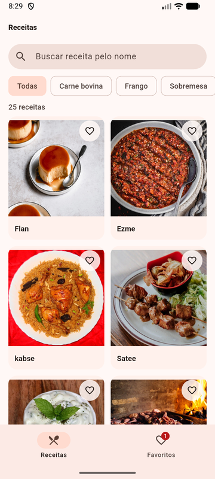 | 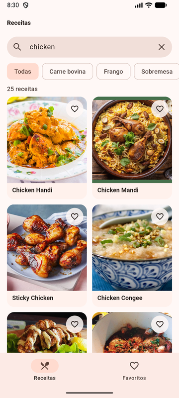 | 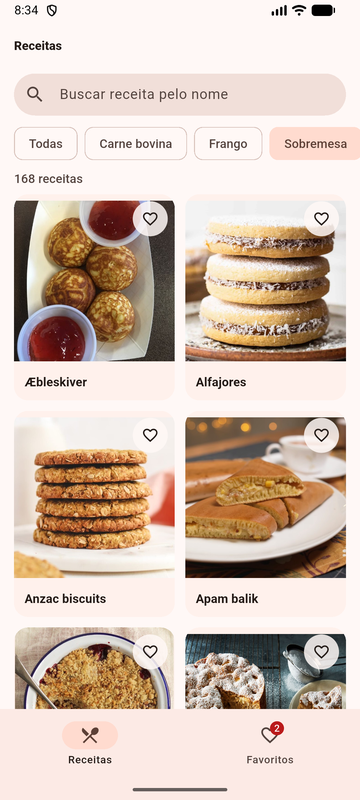 | 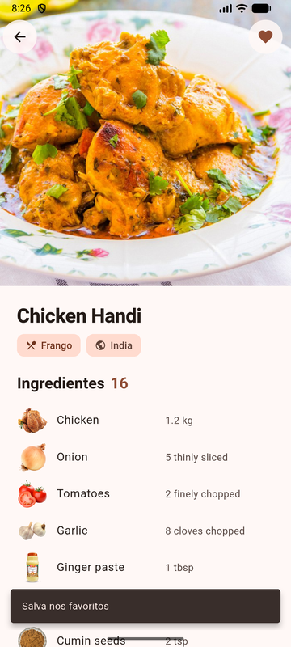 |

| Modo de preparo | Favoritos | Tema escuro | Sem internet |
|---|---|---|---|
| 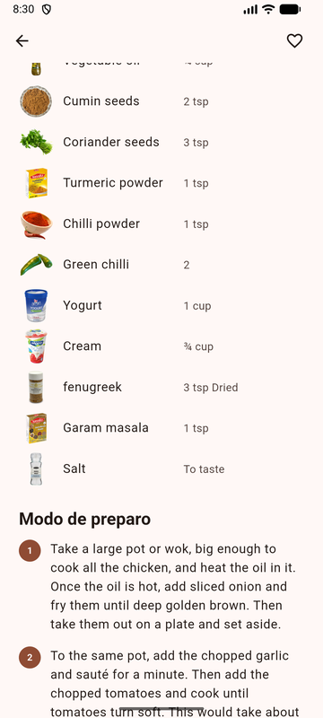 | 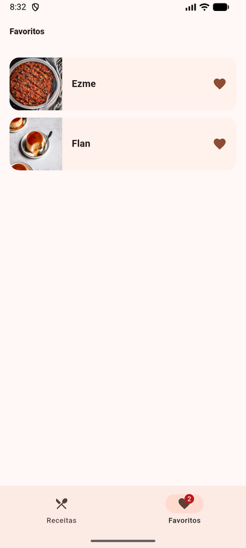 | 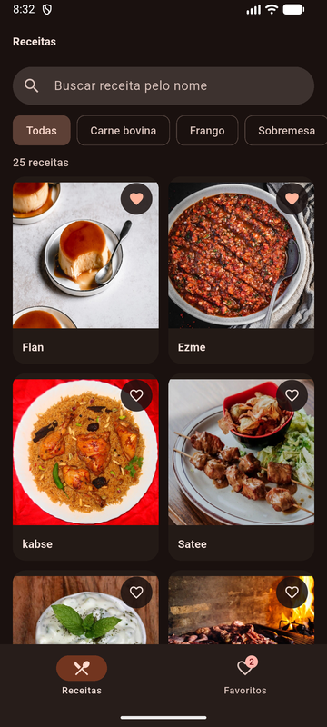 | 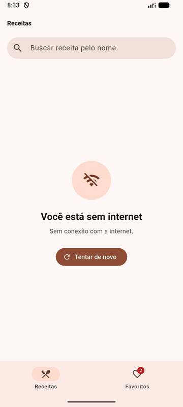 |

| Explorar A–Z | Sem internet, com receitas salvas |
|---|---|
| 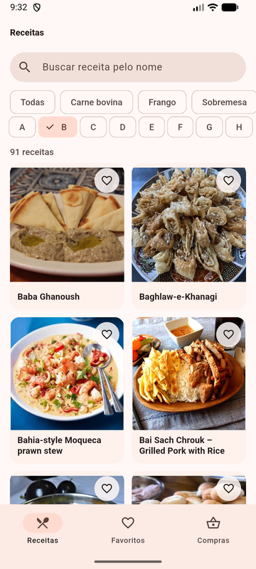 | 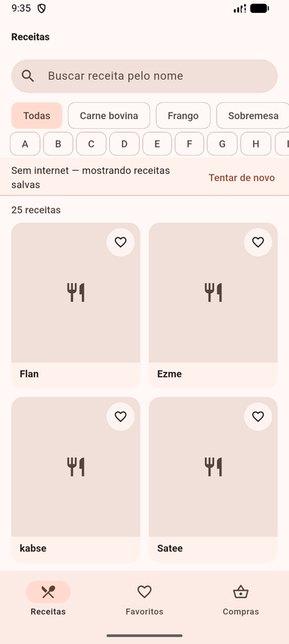 |

## O que o app faz

| # | Feature | Como funciona |
|---|---|---|
| 1 | **Lista** de dados reais | Grade de receitas com foto vinda de `search.php?s=`, puxar para atualizar |
| 2 | **Detalhe** | Foto grande, categoria, origem, tags, ingredientes com foto e medida, modo de preparo em passos (`lookup.php?i=`) |
| 3 | **Busca** | Campo de busca que procura no catálogo inteiro da API (`search.php?s=<texto>`), com filtro local instantâneo enquanto a resposta chega |
| 4 | **Filtro por categoria** | Chips com as 14 categorias reais da API (`categories.php`), traduzidas; tocar busca a categoria inteira na API (`filter.php?c=`) |
| 5 | **Favoritos** | Coração na grade e no detalhe; aba Favoritos com contador, arrastar para remover e "Desfazer"; salvos com `shared_preferences` e mantidos ao fechar o app |
| 6 | **Explore A-Z** | Chips A-Z consultam `search.php?f=<letra>`; a busca por texto filtra os resultados da letra |
| 7 | **Consulta offline** | Lista, categorias, letras e detalhes completos já carregados ficam em cache local |
| 8 | **Lista de compras** | No detalhe, adicione ou remova os ingredientes da receita; na aba Compras, marque os comprados e use "Limpar comprados". Itens agrupados por receita e salvos ao fechar o app |
| 9 | **Compartilhar receita** | Abre a folha nativa do Android com nome, ingredientes, medidas e link da fonte (ou do vídeo, se não houver fonte) |
| 10 | **Ver vídeo** | Botão no detalhe somente quando há vídeo; abre o link HTTPS no aplicativo externo, com mensagem se falhar |
| 11 | **Receitas em português** | Nomes, ingredientes, medidas, origem e modo de preparo traduzidos no próprio aparelho (ML Kit, sem chave e offline depois do primeiro download); busca em português ("frango" encontra "Chicken"); botão de idioma na barra volta ao original em inglês |

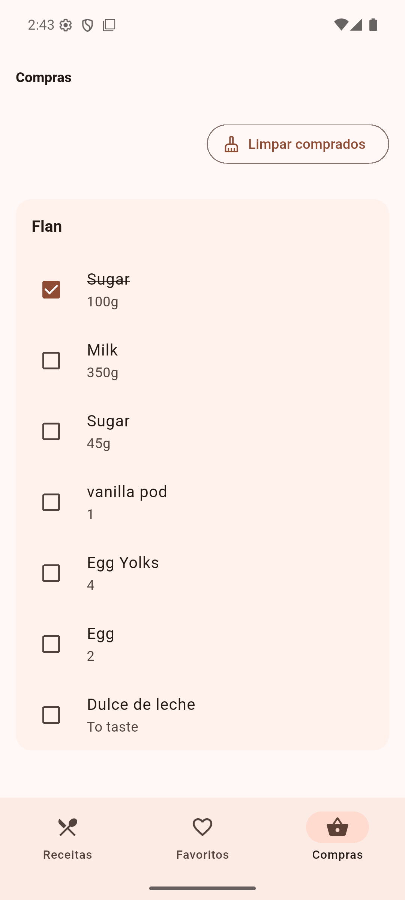

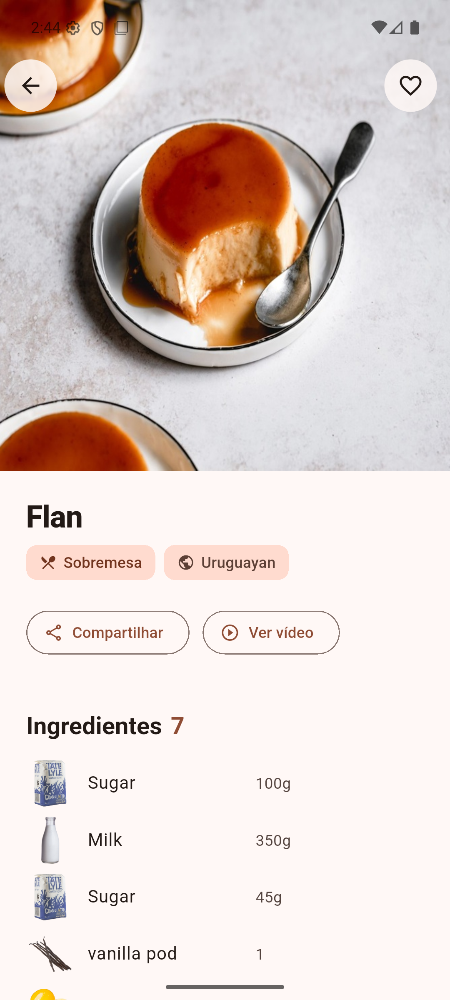

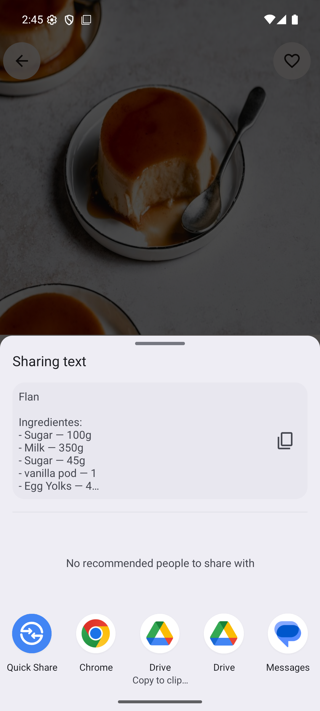

**Estados tratados (nunca tela branca):** carregando (skeleton que pulsa), lista vazia ou busca sem
resultado, sem internet e erro do servidor (mensagens diferentes, com botão "Tentar de novo"), foto
que não carrega (ícone no lugar). Os favoritos abrem mesmo sem internet. A lista inicial guarda
também os detalhes completos recebidos da API, e detalhes abertos online ficam salvos para consulta
offline, incluindo ingredientes e modo de preparo. Uma receita obtida apenas pelo filtro de
categoria precisa ter seu detalhe aberto online antes de poder ser consultada offline.

**Visual:** Material 3 com tema claro e escuro seguindo o sistema, cores e espaçamentos definidos em
um único arquivo (`lib/ui/theme.dart`), grade que se adapta à largura (2 colunas no celular em pé,
mais em paisagem/tablet).

## Como rodar

Pré-requisitos: **Flutter 3.35+** (testado com 3.47.6, canal stable), **JDK 17** e Android SDK
(emulador ou celular com depuração USB).

```bash
# a partir da raiz do repositório
cd exercicios/projeto-final/skeletons/themealdb/flutter/pratica

flutter pub get
flutter run                 # com emulador aberto ou celular conectado
```

Não precisa de chave: a TheMealDB usa a chave pública de testes `1`, documentada pela própria API.

### Build (critério eliminatório)

```bash
flutter build apk --debug   # gera build/app/outputs/flutter-apk/app-debug.apk
```

> **Se o build reclamar de versão do Java/Gradle:** o projeto usa Gradle 8.14.3, Android Gradle
> Plugin 8.11.1 e Kotlin 2.2.20 (mínimos do Flutter 3.47). Se o Flutter estiver usando um Java mais
> novo que o 17 (ex.: o Java do Android Studio), aponte para o JDK 17:
> `flutter config --jdk-dir "<caminho do JDK 17>"`.
>
> **Windows, "Could not write file" / `ShaderCompilerException`:** é o limite de 260 caracteres de
> caminho do Windows. Clone o repositório numa pasta de caminho curto (ex.: `C:\dev\`).

### Testes

```bash
flutter test     # 57 casos, sem internet (a API é simulada com MockClient)
flutter analyze  # sem avisos
```

| Arquivo | O que testa |
|---|---|
| `test/meal_detail_test.dart` | leitura dos ingredientes (`strIngredient1..20` com vazios, nulos e espaços), tags e passos do preparo |
| `test/meal_list_controller_test.dart` | busca local e na API, categoria + busca combinadas, categoria sem receitas, sem internet × erro HTTP |
| `test/list_screen_features_test.dart` | cache offline da lista e abertura de detalhes salvos (ingredientes e preparo) |
| `test/favorites_controller_test.dart` | favorito sobrevive a "fechar o app", remover e desfazer na mesma posição, entrada corrompida ignorada |
| `test/widget_test.dart` | app inteiro: lista → busca → favoritar → aba Favoritos; tela de sem internet |
| `test/shopping_list_controller_test.dart` | ingredientes, marcar/limpar, persistência, duplicatas, registros corrompidos e ordem das gravações |
| `test/shopping_list_screen_test.dart` | detalhe → adicionar/remover compras → aba Compras → marcar e limpar |

Validação da lista de compras em 08/11/2026: `flutter analyze` sem avisos,
23 testes passando e `flutter build apk --debug` concluído (Flutter 3.47.9).
No emulador Clinia Pixel 8: adicionar ingredientes reais de Flan, marcar um item,
encerrar o processo e reabrir preservando o checkbox, e limpar somente os comprados.
O screenshot acima foi capturado após reabrir o app.

| `test/meal_share_test.dart` | texto compartilhado com nome, ingredientes e medidas; fonte, fallback para vídeo e ausência de links |
| `test/translation_test.dart` | tradução na exibição, receita inteira para compartilhar, preferência salva, sem modelo mostra o original, falha num texto, busca em português (API e local) |
| `test/recipe_actions_test.dart` | chamada nativa de compartilhar, falha em SnackBar, vídeo ausente e link inválido |

Dependências das ações: `share_plus` 11.x (compatível com o AGP 8.11.1 do projeto)
e `url_launcher`. A consulta de intents HTTPS está no `AndroidManifest.xml`.
As receitas e seus links continuam vindo da API, sem chave ou cadastro.

Validação das ações em 08/11/2026: `flutter analyze` sem avisos, 26 testes
passando e `flutter build apk --debug` concluído (Flutter 3.47.9).
No emulador Clinia Pixel 8: Flan → Compartilhar abre a folha Android com os sete
ingredientes e link da fonte; Ver vídeo abre `m.youtube.com/watch?v=rpv_PXIoysE`
no navegador externo. Os screenshots foram capturados no emulador.

## Receitas em português (tradução no aparelho)

A TheMealDB só fornece inglês. O app traduz o que aparece na tela com o
[ML Kit Translation](https://developers.google.com/ml-kit/language/translation) do Google:

- **No primeiro uso** o app baixa o modelo de português (~30 MB, também por dados móveis); enquanto isso o
  ícone de idioma na barra mostra um indicador e as receitas aparecem no original. Depois, funciona **offline**.
- **Os dados continuam em inglês** (API, cache, favoritos, lista de compras): só a exibição é traduzida. Assim
  as fotos dos ingredientes, que a API monta pelo nome em inglês, continuam funcionando, e o botão de idioma
  volta ao original na hora.
- **Busca em português:** o texto digitado é traduzido para inglês antes de ir à API, e a busca local também
  compara com o nome traduzido.
- **Limitação:** é tradução automática. Nomes próprios de pratos ficam iguais ("Ezme"), e algumas medidas saem
  literais ("To taste" vira "Provar" em vez de "a gosto"). Os textos da interface já eram escritos em português.

| Detalhe em português | Busca "frango" |
|---|---|
| 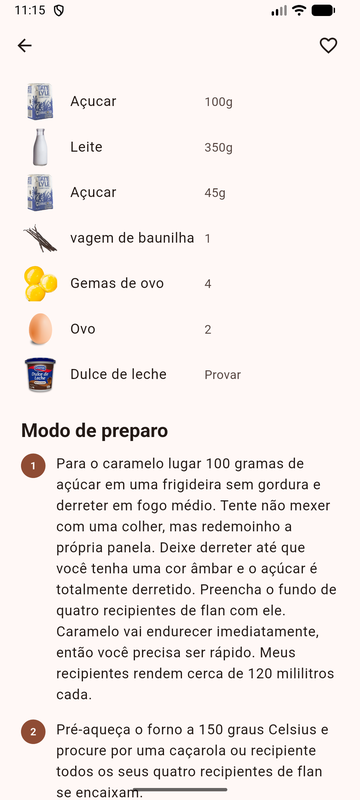 | 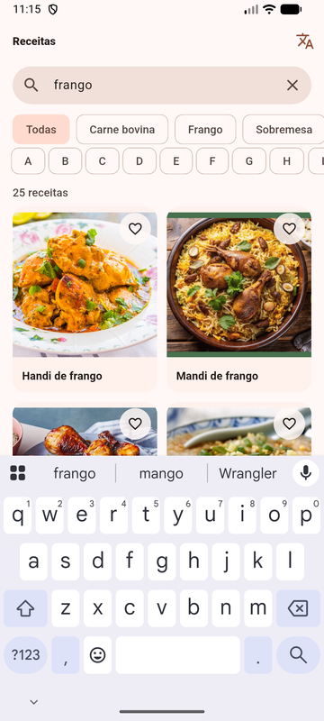 |

## Arquitetura (resumo)

```
lib/
  api/        TheMealDbApi — HTTP + JSON, erros viram ApiException com mensagem para o usuário
  storage/    FavoritesStore, ShoppingListStore, MealsCache — shared_preferences
  models/     MealSummary, MealDetail, Ingredient, ShoppingItem
  state/      MealListController, MealDetailController, FavoritesController, ShoppingListController
  ui/         tema/tokens e widgets reutilizáveis (MealCard, MealImage, StateMessage, Skeleton)
  screens/    ListScreen, DetailScreen, FavoritesScreen, ShoppingListScreen — sem fetch dentro dos widgets
```

Estado com `ChangeNotifier` + `provider`. O porquê, e as alternativas descartadas (Riverpod, Bloc,
`setState` nas telas), está no [`ADR.md`](./ADR.md).

## Testes manuais (Maestro, opcional)

Os flows em `flows/` vieram do skeleton e não são mais avaliados pelo CI. Os identificadores que eles
usam (`item-card-<id>`, `search-input`, `detail-favorite-button`, `tab-favorites`…) foram mantidos,
mas o grupo não rodou o Maestro sobre a interface nova: o visual mudou (grade em vez de lista,
categorias vindas da API), então alguns passos podem precisar de ajuste.

## Registro das mudancas para atualizar a apresentacao

Esta contribuicao implementa os dois proximos passos do slide 16: explorar o catalogo por letra e consultar receitas ja carregadas sem internet.

| Mudanca | Implementacao | Arquivos principais |
|---|---|---|
| Cache offline | Salva listas (incluindo detalhes completos retornados pela busca inicial), categorias, letras consultadas e detalhes abertos em `shared_preferences`. Quando a API indica falta de conexão, os dados salvos são exibidos com aviso e ação para tentar novamente. Erros HTTP continuam sendo tratados como erro do servidor. | `lib/storage/meals_cache.dart`, `lib/state/meal_list_controller.dart`, `lib/state/meal_detail_controller.dart`, `lib/main.dart` |
| Explorar A-Z | Consulta `search.php?f=<letra>`, descarta respostas antigas quando a letra muda e trata `meals: null` como lista vazia. Categoria e letra sao exclusivas; a busca textual filtra localmente os resultados da letra. | `lib/api/themealdb_api.dart`, `lib/state/meal_list_controller.dart`, `lib/screens/list_screen.dart` |
| Testes | Cobre gravacao e fallback do cache, offline sem cache, cache por categoria, resultados por letra, letra sem receitas, exclusividade dos filtros e busca textual combinada. A API falsa tambem responde a `search.php?f=`. | `test/fake_api.dart`, `test/meal_list_controller_test.dart` |

### Sugestoes para os slides

- **Slide 3:** adicionar as funcionalidades "Explorar A-Z" e "Acesso offline a receitas ja carregadas".
- **Slide 4:** demonstrar selecionar uma letra, filtrar por nome, trocar para uma categoria e abrir a lista offline depois de carregar receitas com internet.
- **Slide 7:** incluir `MealsCache` na camada storage. `MealListController` coordena lista, categoria, letra e cache; `ListScreen` le o estado e chama as acoes.
- **Slide 14:** atualizar a contagem de testes depois de rodar a suite completa na branch integrada.
- **Slide 16:** remover "guardar a ultima lista para abrir offline" e "navegar o catalogo por letra" dos proximos passos. O cache guarda apenas origens ja carregadas; receitas ainda nao consultadas precisam de internet.